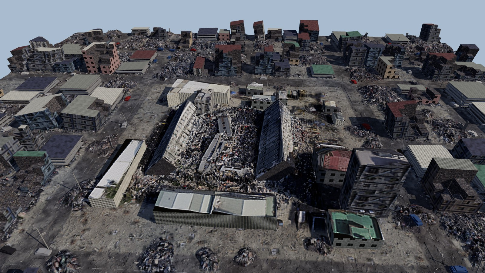

# Collapse site for Isaac Sim

A 320 m × 320 m earthquake disaster site for the Larpverse demo. The centre (about 105 m across) is rebuilt from the four screenshots of the photogrammetry scan: two fallen 16-storey towers, broken floor plates, the rubble field and the surrounding sheds, warehouses and houses, all textured with the scan's own photo. Around it, a wrecked neighbourhood three times wider has been extrapolated: streets, damaged and leaning buildings, pancake collapses, collapsed lots, about 50 smaller rubble mounds, crushed cars, fallen utility poles and about 56,000 pieces of debris.



## Open it

- **GUI:** File › Open › `collapse_site.usda`. Then Window › Script Editor › open `apply_look.py` › Run. This applies the post-processing look.
- **Standalone:** `~/isaacsim/python.sh apply_look.py --camera Oblique_South` (add `--headless --frames 120` on a cloud box).
- **Into the mission stage** (for example in `isaac/scene.py`):
  ```python
  prim = stage.DefinePrim("/World/CollapseSite")
  prim.GetReferences().AddReference("assets/collapse_site/collapse_site.usda")
  # optional: move it so a pile sits where you want it
  UsdGeom.XformCommonAPI(prim).SetTranslate((0.0, 0.0, 0.0))
  ```
  The file brings its own Sun, Sky and cameras under `/CollapseSite/Lights` and `/CollapseSite/Cameras`. Deactivate `Lights` if your stage already has lighting.

## Frame and scale

- Z-up, metres, `metersPerUnit = 1`. This is the same frame as `docs/ISAAC_HANDOFF.md`: x is east, y is north, origin at the centre of the scanned site.
- Scale comes from the fallen towers' storey spacing: 20 px per 3.1 m storey, so 0.155 m per photo pixel.
- Heights in the scanned core are estimates from the oblique views:
  - fallen-tower ridges 9–11 m
  - SE tower 24 m
  - warehouses 6.5–7 m
- This is a standalone hero scene. It is **not** aligned to the seed-7 3×3 pile grid.

## What's inside

| Prim | Contents | Physics |
|---|---|---|
| `/CollapseSite/Terrain` | 16 tiles of 80 m (1.88 M triangles, 0.125 m source heightfield, decimated), plus a 2 km horizon apron | triangle-mesh colliders |
| `/CollapseSite/Buildings/Scanned` | 13 scanned buildings, 2 fallen towers, 4 floor plates. Roofs and tower faces use the scan photo | triangle-mesh colliders |
| `/CollapseSite/Buildings/Surroundings` | 193 procedural lots: standing-damaged, tilted, pancake, collapsed (with wall remnants) | triangle-mesh colliders |
| `/CollapseSite/Debris/Scatter` | PointInstancer, 56,293 instances, 23 prototypes: concrete chunks, slab shards, bricks, blocks, roof tiles, rebar, pipes, cars, poles | visual only |
| `/CollapseSite/Looks` | 38 materials. Each has an **OmniPBR (MDL)** shader for RTX and a **UsdPreviewSurface** fallback. All have albedo + normal maps; the terrain also has roughness | |
| `/CollapseSite/Lights` | Sun (from ESE at 38°, matching the shadows baked into the scan) + sky dome | |
| `/CollapseSite/Cameras` | `TopDown`, `Oblique_South`, `Oblique_NNW` (these match the reference screenshots), `Low_East`, `Wide_Establishing`, `Drone_Orbit_A2` | |

PhysX-raycast LiDAR hits the terrain and the buildings. Debris instances are visual only, so they don't slow down raycasts or collision cooking. RTX LiDAR and cameras see everything.

## Look and post-processing

The scan textures are kept as they were: the photo albedo, with the viewer's hotspot markers painted out. The render look is stored in the stage (`customLayerData.renderSettings`), and `apply_look.py` sets it explicitly. It includes:

- ACES tonemapping at fixed exposure
- ambient occlusion and indirect diffuse
- a +12% contrast and +8% saturation grade
- a soft vignette and light film grain
- subtle bloom
- a dusty Z-up height fog

To change the mood, edit `SETTINGS` in `apply_look.py` or the Sun intensity/colour. For example, lower the sun to about 15° and warm it for a dusk look.

## Performance notes

- Hide `/CollapseSite/Debris` while iterating, and turn it back on for footage.
- Terrain cooking happens once, when you press Play. That takes about 1.9 M triangles across 16 colliders.
- Path-traced hero shots work well. Bump `bump_factor` on the OmniPBR shaders if you want the normal maps to read stronger.

## Honest caveats

- The core is a reconstruction from four screenshots, not a survey. Plan positions are accurate to about 1 m. Heights and hidden faces are inferred.
- The texture resolution of the core is limited by the screenshot, about 15 cm per pixel. Fine detail comes from the normal maps and the 3D debris.
- The surroundings are procedural (seeded, reproducible). They are designed to look plausible, not to match the real neighbourhood.
- **Licence:** the screenshots appear to come from a third-party photogrammetry model. Check that model's licence (and any NoAI tag) before showing this publicly, and credit the author if it is CC-BY.

## Regenerate

`generator/` has the full pipeline: `prep.py`, `heightfield.py`, `terrain_lowres.py`, `terrain_tiles.py`, `buildtex.py`, `buildings.py`, `debris.py`, `write_usd.py`. Run it with Python 3.10+, numpy, opencv, scipy, pyfqmr, mapbox_earcut and usd-core. Layout seeds are in `outer_layout.py`.
