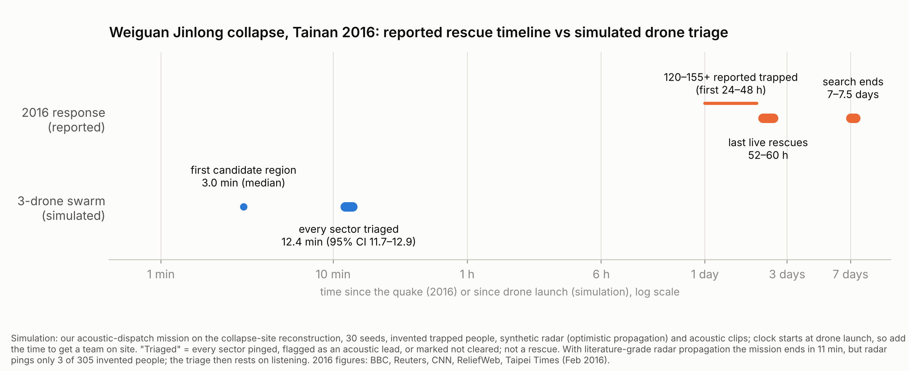

# Case study simulation: Weiguan Jinlong collapse, Tainan, 6 February 2016

## What happened (reported figures)

| Metric | Figure | Notes | Source |
|---|---|---|---|
| Deaths in the collapsed building | 114–115 | 2 more deaths elsewhere in Tainan | BBC, 13 Feb 2016 |
| People rescued alive from the building | 175–289 | | Reuters 13 Feb 2016; CNN 14 Feb 2016; Taipei Times 8 Feb 2016 |
| People injured | 550 | 289 pulled out of the rubble | CNN 14 Feb 2016; ReliefWeb 14 Feb 2016 |
| People initially trapped | 120–155+ in the first 24–48 h | | Taipei Times 8 Feb 2016; Reuters 13 Feb 2016 |
| Rescue duration | 7–7.5 days | last live rescues 52–60 h after the quake (day 3) | BBC 13 Feb 2016; ReliefWeb 14 Feb 2016 |
| Response scale | ~3,900 emergency workers, 140 vehicles, 2 helicopters, city-wide | | Taipei Times 8 Feb 2016 |

Ranges are kept as reported; the sources differ.

## What we simulated

- **Site:** the collapse-site reconstruction of the Weiguan site (`--site collapse`, `collapse_site/collapse_site.usda` from branch `3d_model`): 320 m, the scanned core rebuilt from screenshots of the NCKU photogrammetry model, 8 search sectors Z1–Z8, staging on the south street. It is a reconstruction, not a survey.
- **Mission:** the unchanged autonomous mission (`sim/grid_mission.py`): 3 drones, LiDAR survey, landing on flat cells, radar scans, listening while landed, dispatch to the next sector, battery swaps at the pads.
- **People and signals are invented.** Each seed places about 10 trapped people (305 over 30 seeds) in voids across the sectors, with voices, knocking, weak voices and silent cases (`make_truth` in `sim/site_weiguan.py`). Nothing here says where anyone actually was in 2016.
- **Sensors:** radar `dsp` (synthetic IF through the real DSP chain) under two through-rubble presets; acoustic `stub` (synthetic clips generated from the hidden truth, so the listening numbers are an upper bound).
- **Policies:** ours (listen after each sector, go to the highest acoustic priority) against two radar-only search orders: nearest unvisited sector, and a fixed serpentine raster from the staging street.
- **Run it:** `python -m isaac.eval_collapse --seeds 1-30 [--penetration literature] [--start independent]`, then `--report` (full tables in [EVAL_COLLAPSE.md](EVAL_COLLAPSE.md)) and `python -m isaac.case_timeline` for the figure. Each mission takes about 4 s of CPU.

## Results (30 seeds each)

| | ours (listen + radar) | nearest (radar only) | raster (radar only) |
|---|---|---|---|
| Time until every sector is pinged, flagged as a lead or marked not cleared | 12.4 min [11.7, 12.9] | 10.7 min | 10.6 min |
| First candidate search region (median, optimistic radar) | 3.0 min | 2.9 min | 3.0 min |
| Invented people inside a flagged sector, optimistic radar | **74%** [68, 80] | 24% [18, 29] | 30% [25, 35] |
| Same, literature-grade radar | **66%** [60, 71] | 1% [0, 3] | 1% [0, 2] |
| Same, start sector drawn independently of the people | **62%** [56, 68] | 25% [19, 31] | 22% [18, 27] |
| People localised by a firm radar ping, optimistic radar | 63/305 | 49/305 | 62/305 |
| Same, literature-grade radar | 3/305 | 4/305 | 2/305 |
| Sectors flagged per mission (of 8), optimistic radar | 5.2 | 1.7 | 2.1 |

A sector is *flagged* if it ends the mission with a firm radar ping or an open acoustic lead. Brackets are bootstrap 95% CIs over seeds.

## How to read this against 2016

- **Minutes, not days.** In every configuration the swarm finishes a first pass over all eight sectors in 9.5–12.5 minutes from launch (ours takes about 1–2 minutes longer than the radar-only orders because it stops to listen): each sector ends with a ping, an acoustic lead or an explicit "not cleared". In 2016 the last people were brought out alive 52–60 hours after the quake, and the search ran for 7–7.5 days. The simulation clock starts at drone launch, so the time to get a team and drones on site has to be added.
- **Radar alone does not triage this site.** The wrecks are tall (fallen 16-storey towers, ridges 9–11 m). With the literature-grade through-rubble model (~3 m of rubble under a good scan), radar pings almost no one: 3 of 305 invented people. Even the optimistic model, which is not literature-backed, pings only about 1 in 5. What carries the triage is listening: the sectors our mission flags hold 62–74% of the invented people, against 1–30% for radar-only search orders.
- **This is a dig-order aid, not a rescue count.** A flag says "send a crew here first, with this evidence"; it never confirms a person. Silent sectors are explicitly *not cleared*.

## What this does not show

- **Scale.** In 2016, 120–155+ people were trapped across a 16-storey, nine-block complex. Our scenarios place about 10 invented people in 8 sectors, and the radar generator reports at most one firm return per sector. So the simulation tests sector triage (where to dig first), not how many of 155 people a swarm would find.
- **Flagging is easy here.** On average 7.2 of 8 sectors hold someone, so "flagged sectors with nobody in them" is 0.0 for every policy, and flagging all 8 sectors blindly would cover 100%. The comparison that matters is evidence per sector: ours flags about 5 sectors with a reason (a voice, knocking, a ping); the radar-only orders flag about 2 under optimistic radar and almost none under literature-grade radar.
- **Listening is idealised.** `--acoustic stub` builds clips from the hidden truth. The real pipeline is validated separately (`docs/ACOUSTIC_VALIDATION.md`), and on the real site, noise from 3,900 responders, machinery and helicopters would make listening much harder.
- **No claim about lives.** Nothing here says how many people would have survived with drones. It says how quickly an evidence-ranked dig list could exist.

## Sources

- BBC News, "Taiwan quake death toll reaches 116, as rescue ends", 13 Feb 2016. https://www.bbc.com/news/world-asia-35569224
- Reuters, "Death toll at collapsed building in Taiwanese city reaches 114 as rescue efforts end", 13 Feb 2016. https://www.reuters.com/article/world/death-toll-at-collapsed-building-in-taiwanese-city-reaches-114-as-rescue-efforts-idUSKCN0VM0A7/
- CNN, "Taiwan earthquake: Death toll rises to 114", 13–14 Feb 2016. https://www.cnn.com/2016/02/13/asia/taiwan-earthquake
- ReliefWeb / Xinhua, "Taiwan quake death toll at 116 as search ends", 14 Feb 2016. https://reliefweb.int/report/china-taiwan-province/taiwan-quake-death-toll-116-search-ends
- Taipei Times, "Earthquake Aftermath: Quake death toll in Tainan rises to 29", 8 Feb 2016. https://www.taipeitimes.com/News/front/archives/2016/02/08/2003639061
- Wikipedia, "2016 southern Taiwan earthquake". https://en.wikipedia.org/wiki/2016_southern_Taiwan_earthquake
