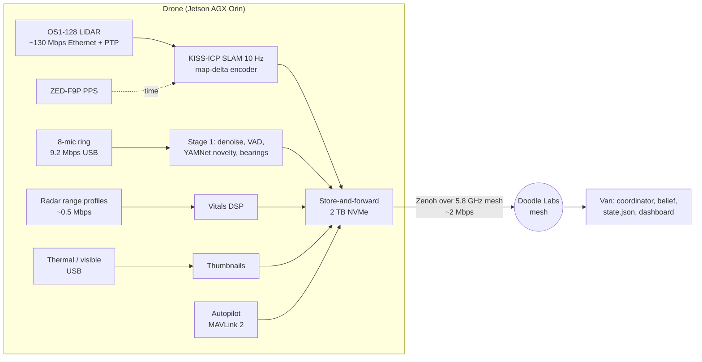
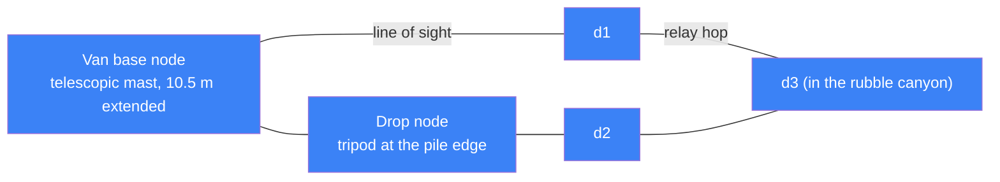
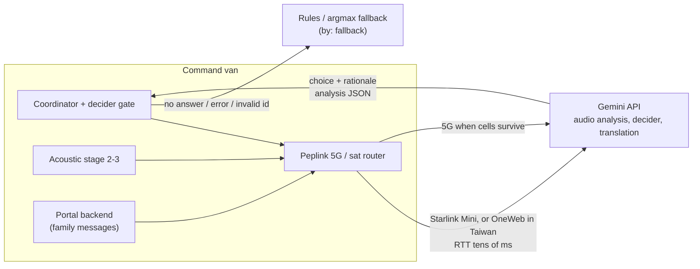
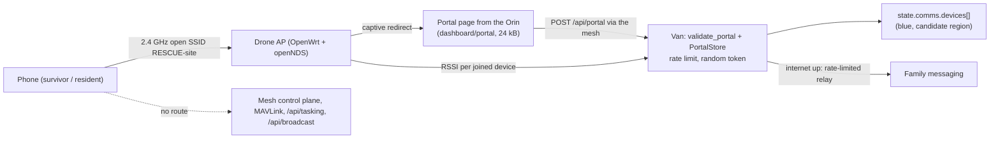
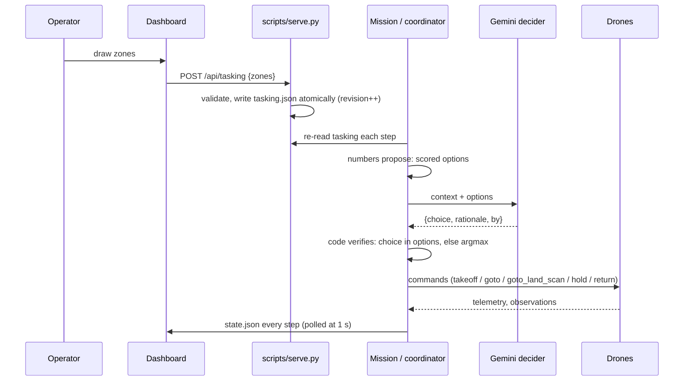
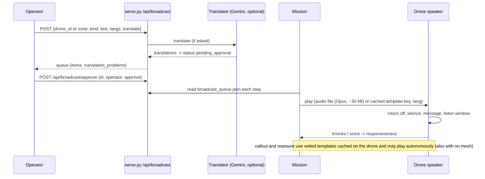

# Comms architecture: how the drones, phones, van and cloud talk

Parts and their specs are in [docs/HARDWARE.md](HARDWARE.md) and [`data/hardware_bom.json`](../data/hardware_bom.json).
The state contract is [contracts/INTERFACES.md](../contracts/INTERFACES.md) (v1.4). The rescue hotspot's link budget,
portal and privacy rules are in docs/HOTSPOT.md (comms agent), and the mesh and RSSI simulation is in `sim/comms.py`.
This document covers the plumbing between those pieces.

## One-slide summary

- **The heavy data stays on the drone.** About 130 Mbps of raw LiDAR, 9 Mbps of raw audio and 450 MB/s of raw radar samples never leave the drone. The mesh carries map deltas, detections, short audio clips and thumbnails, about 2 Mbps per drone.
- **There are two radio layers.** A 5.8 GHz Doodle Labs mesh links the drones and the van, with multi-hop relaying. An open 2.4 GHz rescue hotspot serves phones. The radar module is cabled to its drone, so it needs no radio link. Both stay clear of the radar's 0.4–2 GHz sweep.
- **Numbers propose, the agent decides, code verifies.** Gemini sits in the cloud behind Starlink or OneWeb. With no cloud, a rules decider takes over in about 0 ms and only vetted templates are broadcast.
- **The drones keep working without the mesh.** They finish their search, store everything on 2 TB NVMe, call out with cached templates, and forward the data when the link returns, flying back toward the link if needed.
- **Every sound sent to a person is gated.** Template call-outs can play autonomously. Operator text and every machine translation wait for `/api/broadcast/approve`. Phones can reach only the portal: the mesh is encrypted with AES-256 and MAVLink messages are signed.

Labels: **est.** = our estimate, **verify** = not confirmed on a primary source.

## 1. Diagrams

### 1.1 Sensor → onboard compute → mesh → van



### 1.2 Radar module ↔ drone (cabled; the radar is on the drone's belly)

```mermaid
sequenceDiagram
  participant C as Coordinator (van)
  participant D as Drone Orin
  participant P as Radar module (Pi 5)
  C->>D: goto_land_scan at lead xy (existing command)
  D->>D: MAV_CMD_NAV_LAND on a flat spot (~8 s); landing detected = touchdown
  D->>P: cable: start sweep (0.4-2 GHz SFCW)
  P-->>D: IMU seating ok / rocking: lift off and re-land once
  loop every ~33 ms for 20-60 s
    P-->>D: range profile (2 RX x ~128 bins)
  end
  D->>D: vitals DSP: range candidates, breathing Hz
  D->>C: radar observation (contract) + pods[] status
  D->>D: lift off (~8 s), then the next landing spot
  Note over P,D: data link lost for more than 30 s: radar module keeps logging to SD, data syncs when the link is back
```

### 1.3 Drone ↔ drone multi-hop



Routing is the radio's own self-forming mesh, a layer-2 bridge. `sim/comms.py backhaul_routes()` models it as the
path that maximises end-to-end throughput, `1 / Σ(1/hop_mbps)`, and publishes the result to
`state.comms.backhaul.links[]`.

### 1.4 Van ↔ cloud (Gemini) over satellite



### 1.5 Phones ↔ drone Wi-Fi → mesh → van



### 1.6 Operator ↔ dashboard ↔ tasking API ↔ drones



### 1.7 Speaker broadcast commands



## 2. Data rates and the mesh budget

Assumptions: OS1-128 in 1024×10 mode (1.31 M pts/s); mesh hop 10–20 Mbps usable at the pile edge (est.;
`sim/comms.py` caps a hop at 40 Mbps, and Doodle quotes 80 Mbps peak); end-to-end over 2 hops is roughly half
that.

| Stream | Raw rate | What crosses the mesh | Mesh rate per drone | Notes |
|---|---|---|---|---|
| LiDAR | **~42–126 Mbps** (4–12 B/point by profile, est.) | 0.1 m voxel **map deltas**, quantised int16 xyz + zstd | **~0.5 Mbps** surveying, ~0.05 perched (est.) | ~20k new voxels/s at 10 m/s over a 20 m swath. Full-res tiles (`pc_tiles/`, contract v1.3.1) are assembled at the van, never streamed live |
| SLAM pose | 10 Hz | pose + covariance | ~5 kbps | also feeds the autopilot as external nav |
| Radar, module → drone | B210 IQ ~450 MB/s (2 × 56 MS/s, stays in the radar module) | range profiles over the cable to the drone | (module-to-drone data ~0.5 Mbps) | 2 RX × ~128 bins × complex64 × 30 Hz |
| Radar, drone → van | — | slow-time of ≤ 16 candidate bins during a scan + the observation JSON | **~60 kbps** while scanning | the observation itself (contract "radar observation") is ~1 kB |
| Audio | drone 8 ch × 48 kHz × 24 bit = **9.2 Mbps**; radar-module 4 ch at 16 kHz = 1 Mbps | **only clips that pass the stage-1 novelty filter**: 5 s beamformed Opus 32 kbps ≈ 20 kB; 8-ch FLAC on demand | **~16 kbps** avg (6 clips/min), bursts 20 kB | `clips[].forwarded`; dismissed clips stay on the drone |
| Thermal / visible | 60 Hz video | **640 × 512 JPEG thumbnail every 2 s** | ~160 kbps | live H.265 720p (~2 Mbps) on request, one drone at a time |
| Telemetry | — | MAVLink 2 (attitude, position, battery) | ~20 kbps | signed |
| RTK corrections | — | RTCM3 van → drones | ~5 kbps | |
| Speaker | — | Opus file per operator broadcast (~30 kB), template keys | bursts | templates are pre-cached |
| Rescue Wi-Fi users | phones at up to 72 Mbps PHY | portal page 24 kB once per phone, submissions < 1 kB, RSSI reports | **capped 1 Mbps per hotspot** (policy est.) | internet relay ≤ 64 kbps per client, text-first |
| **Total, steady** | | | **~1.8 Mbps per drone** | +2 Mbps with live video |

**What fits:** 3 drones need about **5.4 Mbps steady**, or about 7.4 Mbps with one live video, on 10–20 Mbps of
usable direct links. That's a 2× margin. A drone two hops out gets about 5–10 Mbps end-to-end, so the van serves its
video only when it's one hop away, and its thumbnails drop to one every 10 s. When a link falls below the steady
rate, priority order is: telemetry and commands, then radar and acoustic observations, then map deltas, then
thumbnails, then Wi-Fi users. Everything lower is queued, not dropped (§5).

**Satellite budget (van ↔ cloud):** Gemini audio calls send about 20–100 kB per forwarded clip group. Decider calls
send a 10–30 kB JSON context per dispatch gate. Family messages are small. The total is **under 0.5 Mbps**. Remote
viewers get state summaries, never the 3.6 MB point-cloud preview. Starlink Mini's downlink is 100+ Mbps; its uplink
is lower (verify).

## 3. Where each computation runs

| Function | Runs on | Latency (est.) | Needs mesh? | Needs cloud? |
|---|---|---|---|---|
| Stabilisation, failsafes, RTL | autopilot (Cube Orange / DJI FC) | ms | no | no |
| SLAM (KISS-ICP), external-nav pose to the autopilot | drone Orin | < 100 ms per sweep | no | no |
| Landing / perch screening (`sim/landing.py` logic) | drone Orin | < 0.5 s | no | no |
| Stage-1 acoustics: denoise, VAD, YAMNet novelty, bearings | drone Orin | < 1 s after the clip ends | no | no |
| Radar sweep + range FFT | radar-module Pi 5 | 33 ms per frame | no | no |
| Radar vitals (breathing / heart rate, condition) | drone Orin | physics-bound: 20 s dwell (rate), ≥ 45–60 s (pattern) | no | no |
| Landing sequencing, IMU seating check | drone Orin | 8 s to land / 8 s to lift off | no | no |
| Template call-out playback + listen window | drone Orin | seconds | no | no |
| Captive portal page + local submission queue | drone Orin (AP) | < 1 s | for delivery | no |
| Coordinator: dispatch scoring, belief / localisation, pile association | van | < 1 s per step | **yes** | no |
| RSSI phone localisation (`sim/comms.py localise`) | van | ≤ 20 s refit | yes | no |
| Map fusion across drones, tiles | van | seconds | yes | no |
| Dashboard, tasking, broadcast queue | van (`scripts/serve.py`) | 1 s poll | yes (to reach drones) | no |
| Stage 2–3 acoustic analysis (language, transcript, distress) | **cloud (Gemini)** | ~4.5 s per call (contract example `latency_ms 4500`) | yes | **yes**, else fallback |
| Decider (agent decides) | **cloud (Gemini)** → verified in the van | 1–5 s | yes | **yes**, else argmax |
| Translation of operator text and portal messages | cloud (Gemini) | 1–5 s | yes | yes, else templates only |

**With no cloud:**

- The decider falls back to the argmax option, recorded with `by: "fallback"` or `"argmax"` (contract, dispatch
  decisions).
- Audio analysis falls back to the stage-1 label and the template rationale (`rationale_by: "template"`).
- Translations stop, so only the pre-vetted multilingual templates play. Portal messages are shown untranslated
  (`by: "none"`), and family messaging queues until the link returns.
- The search itself is unaffected.

**With no mesh:**

- Each drone continues its last task (zone recon or the current lead) under onboard autonomy. It keeps perching,
  listening and landing for radar scans, plays template call-outs, and serves the portal locally.
- Everything is time-stamped (GNSS PPS) and queued on NVMe.
- After a configurable outage (e.g. 120 s, est.) and at the end of each task, the drone flies toward its
  last-good-link waypoint as a data mule. If the outage persists, it lands at staging under the battery reserve rule.
- New zones, operator broadcasts and translations wait for the link. The van marks the drone `link: stored` (a
  proposed field, §4).

## 4. Message types and protocols

| Link | Protocol | Carries |
|---|---|---|
| Orin ↔ autopilot | **MAVLink 2** over UART (mavlink-router); DJI build: Payload SDK over E-Port Lite (verify whether it can fly the aircraft) | commands, position, battery |
| Drone ↔ van, flight | MAVLink 2 over UDP on the mesh, **signed** | same, mirrored to the van |
| Inside the drone | **ROS 2** (DDS, shared memory) | sensor topics |
| Drone ↔ van, perception | **Zenoh** (`zenoh-bridge-ros2dds` / `rmw_zenoh`) with a topic allow-list; MQTT over TLS is the simpler alternative | observations, map deltas, clips, status |
| Radar module ↔ drone | ZeroMQ or Zenoh over the cable between them | sweep control, range profiles, IMU, radar-module audio |
| Van ↔ dashboard | HTTP: static `state.json` polled at 1 s + JSON APIs | state, tasking, broadcasts, portal |
| Van ↔ cloud | HTTPS (Gemini API) | audio, context, translations |
| Phone ↔ drone | HTTP captive portal → `POST /api/portal` | answers, messages |

DDS discovery multicast floods a lossy multi-hop mesh, so DDS stays inside each drone and Zenoh carries an explicit,
rate-limited set of keys across the mesh. That choice is architecture decision 2.

**Mapping onto the state contract** (contracts/INTERFACES.md):

| Drone-side message (ROS 2 topic → Zenoh key) | Van action | `state.json` field |
|---|---|---|
| `/radar/obs` → `lv/<d>/radar/obs` (contract "radar observation") | localiser, belief | `scans[]`, `radar_candidates[]`, `belief` |
| `/pod/status` → `lv/<d>/pod` | | `pods[]` (`status: stowed / lowering / scanning / raising`, legacy field names for: on the drone / landing / scanning on the rubble / lifting off), `drones[].winch_len_m` (legacy field, unused) |
| `/acoustic/obs`, `/audio/clip` → `lv/<d>/acoustic/*` | association, Gemini stage 2 | `acoustic[]`, `acoustic_clips[]`, `clips[].audio_analysis`, `piles[]` |
| `/map/delta` → `lv/<d>/map/delta` | map fusion, tiles | `heightmap`, `pointcloud` (+ `tiles`), `landing_sites[]` |
| MAVLink HEARTBEAT, GLOBAL_POSITION_INT, BATTERY_STATUS | | `drones[]` (`pose`, `state`, `battery`, `track`) |
| `/speaker/state` → `lv/<d>/speaker` | | `drones[].speaker`, `broadcasts[]`, `callouts[]` |
| radio stats (Doodle API) | | `comms.backhaul.links[]` (`rssi_dbm`, `mbps`) |
| AP stats + portal posts | `validate_portal`, `PortalStore` | `comms.hotspots[]`, `comms.devices[]`, `comms.portal` |
| (van) decider | verify choice ∈ options | `decisions[]` |

**Coordinator → drone commands** (contract "Coordinator to drone: commands"):

| Contract `type` | ArduPilot MAVLink |
|---|---|
| `takeoff` | `MAV_CMD_NAV_TAKEOFF` (GUIDED mode) |
| `goto` | `SET_POSITION_TARGET_GLOBAL_INT` or `MAV_CMD_DO_REPOSITION`. The site frame (x east, y north, origin at the rubble centre) is converted to WGS84 at the van with `site.geo` |
| `goto_land_scan` | goto, then `MAV_CMD_NAV_LAND` at the landing site, then the scan request on Zenoh |
| `hold` | `MAV_CMD_NAV_LOITER_UNLIM` / BRAKE |
| `return` | `MAV_CMD_NAV_RETURN_TO_LAUNCH` |
| *proposed* `lower_pod` / `raise_pod` (legacy command names in the sim contract) | Not needed on the real build: `goto_land_scan` lands the drone and the radar scan follows |

**Existing HTTP APIs** (`scripts/serve.py`, van only, bound to 127.0.0.1 by default):

- `GET`/`POST /api/tasking`: operator zones and AOI, written atomically to `dashboard/data/tasking.json`.
- `GET`/`POST /api/broadcast`: operator loudspeaker queue (contract v1.3).
- `POST /api/broadcast/approve`: release or reject a pending item.
- `POST /api/portal` is coming. `sim/comms.py` already has `validate_portal` and `PortalStore`.

**Proposed contract additions** (for the orchestrator; not in v1.4):

- Commands: `lower_pod` and `raise_pod` (`{drone_id, type, xy, dwell_s}`; legacy names for land-and-scan and lift-off), plus `relay_hold`, which hovers a drone
  at an xy as a mesh relay.
- `drones[].link`: `mesh | stored`, plus `last_link_t` and `queued_kb`, the store-and-forward backlog.
- `comms.backhaul.links[].latency_ms`.

## 5. Failure modes and degradation

| Failure | Detection | Behaviour |
|---|---|---|
| One drone out of mesh range | no Zenoh / MAVLink heartbeat for 5 s | ArduPilot GCS failsafe set to *continue the mission* (not RTL). The drone finishes its task, then data-mules to its last good link point. The van shows `link: stored` |
| Mesh partition (canyon between blocks) | `backhaul_routes` finds no path | another drone becomes the relay (`relay_hold`, which costs that drone's endurance), or a drop node is placed at the pile edge |
| Van power cut | UPS alarm | 1.5 kWh UPS rides through (~3 h at ~470 W). The drones are unaffected |
| No satellite / 5G | router WAN down | decider → argmax, audio → stage-1 + template rationale, translations off. The local dashboard keeps working |
| Gemini error, timeout, bad JSON or unknown option id | exception / validation | code verifies: argmax fallback, logged with `by` |
| Gemini over-claims distress | `audio_analysis.verify` similarity check | unverified items go to `distress_unverified`, and the pile priority is not raised by them |
| GNSS degraded (urban canyon, multipath) | fix quality, HDOP | the LiDAR SLAM pose goes to the autopilot as external nav (MAVLink `ODOMETRY` / `VISION_POSITION_ESTIMATE`) |
| Radar-module data link lost | no frames for 30 s | the radar module keeps logging to SD, and the data syncs when the link is back. The scan is marked low quality |
| Drone landed unstably | IMU shows rocking or tilt above the limit | lift off and re-land once, then pick another landing spot. The radar-module strobe and last position are logged as a hazard |
| Radar RFI from rescuers' radios / cellular | narrowband spikes in the sweep | skip those sub-bands (SFCW). The scan's `quality` drops and is never treated as a negative |
| Hotspot overload | client count | cap of about 32 clients per AP (est.), per-client rate limit, portal-only walled garden |
| Clock drift | PTP / PPS offset > 5 ms | flag the affected scans, re-sync |
| Low battery | ArduPilot battery failsafe | RTL at the reserve (sim: 25%), then a battery swap (`mission.battery_swaps`) |
| Generator noise masks listening | noise floor in stage 1 | generators ≥ 100 m downwind. The coordinator can pause loud van loads during a listen window (est.) |

## 6. Security

- **Link encryption.** The mesh uses AES-256 (Doodle Labs: FIPS 140-3; Silvus: AES-256 / FIPS 140-3) with per-deployment keys loaded at the van. The DJI O3 link is AES-256 per DJI.
- **MAVLink 2 signing** is on for every link that can command a drone.
- **Zenoh / MQTT** run over TLS with mutual authentication. Each drone may publish only to its own `lv/<d>/…` keys.
- **Network separation.** The hotspot is an untrusted network on its own VLAN or firewall zone. Phones reach only
  the portal page and `POST /api/portal`, plus rate-limited internet when it's up. They never reach MAVLink, Zenoh,
  `/api/tasking` or `/api/broadcast`. The comms contract already forbids passive probe-request or MAC sniffing,
  never stores MACs, and uses random session tokens (contract v1.4).
- **The van APIs** bind to 127.0.0.1 by default, which matches `scripts/serve.py`. On the van LAN they sit behind a
  TLS reverse proxy with operator login. The operator name is recorded on every approval (`approved_by`).
- **The broadcast gate.** Vetted templates (`sim/guidance.py`) may play autonomously. Operator free text is queued.
  Every machine translation is `pending_approval` until an operator approves it with `POST /api/broadcast/approve`.
  Replies to phones follow the same rule (`replies[].confirmed_by: "operator"`). We'd add a second confirmation for
  any broadcast that targets all drones at once (proposal).
- **Secrets and data.** The Gemini key lives only in the van (`scripts/set_gemini_key.sh`, `.env`), never on a
  drone. Only clips that pass stage 1 leave the site. Portal messages stay at the van (GCS). Drone NVMe is encrypted
  (LUKS) in case an aircraft is lost.

## 7. Three architecture decisions

1. **Edge-first, deltas over the mesh.** Raw LiDAR, audio and radar never cross the radio. That's what makes three
   heavy sensor drones fit in about 6 Mbps, and it's why losing the mesh doesn't stop the search.
2. **ROS 2 inside the drone, Zenoh across the mesh, MAVLink for flight.** This choice needs an open-autopilot
   airframe (ArduPilot H6HL class), because the DJI airframe has no MAVLink and only a Payload SDK port.
3. **A separate band for each job, chosen around the radar.** The radar uses 0.4–2 GHz and notches GNSS and
   cellular. The mesh uses 5.8 GHz and the hotspot 2.4 GHz channel 1. The H6HL's 900 MHz RC
   link overlaps the sweep, so the radar skips those steps.

## Sources

- MAVLink 2 message signing: [mavlink.io](https://mavlink.io/en/guide/message_signing.html). GCS failsafe options: [ArduPilot](https://ardupilot.org/copter/docs/gcs-failsafe.html). Non-GPS navigation / external odometry: [ArduPilot](https://ardupilot.org/copter/docs/common-non-gps-navigation-landing-page.html).
- Zenoh for ROS 2 across lossy links: [zenoh-plugin-ros2dds](https://github.com/eclipse-zenoh/zenoh-plugin-ros2dds), [rmw_zenoh](https://github.com/ros2/rmw_zenoh).
- Mesh radios: [Doodle Labs Mini Mesh Rider](https://doodlelabs.com/product/mini-oem-smart-radio) (80 Mbps, 5 W avg, AES-256 / FIPS 140-3); [Silvus SL5200](https://prnewswire.com/news-releases/silvus-technologies-unveils-streamcaster-lite-5200-302283091.html).
- DJI FlyCart 30 O3 link (2.4 / 5.8 GHz, AES-256): [DJI specs](https://www.dji.com/flycart-30/specs). E-Port Lite and Payload SDK: [DJI developer docs](https://developer.dji.com/doc/payload-sdk-tutorial/en/quick-start/drone-port.html).
- Satellite backhaul: [Starlink Mini](https://www.techspot.com/news/103471-starlink-mini-299-dish-provides-100mbps-wifi-6.html). Taiwan: OneWeb via Chunghwa Telecom ([moda.gov.tw](https://moda.gov.tw/en/press/press-releases/13056)); Starlink's legal hurdles were removed in July 2026, but we found no confirmed service launch ([Citizen Digital / AFP](https://citizen.digital/article/taiwan-lawmakers-remove-legal-hurdles-for-starlink-to-operate-n386806)).
- Narrowband interference to rubble bio-radars at Wenchuan and Yushu: [Frontiers in Earth Science 2023](https://www.frontiersin.org/journals/earth-science/articles/10.3389/feart.2023.1158764/full).
- OS1 data and power: [Ouster Rev7 datasheet](https://cdn.shopify.com/s/files/1/0400/1752/6943/files/datasheet-rev7-v3p0-os1.pdf). LiDAR bytes per point are our estimate across Ouster data profiles (verify against the firmware user manual).
