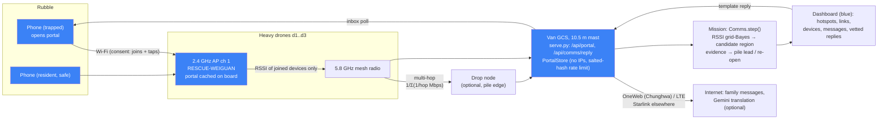

# Rescue hotspot and comms relay (contract v1.4)

Each heavy drone (FlyCart 30 / Agras T50 class) runs an **open 2.4 GHz Wi-Fi access point**, `RESCUE-WEIGUAN`. The AP is backhauled over the drones' **5.8 GHz mesh** to the operator's van (GCS). The van can add internet over **OneWeb via Chunghwa Telecom or LTE** (Tainan); Starlink is the generic option elsewhere.

A phone that joins sees a **multilingual captive portal** with three buttons: *I'm trapped / I'm safe / Send a message*. When the van has internet, the portal also offers *Message your family*. Phones that join give a **consent-based** search signal: several drones measure the RSSI of each phone's frames, and a grid-Bayes fit turns those into a **candidate region** (blue, never "confirmed").

| Piece | File | Status |
|---|---|---|
| Link budget, mesh routing, hidden phone truth, RadioSim generator, RSSI localiser, `Comms` mission facade, offline translation, vetted replies, stdlib portal API (`validate_portal`, `validate_reply`, `PortalStore`) | `sim/comms.py` | committed |
| Captive portal page: 23.8 kB, no CDN, 6 languages | `dashboard/portal/index.html` | committed |
| Tests: 15, about 45 s, no LLM key needed | `tests/test_comms.py` | committed |
| Screenshots at 390 px | `docs/screenshots/portal_390_{zh_home,en_sent,id_sent_msg}.png` | committed |
| Ops API (`/api/portal`, `/api/comms/reply`, `--lan`) | patch in §9.3, for `scripts/serve.py` | **orchestrator applies** |
| Mission integration | patch in §9.2, for `sim/grid_mission.py` | **orchestrator / mission builder applies** |
| Scenario hook (one line) | patch in §9.1, for `sim/scenario.py` | **orchestrator applies** |

Everything about phones in the simulation is **SYNTHETIC**: who has one, battery, language, and messages. Simulated messages carry `"synthetic": true`.

## 1. Research (numbers used, with sources)

Values marked *est.* are our estimates, not measurements.

| Topic | What the sources say | What we use |
|---|---|---|
| Flying cell sites after disasters | AT&T's tethered "Flying COW" LTE drone flew at about 200 ft over Puerto Rico after Hurricane Maria (Nov 2017). AT&T rated it at about 40 sq mi of coverage and up to 8,000 users ([Fierce](https://www.fierce-network.com/wireless/at-t-deploys-lte-equipped-flying-cow-drone-puerto-rico), [Engadget](https://www.engadget.com/2017/11/06/att-flying-cow-drone-cell-service-puerto-rico/), [NPR](https://www.npr.org/sections/thetwo-way/2017/11/17/564879549/faa-approves-drone-as-cell-phone-tower-in-the-sky-for-puerto-rico)). | It needed the carrier and its licensed spectrum. Our hotspot is unlicensed Wi-Fi, so it needs no carrier. |
| Phone-locating SAR | CENTUM **Lifeseeker** (drone "Mini" and helicopter versions) runs its own small cell. It finds any phone that is switched on and claims < 5 m accuracy, about 5 km range on drones, and 100+ missions ([UST](https://www.unmannedsystemstechnology.com/2023/06/lifeseeker-completes-over-100-successful-sar-missions-in-one-year/), [Volatus](https://enterprise.volatusdrones.com/lifeseeker/), [helis.com](https://www.helis.com/database/news/phone-location-sar-helicopter/)). It's a cellular base station, used by or with authorities. These figures are vendor-reported. | **Not implemented.** Cellular interception or impersonation needs authority and carrier cooperation and a licence. We locate only phones that **choose** to join an open Wi-Fi. |
| Wi-Fi drones locating phones | An EPFL student project used a drone to sniff probe requests and localise phones by RSSI, and noted that Wi-Fi under several metres of concrete won't be heard. Wi2SAR uses an on-drone AP and RSS-only direction finding for wilderness SAR. Others use Kalman-filtered RSSI ([robohub](https://robohub.org/rescue-drone-that-finds-survivors-using-their-cellphones-wifi-signals), [themoonlight review of Wi2SAR](https://www.themoonlight.io/review/take-me-home-wi-fi-drone-a-drone-based-wireless-system-for-wilderness-search-and-rescue), [NUS APSYS'13](https://www.comp.nus.edu.sg/~bleong/publications/apsys13-sos.pdf)). | We take the on-drone AP idea **without** probe sniffing. Our localiser is a grid-Bayes fit over RSSI (§4). |
| 2.4 GHz through walls | Vendor planning tables give 12–25 dB for a 100 mm concrete wall, 23–25 dB for 200 mm, and 25–30+ dB for reinforced concrete ([interline](https://interline.pl/Information-and-Tips/Building-Materials-and-Wi-Fi-Signal-Loss-2.4-GHz-and-5-GHz), [Keenetic](https://help.keenetic.com/hc/en-us/articles/213968869)). That is about 100–250 dB/m of *solid* concrete (est.). | — |
| Radio through collapsed buildings | NIST measured building implosions (50 MHz–2 GHz): up to about 50 dB just to enter an intact building, and much more after collapse ([NIST TN / IEEE AP-Mag 2014](https://www.nist.gov/publications/radio-propagation-measurements-during-and-after-collapse-three-large-building)). UCLouvain work on partially destroyed buildings reports about 80 dB/m at 2 GHz and 60–100 dB at 2.45 GHz ([UCLouvain](https://research.dial.uclouvain.be/bitstreams/27fad5b2-1639-4aa1-8d62-db6d503166dd/download)). We found **no** published per-metre 2.4 GHz rubble figure. | Effective loss along the buried path: **lognormal, median 20 dB/m, clipped to 6–60 dB/m per phone (est.)**. It's lower than solid concrete because a pancake collapse is void-rich, and paths run through gaps. This is the biggest uncertainty in the whole model. |
| Drone mesh radios | Doodle Labs Mesh Rider: 80 Mbps peak; datasheet 40 Mbps at 10 m on 20 MHz; field tests 10 Mbps at 12 km and 2–6 Mbps at 10 km ([Doodle](https://doodlelabs.com/product/mini-oem-smart-radio), [tech library](https://techlibrary.doodlelabs.com/drone-performance-usecases), [datasheet](https://mouser.com/datasheet/2/895/nanoOEM_1700-3169614.pdf)). Silvus SL5200: up to 100 Mbps, 2 W, claimed 75 km at 10 Mbps ([Silvus](https://silvustechnologies.com/loitering-munitions-brochure), [commercialuavnews](https://www.commercialuavnews.com/silvus-technologies-unveils-streamcaster-lite-5200-ultra-low-swap-oem-module-delivering-powerful-manet-radio-performance-for-leading-edge-unmanned-systems)). | 5.8 GHz, 27 dBm, 3 dBi each end, 20 MHz. Per-hop throughput is `min(40, 10·log2(1+SNR))` Mbps (est.). See also docs/COMMS_ARCHITECTURE.md. |
| Phone Wi-Fi TX power | Vendor estimate 10–14 dBm. The regulatory ceiling is 20 dBm EIRP in TW/EU. FCC test reports per model give exact conducted power ([purple.ai](https://www.purple.ai/fr-fr/blogs/domine-a-forca-do-sinal-wifi-acelere-sua-rede-rapidamente), [arXiv 2501.12317](https://arxiv.org/pdf/2501.12317)). | **15 dBm (est., range 12–18)**, minus 3 dB for hand, body and orientation. |
| Captive portals | iOS probes `captive.apple.com` and opens the Captive Network Assistant. Android probes `/generate_204`. RFC 8910 (DHCP option 114) and RFC 8908 (API) are supported on Android 11+ and recent iOS, and both platforms still fall back to the probes ([Android source](https://source.android.com/docs/core/connect/android-custom-tabs-captive-portal), [i3-connect](https://docs.i3-connect.com/how-to/how-android-detects-portals-and-connectivity), [IETF CAPPORT survey](https://www.ietf.org/proceedings/98/slides/slides-98-capport-survey-00.pdf)). The CNA mini-browser has limited JS and storage and closes when you leave it. | The portal is a single plain page with no external resources, and every action is one POST. The serve.py patch answers the probe paths with a 302 to the portal. |

## 2. Architecture



**Truth/estimate split** (RULES rule 9) follows the `sim/callout.py` pattern:

- `phone_truth()` is hidden. It's read only by the `RadioSim` generator, the same way the call-out generator reads victims.
- `RadioSim` emits what real APs and the portal would: joins, RSSI of *joined* devices, and taps.
- `Comms`, the mission and the dashboard never see truth.

## 3. Link budgets (sim/comms.py constants)

| Link | Budget | Result |
|---|---|---|
| Path loss | 2-slope: free space to 10 m, then n = 3 (est.) | PL(10 m) = 60.1 dB, PL(50 m) = 81.1 dB |
| Downlink (drone AP → phone) | 20 dBm EIRP; −90 dBm phone sensitivity (est.); 3 dB body loss | 107 dB minus rubble |
| Uplink (phone → AP) | 15 dBm + 3 dBi; −94 dBm AP sensitivity (est.); 3 dB body loss | 109 dB minus rubble |
| Association | **both** margins ≥ 6 dB, with 6 dB static shadowing per drone position (3 m bins) | `radius_m_est` for a phone under **1 m of rubble** (20 dB) is **≈ 49 m** from a drone 10 m up, or **≈ 50 m** from a landed drone. In the open it's **≈ 230 m**. Under 2 m of rubble (40 dB) it's **≈ 4 m** |
| Mesh hop (5.8 GHz) | 27 dBm, 3 + 3 dBi, −95 dBm noise floor, SNR ≥ 5 dB; piles in the way add 20 dB/m, capped at 25 dB (diffraction, est.) | 80 m: −61 dBm, 40 Mbps. 500 m: −86 dBm, 32 Mbps. Out of range: multi-hop through another drone or the drop node |
| Latency | 3 ms per hop + 1500 B serialisation (est.) | `links[].latency_ms` (one hop at 40 Mbps ≈ 3.3 ms) |
| Store-and-forward | about 1.8 Mbps (225 kB/s) per drone steady (docs/COMMS_ARCHITECTURE.md) | `drones[].link` is `ok`, `degraded` (< 4 Mbps end to end) or `lost`. While `lost`, `queued_kb` grows at 225 kB/s; when the link returns it drains at the end-to-end rate |

**Consequence:** a buried phone usually joins only when a drone is **close, overhead or landed on that pile**. Two meters of rubble at the median loss is out of reach. Phones also don't auto-join an unknown open SSID: a **conscious** person has to pick `RESCUE-WEIGUAN`. So unconscious victims are invisible to comms. That's one more reason comms is an *extra* signal and never a clearance.

## 4. RSSI localisation and accuracy (honest)

`localise(readings, grid)` works as follows:

1. Readings are averaged per (drone, 3 m position bin), and the 32 strongest bins are kept.
2. The model is `dbm = 15 + 3 − 3 − PL(d) − α·ℓ(drone→cell) + e`. Here ℓ is the length of the line below the **public LiDAR heightmap**, with the cell at surface − {0, 0.9, 1.5} m. α (dB/m) is a nuisance parameter with a lognormal prior (median 20). The noise e has σ 7 dB.
3. The likelihood is tempered to about 8 effective looks, because bins share geometry.
4. A Gaussian prior with σ 6 m is centred on the RSSI peak, the power-weighted centroid of the 5 strongest positions.
5. Profile over the nuisances on a 1 m grid, ±14 m.
6. The estimate is the centroid of the main mode, and σ is the spread over the **whole** posterior plus a 1.5 m floor.
7. The fit returns `None` if the posterior piles up at the window edge (the phone may be outside the measured area) or if the drones were only ever in one place.

Synthetic results: seed-7 heightmap; 40 phones per row; 3 drones; 2 dB fast fading; static shadowing σ 6 dB; per-phone rubble loss 6–60 dB/m. Produced with `tests/test_comms.py::_trial` and the scratch evaluator.

| Geometry | Phones | Fit returned | Median error | p90 | Inside 2.45σ (95% radius) |
|---|---|---|---|---|---|
| Hover ring at 9 m, then landed around the pile | buried 0.8–1.9 m | 34 / 40 | **0.6 m** | 6.8 m | 94% |
| Lawnmower survey only, 10 m AGL | buried | 25 / 40 | **7.1 m** | 10.8 m | 84% |
| Lawnmower survey only | on the surface, 15 m off the pile | 40 / 40 | 5.8 m | 6.9 m | 100% |
| Ring around the pile | on the surface, 15 m off the pile | 24 / 40 | 3.4 m | 5.0 m | 100% |
| Baseline: power-weighted centroid of the 5 strongest positions | buried, survey | — | 5.0 m | 6.8 m | (no σ) |

In the full seed-7 mission, with the §9 patches applied on a scratch copy and `--acoustic stub`:

- Two trapped phones and one bystander join.
- A3's phone (V2) was fitted inside A3 at ±5.3 m. That's correct, and A3 was re-opened as a lead.
- B2's phone (V4) was **first fitted in the wrong sector (B3) at ±3.6 m at t = 97 s**, from drones working B3 about 22 m away. It was fitted in B2 at t = 607 s once the fleet reached B2 (final error about 0.2–4 m).

**Limits (say these out loud in the pitch):**

- RSSI through rubble is a **candidate region of several metres**, not a position.
- The near-and-buried vs far-and-in-the-open ambiguity is real. A phone at the edge of one pile can be fitted to the neighbouring pile until a drone gets close. Evidence therefore raises a **lead**: it never makes a ping, and it never clears or confirms anything.
- The survey-only geometry is worse than landing around the pile, so the strongest signal comes when the drones are already there.
- Deeper phones (≥ 2 m at median loss) and phones of unconscious people don't join at all.
- The rubble loss per metre is an estimate with no published 2.4 GHz measurement behind it.
- The model ignores ground reflection and diffraction for the hotspot link. Shadowing is iid per 3 m bin, while real multipath in voids is more structured.
- Possible improvements, not built:
  - Wi-Fi RTT/FTM (802.11mc) ranging. It needs an app on the phone; a web page can't do it.
  - A directional or array antenna on the drone (Wi2SAR-style bearings).
  - Requiring a consistent fit from two drone sites before raising evidence.

## 5. Mission behaviour (`Comms` API)

```python
comms = Comms(scenario, grid, gcs_xy=base_xy, sectors={pid: {"xy", "polygon"}}, seed=seed,
              internet=True, gcs_uplink="oneweb", relay_xy=None, use_llm=False)
events = comms.step(t, flight.poses())   # joined | left | status | message | located | evidence | link_lost | link_restored
comms.ingest_portal("dashboard/data/portal.json", t)          # real phones (live demo), as live devices without position
comms.ingest_replies("dashboard/data/comms_replies.json", t)  # operator replies -> devices[].replies
state["comms"] = comms.state(); drones[i].update(comms.drone_link(did))
comms.reply(dev, "help_coming", operator="op1")               # vetted template only
draft = comms.draft_free_text(dev, text, "vi"); comms.confirm_draft(draft, "op1")   # LLM text needs confirmation
```

- **Evidence** fires once per (device, pile, status). It needs a located device with σ ≤ 6 m inside a pile polygon, status not `safe`, and at least one reading of −80 dBm or stronger. The mission patch then sets the pile to `lead` with priority 85 for `trapped` (50 for `unknown`), unless the pile is already a `ping`. It adds `piles[].comms_evidence` and logs `New evidence ... re-opened for a revisit` when the pile was already searched.
- **Translation of incoming messages** works offline first. An exact match against the synthetic phrasebook gives a full translation. Otherwise a small vetted keyword gloss in 5 languages gives something like `keywords: pinned, water, number 2`. Otherwise the result is `null` with `by: "none"`. Gemini, through `agents.llm` JSON mode, is tried only with `use_llm=True` (`LARPVERSE_PORTAL_LLM=1` on the server) and a working key, and its answer must keep the source's numbers. With the daily quota exhausted, everything still works (`LLM_PROVIDER=none` in tests).
- **Operator replies** are vetted templates in zh-TW, nan-TW, en, id, vi and tl, all pending native-speaker review: `help_coming`, `stay_put`, `tap_metal`, `head_to_light`. Free text needs `confirmed_by` (the API) or `confirm_draft` (the sim). Banned claims ("found", "confirmed") are rejected.
- **Hidden truth** (`phone_truth`):
  - Each person has a phone with p = 0.65 and it works with p = 0.85. The demo seed 7 forces V2, V4 and W1, the same way `DEMO_PHYSIO` does.
  - A victim can tap only if conscious (`calm` or `distressed_tachypnea`). Bystanders come from `callout.walking_wounded`.
  - Battery is 8–90% and drains 5–12%/h. Reaction delay is Exp(45 s).
  - Languages: zh-TW 42%, nan-TW 30%, id 9%, vi 9%, tl 5%, en 5% (est.; Tainan residents plus migrant workers).
  - It uses its own RNG stream, `default_rng([seed, 123])`, so existing scenarios don't change (tested).

## 6. Captive portal (`dashboard/portal/index.html`)

- One file, **23.8 kB**, inline CSS and JS, no CDN or fonts. It works offline from the drone's cache.
- Large controls: 72 px buttons, 44+ px controls. High contrast, light and dark.
- The language comes from `navigator.languages` (zh → zh-TW, nan → nan-TW, id/in/ms → id, vi, tl/fil → tl, en; default zh-TW). There's a switcher, `?lang=`, and the choice is remembered in localStorage.
- A random 16-hex device token is kept in localStorage. No identifiers are read from the phone.
- The three big buttons; an optional **battery share** (`navigator.getBattery`, disabled with a note when the browser doesn't support it); and an opt-in **location**. The location option says it usually doesn't work indoors or under rubble, and that the drones estimate position from Wi-Fi anyway.
- *People with me 1 / 2 / 3+*.
- *Message your family* appears only when `/api/portal/status` reports internet at the van.
- On send: "Your message reached the rescue team. Help is coming. Save battery…", shown at the top. Then it polls `/api/portal/inbox` every 15 s for the team's vetted replies, shown in the phone's language.
- There's a short privacy notice.
- Tested headless at **390 × 844**, with Playwright-core on system Chrome via `scripts/heavy.sh --browser` and the API mocked by route interception:
  - no horizontal scroll (scrollWidth 390);
  - no console errors;
  - the POST bodies validate against `validate_portal`;
  - the zh-TW / en / vi / id auto-language checks pass.

  Screenshots are in `docs/screenshots/portal_390_*.png`.

## 7. Privacy and legal

- **Consent:** only devices that join *and* use the portal are measured. RSSI is read from frames of associated clients. There's no probe-request capture, no monitor-mode sniffing of non-joined devices, and no cellular interception (Lifeseeker-style cellular localisation stays an authority and carrier tool).
- **No MACs:**
  - The AP necessarily handles MAC addresses in RAM to associate. The design maps each one to a random session token and never logs or persists it.
  - In the sim and the API, no MAC, IP, IMEI or IMSI field exists anywhere (tested with a key and value scan).
  - The rate limiter keeps `sha256(random per-process salt + address)` in memory only, so `portal.json` holds no IP or hash.
- **Data minimisation:** the portal stores only what the person typed or opted into (battery, people count, location, family contact). It stays at the van. GET `/api/portal` and POST `/api/comms/reply` are localhost-only, and the dashboard GET returns only `{id, t, device, status, text, lang, translation, by, battery_pct}`. Data is deleted after the operation (policy, stated on the page).
- **Spectrum and law (Taiwan):**
  - 2.4 GHz Wi-Fi is licence-exempt within the NCC low-power rules, at 100 mW EIRP class (configured at 20 dBm).
  - Mesh at 5.8 GHz needs type-approved radios.
  - Drone ops need a CAA permit. Disaster ops normally run under the authorities' command.
  - Family messaging over the van's internet should be rate-limited (≤ 64 kbps per client, policy in COMMS_ARCHITECTURE) and text-only.
- Portal strings and reply templates in zh-TW, nan-TW, id, vi and tl were written for the demo and **need native-speaker review**.

## 8. Live demo script (judges' phones)

1. On the demo laptop, start a hotspot, e.g. `nmcli dev wifi hotspot ssid RESCUE-WEIGUAN password ''`, or an open AP. The laptop usually becomes `10.42.0.1`.
2. Start the ops server with the patched serve.py: `python3 scripts/serve.py --lan`. It prints a warning: everything static is visible on that network, but the operator endpoints stay localhost-only.
3. Show a QR code for `http://10.42.0.1:8765/dashboard/portal/`. The automatic captive pop-up needs port 80 and DNS hijack (dnsmasq `address=/#/10.42.0.1` plus a redirect from 80 to 8765, which needs sudo). That's optional; the QR is the reliable path.
4. A judge joins, opens the page (it's in their phone's language), and taps **I'm trapped**. The calm confirmation appears.
5. On the dashboard, within 3 s, the *Connected* panel shows a new blue device marked `live`, with the toast "New message from rescue Wi-Fi".
6. The operator clicks the vetted reply **Stay where you are, conserve battery**. Within 15 s it appears on the judge's phone, in their language.
7. Say what's real and what isn't: "Your phone isn't in our simulated rubble, so it has no position. In the sim, the drones locate joined phones from RSSI to a few metres, and a phone in a searched pile re-opens it as a lead, never as a confirmed person."
8. Afterwards, stop the server (Ctrl-C) and remove `dashboard/data/portal.json` and `comms_replies.json`.

## 9. Requests (for the orchestrator)

1. **Scenario hook** (§9.1, one line): it adds the hidden `truth["phones"]`. Nothing else moves, because the RNG stream is separate (tested). `Comms` computes the same truth itself if the hook isn't applied, so this is optional. It only affects the `grid` site path of `make_scenario`.
2. **Mission integration** (§9.2):
   - `comms=True`, `uplink="oneweb"`, and `comms_llm=False` on `GridMission`;
   - CLI flags `--no-comms` and `--uplink oneweb|lte|starlink|none`;
   - a `Comms.step` each step, with portal and reply ingest every 5 steps;
   - log lines;
   - the evidence → lead / re-open logic;
   - `drones[].link/last_link_t/queued_kb`;
   - `state["comms"]`.

   It was built against HEAD `698d79b` (`patch --dry-run` clean) and run end to end on a scratch package mirror: seed 7, `--acoustic stub`, exit 0, mission complete, mesh links OK, and A3 / B2 got comms evidence (log in §4). The mission still never reads truth.
3. **serve.py** (§9.3):
   - POST `/api/portal`: validated, 4 kB limit, 6/min and 40/h per salted-hash address, atomic write to `dashboard/data/portal.json`, no IP.
   - GET `/api/portal`: localhost only, returns exactly `{"submissions": [{id, t, device, status, text, lang, translation, by, battery_pct}]}` as dashboard/comms.js expects.
   - GET `/api/portal/status` and GET `/api/portal/inbox?device=`.
   - POST `/api/comms/reply` `{device, template | text, lang, confirmed_by}`: localhost only; templates directly, free text only with `confirmed_by`; queued in `dashboard/data/comms_replies.json`.
   - Captive-probe 302s.
   - A `--lan` flag, OFF by default, with a printed warning.

   It was built against HEAD `cf71f94`'s serve.py, and the handlers were exercised without a socket on system python3 (no numpy):
   - 200 for a valid submission; 400 for a bad one; 429 on the 7th in a minute;
   - 403 for GET and reply from the LAN; 200 for both from localhost;
   - 400 for unconfirmed free text; the inbox returns the reply;
   - 302 for the probes; 400 for an oversized body;
   - no IP in the file.
4. **Dashboard** (dashboard/comms.js, already done in c20111a):
   - When `/api/comms/reply` exists, POST the vetted-template buttons to it instead of the local log.
   - Show `drones[].link` (`degraded` / `lost`) and `queued_kb`, `backhaul.uplink` (e.g. "internet via OneWeb"), the optional `backhaul.relay_xy` (drop node), and `piles[].comms_evidence`.
   - Messages with `synthetic: true` should carry a small "synthetic" tag.
5. **Contract** (additive, beyond v1.4 / v1.4.2):
   - `comms.backhaul.uplink` (`oneweb|lte|starlink|null`) and optional `backhaul.relay_xy`;
   - `devices[].live` (real portal phones, no position) and `messages[].synthetic`;
   - `devices[].replies[].text`;
   - `piles[].comms_evidence {device, status, t, est_xy, sigma_m}`;
   - event names: joined, left, status, message, located, evidence, link_lost, link_restored.
   - Languages use `nan-TW`, consistent with the speaker templates, rather than the `nan` in the v1.4 example.
6. `.gitignore`: add `dashboard/data/portal.json` and `dashboard/data/comms_replies.json` (personal data from the live demo).

### 9.1 `sim/scenario.py`

```diff
--- a/sim/scenario.py
+++ b/sim/scenario.py
@@ -260,7 +260,8 @@
         name = DEMO_PHYSIO.get(seed, {}).get(v["pile"], name)
         v["physio"] = {"state": name, **{key: float(prng.uniform(*rng_)) for key, rng_ in PHYSIO_STATES[name].items()}}
     sc.truth = {"start_pile": start, "roles": roles, "victims": victims, "sounds": sounds}
-    return sc
+    from .comms import attach_phone_truth          # v1.4: hidden phones (own RNG stream [seed, 123]; nothing else moves)
+    return attach_phone_truth(sc, seed)
 
 
 if __name__ == "__main__":
```

### 9.2 `sim/grid_mission.py`

```diff
--- a/sim/grid_mission.py
+++ b/sim/grid_mission.py
@@ -22,6 +22,9 @@
   * speaker  : ``speaker=True`` (default): loudspeaker call-out after each passive listen, reassurance after
                a ping / response, route guidance to people on open ground (sim/callout.py, contract v1.3);
                pass ``callout_fn=`` (scenario, plan, seed) -> {"detections": [...]} to replace the generator
+  * comms    : ``comms=True`` (default): drone Wi-Fi hotspots + mesh backhaul to the van, captive-portal events,
+               consent-based phone localisation (sim/comms.py, contract v1.4); a located phone inside a pile is
+               new evidence (lead / re-open), never a confirmed person. CLI ``--no-comms``, ``--uplink``
 """
 from __future__ import annotations
 
@@ -134,7 +137,7 @@
                  autonomous=True, mission_scans=None, dispatch_policy="acoustic", reserve=RESERVE, swap_s=SWAP_S,
                  listen_s=None, revisit_max=2, penetration=None, launch_pile=None, site="grid", platform=None,
                  delivery=None, speaker=True, callout_fn=None,
-                 tasking=None, recon_accept_s=RECON_ACCEPT_S):
+                 tasking=None, recon_accept_s=RECON_ACCEPT_S, comms=True, uplink="oneweb", comms_llm=False):
         """``autonomous`` (default): keep searching until the mission scan budget (``mission_scans``, default
         24), the time limit or the open leads run out; battery swaps at the pads; open leads without a firm
         ping are revisited once. ``pile_budget`` caps pile visits (None = no cap; legacy mode uses 3).
@@ -221,6 +224,14 @@
                              "radar_candidate_ids": [], "why": "Not visited, nothing heard yet. Not cleared."}
                       for name, (x, y) in self.world.pile_xy.items()}
         self._tracks = {}              # drone id -> last <= 200 [x, y, z, t] samples (drones[].track)
+        # rescue hotspot + comms relay (contract v1.4): the phone truth lives in the RadioSim generator inside
+        # sim.comms (like the call-out generator); the mission only sees joined devices, RSSI fits and portal taps
+        self.comms, self._comms_seen = None, set()
+        if comms:
+            from .comms import Comms
+            self.comms = Comms(self.scenario, self.grid, self.base_xy, seed=seed, site="WEIGUAN",
+                               sectors={n: {"xy": p["xy"], "polygon": p["polygon"]} for n, p in self.piles.items()},
+                               internet=uplink is not None, gcs_uplink=uplink, use_llm=comms_llm)
         self.visited = []
         self.done_scans, self.done_cands, self.done_sites = [], [], []
         self.clips, self.acoustic_obs, self.dispatch = [], [], []
@@ -595,6 +606,8 @@
     # ------------------------------------------------------------------ main loop
     def step(self):
         self._poll_tasking()
+        if self.comms is not None:
+            self._comms_step()
         if self.speaker is not None and self.out_dir:     # operator broadcasts approved on the dashboard (v1.3)
             n = self.speaker.ingest_operator(os.path.join(self.out_dir, "broadcast_queue.json"), self.t, self._drone_xy())
             if n:
@@ -959,6 +972,51 @@
         if gate:
             self._gate(res)
 
+    # ------------------------------------------------------------------ rescue hotspot / comms (v1.4)
+    COMMS_PRIORITY = {"trapped": 85, "unknown": 50}     # a located connected phone is a lead, never a confirmation
+
+    def _comms_step(self):
+        evs = self.comms.step(self.t, self.flight.poses())
+        if self.out_dir and self.k % 5 == 0:             # live captive-portal submissions + operator replies
+            evs += self.comms.ingest_portal(os.path.join(self.out_dir, "portal.json"), self.t)
+            self.comms.ingest_replies(os.path.join(self.out_dir, "comms_replies.json"), self.t)
+        for ev in evs:
+            dev, typ = ev.get("device"), ev["type"]
+            if typ == "joined" and dev not in self._comms_seen:
+                self._comms_seen.add(dev)
+                self._say(f"Phone {dev} joined the rescue Wi-Fi via {ev['drone_id']} (consent: it opened the portal)")
+            elif typ == "status":
+                self._say(f"Phone {dev}{' (live portal)' if ev.get('live') else ''}: '{ev['status']}'"
+                          + (f", battery {ev['battery_pct']}%" if ev.get("battery_pct") is not None else ""))
+            elif typ == "message":
+                tr = f" -> \"{ev['translation']}\" [{ev['by']}]" if ev.get("translation") and ev["lang"] != "en" else ""
+                self._say(f"Phone {dev} message ({ev['lang']}): \"{ev['text']}\"{tr}")
+            elif typ == "located":
+                self._say(f"Phone {dev}: RSSI fit {ev['est_xy']} +-{ev['sigma_m']:.1f} m"
+                          + (f" in {ev['pile']}" if ev.get("pile") else "") + " (candidate region from multi-drone RSSI)")
+            elif typ == "evidence":
+                self._comms_evidence(ev)
+            elif typ in ("link_lost", "link_restored"):
+                self._say(f"{ev['drone_id']} mesh link {'lost: storing data on board' if typ == 'link_lost' else 'restored'}"
+                          f" ({ev['queued_kb']:.0f} kB queued)")
+
+    def _comms_evidence(self, ev):
+        """A connected phone located inside a pile (sigma <= 6 m): new evidence. Raises the pile to a lead (or
+        re-opens it for a revisit if it was already searched); never changes a ping, never 'confirmed'."""
+        p = self.piles.get(ev["pile"])
+        if p is None:
+            return
+        pr = self.COMMS_PRIORITY.get(ev["status"], 50)
+        why = (f"Connected phone {ev['device']} ({ev['status']}) located at {ev['est_xy']} +-{ev['sigma_m']:.1f} m "
+               "by multi-drone Wi-Fi RSSI: candidate region, not a confirmed person.")
+        searched = ev["pile"] in self.visited
+        self._say(f"New evidence for {ev['pile']}: {why}" + (" Pile already searched: re-opened for a revisit."
+                                                             if searched and p["status"] != "ping" else ""))
+        if p["status"] != "ping" and (p["priority"] or 0) < pr:
+            p.update(priority=pr, status="lead", why=f"{why} {p['why']}".strip())
+        p["comms_evidence"] = {"device": ev["device"], "status": ev["status"], "t": ev["t"],
+                               "est_xy": ev["est_xy"], "sigma_m": ev["sigma_m"]}
+
     # ------------------------------------------------------------------ loudspeaker (v1.3)
     def _begin_callout(self, name, firm, pm):
         """Plan the call-out after the passive listen. Returns the extra landed seconds: message + listen window
@@ -1374,6 +1432,8 @@
                 d["state"] = "listening"
             if self.speaker is not None and d["id"] in playing:
                 d["speaker"] = playing[d["id"]]
+            if self.comms is not None:                   # v1.4: mesh link, store-and-forward backlog
+                d.update(self.comms.drone_link(d["id"]))
             out.append(d)
         return out
 
@@ -1450,6 +1510,8 @@
             "dispatch": self.dispatch,
             "decisions": self.decisions,
             "slam": list(self.slam_metrics.values()) if self.slam else None,
+            # ---- v1.4 rescue hotspot + comms relay
+            "comms": self.comms.state() if self.comms is not None else None,
             # ---- v1.3 speaker (broadcasts, callouts, responsiveness per sector)
             **(self.speaker.state(self.t) if self.speaker is not None else
                {"broadcasts": [], "callouts": [], "responsiveness": {}}),
@@ -1536,6 +1598,10 @@
                     help="autonomous: auto-accept recon zone proposals after this many seconds without operator tasking")
     ap.add_argument("--no-speaker", dest="speaker", action="store_false",
                     help="disable the loudspeaker call-out / reassurance / guidance (contract v1.3)")
+    ap.add_argument("--no-comms", dest="comms", action="store_false",
+                    help="disable the rescue hotspot / comms relay (contract v1.4)")
+    ap.add_argument("--uplink", default="oneweb", choices=["oneweb", "lte", "starlink", "none"],
+                    help="van internet backhaul (Tainan: OneWeb via Chunghwa Telecom, or LTE); none = local only")
     ap.add_argument("--quiet", action="store_true")
     a = ap.parse_args(argv)
     t0 = time.time()
@@ -1552,7 +1618,8 @@
                     dispatch_policy=a.dispatch, penetration=a.penetration, site=a.site,
                     platform=a.platform, delivery=a.delivery, speaker=a.speaker,
                     tasking=os.path.join(a.out, "tasking.json") if a.tasking == "auto" else a.tasking,
-                    recon_accept_s=a.recon_accept_s)
+                    recon_accept_s=a.recon_accept_s, comms=a.comms,
+                    uplink=None if a.uplink == "none" else a.uplink)
     m.run()
     s = m.summary()
     print(f"done in {time.time() - t0:.1f} s wall, {m.t:.0f} s sim; visited {' -> '.join(s['visited'])}; "
```

### 9.3 `scripts/serve.py`

```diff
--- a/scripts/serve.py
+++ b/scripts/serve.py
@@ -9,7 +9,17 @@
 POST /api/broadcast     {drone_id | zone, kind: operator|callout|reassure, text, src_lang, langs, translate, operator}
                         -> operator text queued; machine translations (Gemini, optional) stay pending_approval
 POST /api/broadcast/approve  {id, operator, approve: true|false} -> release or reject one pending item
-Stdlib only. Binds to 127.0.0.1 by default (LAN demo: --host 0.0.0.0 at your own risk).
+POST /api/portal        captive portal (phones; contract v1.4): {device, status, lang, message, battery_pct, people,
+                        location, family} -> validated, rate-limited per address (salted hash, in memory only),
+                        stored in dashboard/data/portal.json without any IP
+GET  /api/portal        (operator, localhost only) {"submissions": [{id, t, device, status, text, lang, translation,
+                        by, battery_pct}]}
+GET  /api/portal/status phone: {"internet": bool} (family messages shown only when the van has internet)
+GET  /api/portal/inbox?device=<token>  phone: vetted replies queued for that phone only
+POST /api/comms/reply   (operator, localhost only) {device, template | text, lang, confirmed_by}: templates directly,
+                        free text only with confirmed_by -> dashboard/data/comms_replies.json
+GET  /generate_204, /hotspot-detect.html, ...  captive-portal probes -> 302 to /dashboard/portal/
+Stdlib only. Binds to 127.0.0.1 by default; --lan binds 0.0.0.0 for the live phone demo (prints a warning).
 """
 import argparse
 import json
@@ -22,6 +32,11 @@
 ROOT = os.path.dirname(os.path.dirname(os.path.abspath(__file__)))
 TASKING = os.path.join(ROOT, "dashboard", "data", "tasking.json")
 BROADCAST_Q = os.path.join(ROOT, "dashboard", "data", "broadcast_queue.json")
+PORTAL = os.path.join(ROOT, "dashboard", "data", "portal.json")
+LOCAL = ("127.0.0.1", "::1", "::ffff:127.0.0.1")
+CAPTIVE_PROBES = ("/generate_204", "/gen_204", "/hotspot-detect.html", "/library/test/success.html",
+                  "/connecttest.txt", "/ncsi.txt", "/canonical.html", "/success.txt")
+_portal_store = None
 if ROOT not in sys.path:                     # sim.guidance (stdlib-only parts) for the broadcast API
     sys.path.insert(0, ROOT)
 MAX_BODY = 512 * 1024
@@ -60,6 +75,15 @@
     return res
 
 
+def portal_store():
+    """One PortalStore per process: its rate-limit salt is random per process and never written to disk."""
+    global _portal_store
+    if _portal_store is None:
+        from sim.comms import PortalStore                # stdlib-only part of sim.comms (numpy optional)
+        _portal_store = PortalStore(PORTAL, use_llm=os.environ.get("LARPVERSE_PORTAL_LLM") == "1")
+    return _portal_store
+
+
 class Handler(SimpleHTTPRequestHandler):
     def __init__(self, *a, **kw):
         super().__init__(*a, directory=ROOT, **kw)
@@ -76,7 +100,36 @@
         self.end_headers()
         self.wfile.write(body)
 
+    def _local(self):
+        return self.client_address[0] in LOCAL
+
+    def _portal_get(self, route):
+        from urllib.parse import parse_qs, urlsplit
+        st = portal_store()
+        if route == "/api/portal/status":
+            return self._json(*st.status())
+        if route == "/api/portal/inbox":               # cheap read of this token's replies only
+            return self._json(*st.inbox((parse_qs(urlsplit(self.path).query).get("device") or [""])[0]))
+        if not self._local():                            # messages are for the operator only
+            return self._json(HTTPStatus.FORBIDDEN, {"error": "operator endpoint (localhost only)"})
+        return self._json(*st.dashboard())
+
+    def _body(self, limit):
+        n = int(self.headers.get("Content-Length") or 0)
+        if n <= 0 or n > limit:
+            raise ValueError("empty or too large body")
+        return json.loads(self.rfile.read(n))
+
     def do_GET(self):
+        route = self.path.split("?")[0]
+        if route in ("/api/portal", "/api/portal/status", "/api/portal/inbox"):
+            return self._portal_get(route)
+        if route in CAPTIVE_PROBES:                      # phones' connectivity checks -> show the portal
+            self.send_response(HTTPStatus.FOUND)
+            self.send_header("Location", "/dashboard/portal/")
+            self.send_header("Content-Length", "0")
+            self.end_headers()
+            return None
         if self.path.split("?")[0] == "/api/broadcast":
             from sim.guidance import queue_load          # stdlib-only part of sim.guidance (numpy optional)
             return self._json(HTTPStatus.OK, queue_load(BROADCAST_Q))
@@ -92,6 +145,8 @@
         route = self.path.split("?")[0]
         if route in ("/api/broadcast", "/api/broadcast/approve"):
             return self._broadcast(route)
+        if route in ("/api/portal", "/api/comms/reply"):
+            return self._portal_post(route)
         if route != "/api/tasking":
             return self._json(HTTPStatus.NOT_FOUND, {"error": "unknown endpoint"})
         n = int(self.headers.get("Content-Length") or 0)
@@ -126,6 +181,21 @@
             return self._json(HTTPStatus.BAD_REQUEST, {"error": str(e)})
         return self._json(HTTPStatus.OK, out)
 
+    def _portal_post(self, route):
+        """Captive portal (phones) and operator replies (contract v1.4). Validation, size limits and the rate
+        limit live in sim.comms (PortalStore / validate_portal / validate_reply); no IP is ever stored."""
+        from sim.comms import MAX_BODY as PORTAL_MAX
+        st = portal_store()
+        if route == "/api/comms/reply" and not self._local():
+            return self._json(HTTPStatus.FORBIDDEN, {"error": "operator endpoint (localhost only)"})
+        try:
+            body = self._body(PORTAL_MAX if route == "/api/portal" else 16 * 1024)
+        except (ValueError, json.JSONDecodeError) as e:
+            return self._json(HTTPStatus.BAD_REQUEST, {"error": str(e)[:200]})
+        if route == "/api/portal":
+            return self._json(*st.submit(body, self.client_address[0]))
+        return self._json(*st.reply(body))
+
     def log_message(self, fmt, *args):  # quiet: only API calls and errors
         if "/api/" in (self.path or "") or (args and str(args[1]).startswith(("4", "5"))):
             super().log_message(fmt, *args)
@@ -135,6 +205,14 @@
     ap = argparse.ArgumentParser(description=__doc__, formatter_class=argparse.RawDescriptionHelpFormatter)
     ap.add_argument("--host", default="127.0.0.1")
     ap.add_argument("--port", type=int, default=8765)
+    ap.add_argument("--lan", action="store_true",
+                    help="bind 0.0.0.0 so phones on the demo hotspot can open /dashboard/portal/ (OFF by default)")
     a = ap.parse_args()
-    print(f"Larpverse ops server: http://{a.host}:{a.port}/dashboard/  (APIs: /api/tasking, /api/broadcast)")
+    if a.lan:
+        a.host = "0.0.0.0"
+        print("WARNING: --lan binds 0.0.0.0: every device on this network can read the repo's static files and POST "
+              "to /api/portal and /api/tasking. Use only on the closed demo hotspot; operator endpoints "
+              "(GET /api/portal, /api/comms/reply) stay localhost-only.", flush=True)
+    print(f"Larpverse ops server: http://{a.host}:{a.port}/dashboard/  "
+          "(APIs: /api/tasking, /api/broadcast, /api/portal, /api/comms/reply; phones: /dashboard/portal/)")
     ThreadingHTTPServer((a.host, a.port), Handler).serve_forever()
```
