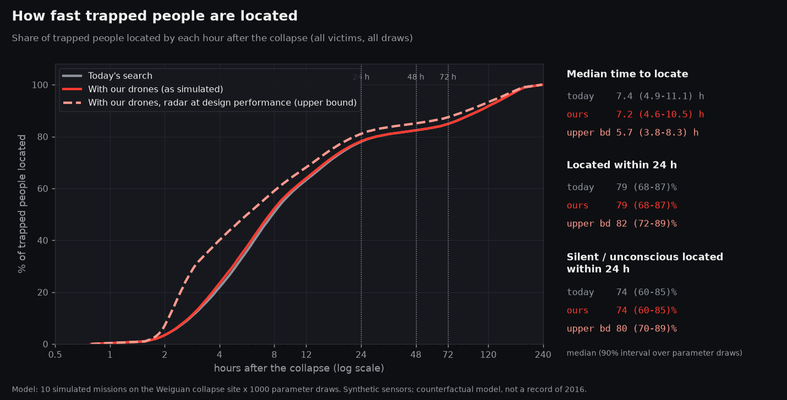
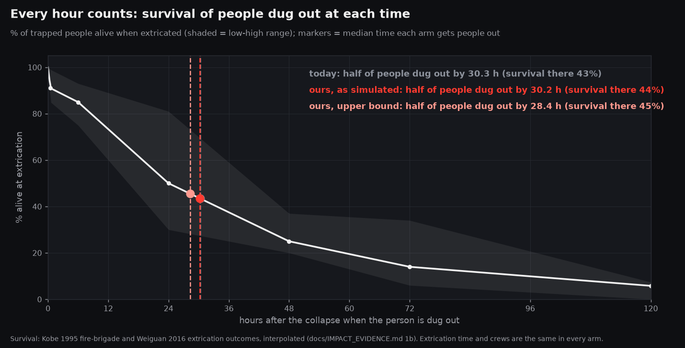
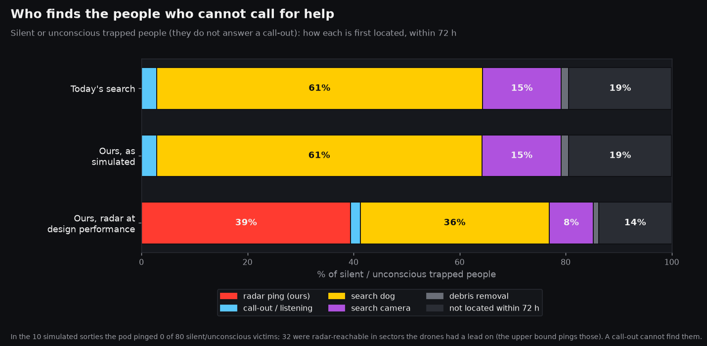
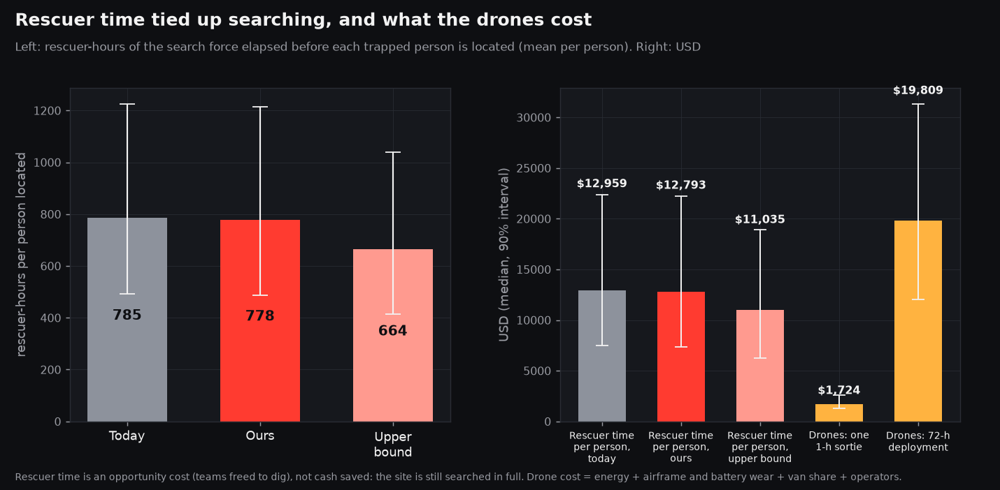
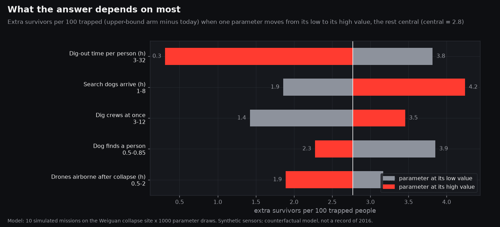
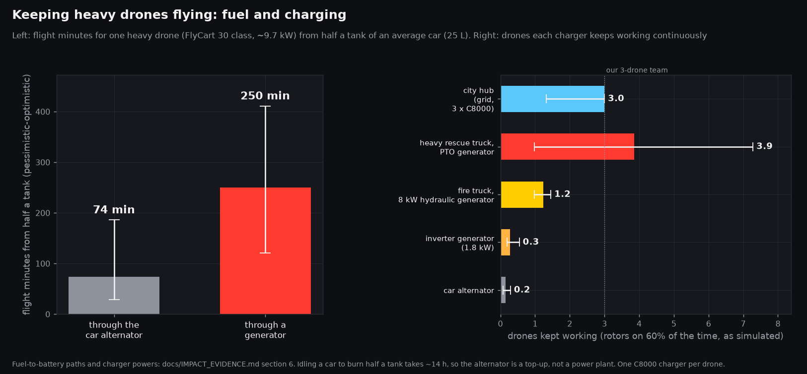

# Impact model: our drones vs today's search in the first 72 h

**This is a counterfactual model, not a record of what happened in 2016.** It takes 10 real runs of our autonomous mission and the sourced numbers in [IMPACT_EVIDENCE.md](IMPACT_EVIDENCE.md) / `data/impact_params.json` (v1.0), and it asks one question: if these drones had worked a building collapse like Weiguan Jinlong, how much sooner would trapped people have been located, and how much would that change who comes out alive?

> **Status (8 Nov, evidence v1.1).** The model code now uses the v1.1 parameters:
> - local-tier dog start;
> - 2–8 parallel dig worksites;
> - drone airborne at 0.75 h;
> - alert → dig start of 0.75 h, which now also applies to radar pings;
> - **extrication time drawn per person from their entrapment type** (section 2).
>
> **The numbers, charts and tornado in sections 0–3 and 7 are still from the v1.0 run.** They will be refreshed when the collapse-site pod-coverage fix is merged and both sites are re-run.
>
> A preview of v1.1 on the same cached missions (150 draws, not committed):
>
> | Measure | Collapse site | Grid site |
> |---|---|---|
> | Ours, as simulated (per 100 trapped) | +0.2 | +1.2 |
> | Upper bound (per 100 trapped) | **+1.4 (−1.2 to +3.4)** | +3.4 |
> | Weiguan late cohort, upper bound | **+8 (2.7–17)** | |
>
> In the preview, **the number of parallel dig worksites becomes the most sensitive input.** With only 2 worksites the upper-bound gain falls to about 0. With 8 it reaches about 3.4 per 100.

Code: `sim/impact.py` (model), `scripts/run_impact.py` (runs, Monte Carlo, charts), `tests/test_impact.py`. Results: `data/impact_results.json`. Charts: `docs/img/impact_*.png`.

Reproduce:

```
scripts/heavy.sh .venv/bin/python scripts/run_impact.py sim --seeds 1-3        # ... 4-6, 7-8, 9-10 (collapse site)
scripts/heavy.sh .venv/bin/python scripts/run_impact.py sim --site grid --seeds 1-5   # ... 6-10
scripts/heavy.sh .venv/bin/python scripts/run_impact.py model --seeds 1-10 --n 1000 --n-secondary 500 --tornado-m 16
.venv/bin/python -m pytest -q tests/test_impact.py
```

## Judge summary: five numbers

Ranges are the median and the 90% interval over 1,000 draws of the uncertain parameters, unless the line says "count". "Upper bound" is the same drones with the radar pod working as designed. It firmly pings every silent, radar-reachable person in a sector the drones were already sent to, by the end of the one-hour sortie. "As simulated" is what the current code actually did.

| # | Headline | Why believe it |
|---|---|---|
| 1 | **In the first hour, the drones put a lead on the sector of 53% of trapped people within 30 min of launch (median 8 min).** By the end of the sortie, 83% of the people in the collapse core were in a lead sector. | This is a count from 10 runs of the real mission code on the Weiguan site model. The acoustic leads come from the documented synthetic stub, so treat them as an upper bound. |
| 2 | **Silent and unconscious people located within 24 h: 74% (60–85) today, 80% (70–89) at the upper bound.** As simulated it stays at 74%, because the pod pinged none of them on this site. | A call-out cannot find someone who cannot answer; that is true by design and sourced. Dogs carry today's search (61% of these people), and the radar is the only other route. |
| 3 | **Extra survivors per 100 trapped: +0.2 (−0.1 to +0.7) as simulated, +0.75 (−1.8 to +2.7) at the upper bound.** On the small grid site, where the pod pinged 12 of 40 people, the gain is +1.3 (+0.3 to +4.0) as simulated and +3.0 (+1.1 to +6.6) at the upper bound. | The same victims and the same random numbers run through both arms. The survival table comes from Kobe and Weiguan outcome data, the result is reweighted to the sourced 28% unconscious share, and the extrication crews are a shared bottleneck in both arms. |
| 4 | **Weiguan, counterfactual: about +6 survivors (0.6 to 14) among the 113 people brought out after day 1, if the radar works as designed. With the code as it is today: 0 (0 to 1.6).** | The result is anchored on Weiguan's own late cohort: 113 people, of whom 11 came out alive (9.7%). Our model shifts only the share it locates within day 1, 15% (5–26). It is optimistic, because the late cohort is deeper and more injured than the survival curve assumes. |
| 5 | **The drones cost about $1.7k per one-hour sortie (1.3–2.6k), or about $20k for a 72-h deployment (12–31k), and a heavy-rescue truck's PTO generator keeps 3.9 drones working (1.0–7.3).** For comparison, international teams spend $0.8–0.94 M per life saved [S]. The rescuer-hours tied up before each person is found fall 15% at the upper bound (785 to 664). | Costs are built from HARDWARE.md prices, the simulated flight hours and battery swaps, and the operators. Charging uses the evidence file's fuel-to-battery paths. Rescuer time is an opportunity cost, not cash saved. |

**Bottom line for judges.** Faster leads alone barely move survival. The baseline already works the collapse core first, and in the first hours the survival curve is still high. Lives are won or lost on the **silent people that today's search finds after day 1**, which only a through-rubble breathing sensor can find early. On the Weiguan-scale site the pod has not yet produced a firm ping in the first sortie (0 of 170 people, 344 scans; see Requests). Until it does, **we do not claim lives saved at Weiguan scale**. We claim the upper bound in rows 3 and 4, and on the grid site the radar half of that is demonstrated.








## 1. Our system, from real simulation runs

| | Collapse site (primary) | Grid site (secondary) |
|---|---|---|
| Geometry | `site="collapse"`: the teammate's 320 m Weiguan model (two fallen 16-storey towers plus an extrapolated district), 157 sectors, 28,854 m² of rubble | 3×3 piles, about 60 m across |
| Victims (hidden truth, evaluator only) | 13–22 per seed, 170 in total; 80 cannot answer a call-out (unconscious / apnoeic breathing state); 139 within 3 m of the surface | 4 per seed, 40 in total; 17 cannot answer |
| Seeds | 1–10 | 1–10 |
| Mission defaults | heavy_sar + winch pod, `--penetration literature`, DSP radar on a synthetic IF, physio breathing, 36 pod scans, 3,600 s limit, SmoothFlight, battery swaps | same |
| Acoustic | **`stub-from-truth`**: synthetic clips built from the hidden truth, cleaner than the real pipeline. The real pipeline has no cache for these scenes, and running it uncached on 20 missions was not feasible under the memory cap. | same |
| Sector leads | 99/170 people; 53% within 30 min of launch | 30/40 |
| Firm radar pings within 3 m | **0/170**; 1 false ping (> 3 m from anyone) | **12/40** (4 of them silent / unconscious), median 23 min |
| Scans / swaps / drone flight per sortie | 34.4 / 1.4 / 1.51 h (sum of 3 drones), 50 min mission | 28.8 / 0.8 / 0.82 h, 42 min |

Code version: the runs started at HEAD `ff5abca` and finished at `7f7fdbd`. Other agents committed during the window, including `fa4e74b` (SmoothFlight as the default, and non-human returns never becoming pings). SmoothFlight was already the default in the working tree when the first run started, and every row records `flight_model: smooth`, so no re-run was needed. The grid rows were all run at `c19bbc1`. Each row in `eval/impact_rows/<config>/seedNNN.json` records its HEAD and which sim/acoustic files were uncommitted at the time.

How a person is scored: their **first lead** is the first mission time at which their sector is a lead (an acoustic, call-out or phone lead with priority ≥ 20), or holds a ping. Their **firm ping** is the first radar `candidate` within 3 m of them (the `sim.evaluate_grid.score_run` matching). Their **responsiveness** comes from their hidden breathing state: `unconscious_slow` and `irregular_apneic` never answer a call-out, the same rule as `sim/callout.py`.

## 2. Method

Every Monte Carlo draw samples all the uncertain parameters (triangular low/central/high; the survival points share one quantile so the curve stays a curve). It then runs three arms on **the same victims, sectors and per-victim random numbers**:

- **Today's search.** Search crews (`search_teams`) work the sectors in a fixed order: the reported sector, then the collapse core nearest-first, then the district. Each sector gets a call-out / listening pass and a camera / void-search pass. The effort per 100 m² is the Weiguan calibration (2 team-hours per 100 m², range 1–4), split by `hasty_share`.
  - Dogs (`canine_teams`, from `canine_start_h`, 50% duty) sweep the same order.
  - The call-out finds a responsive person with p = 0.75 and an unresponsive one with p = 0.02. A dog finds anyone with p = 0.7, and a camera with p = 0.5. All three are scaled by `deep_detect_factor` for people more than 3 m deep.
  - Anyone still not found is reached by debris removal, between 64 h and 192 h (Weiguan's machinery start and demolition end).
  - Location = detection + `pinpoint_h`.
- **Ours, as simulated.** The same crews, plus the drones, which are airborne at `drone_deploy_h` (0.75 h, v1.1).
  - Every sector lead from the run (keeping a share `acoustic_lead_keep`, 0.8) moves that sector to the front of the crews' and dogs' queue once the lead exists.
  - Every firm ping (keeping a share `ping_keep`, 0.8) locates that person at the ping time + `pinpoint_h`. A ping still needs confirmation and shoring before the dig, the same alert → dig start as any other alert (v1.1).
  - Each person is located by whichever comes first.
- **Ours, upper bound.** The same as "as simulated", but the pod also pings every silent, radar-reachable person (≤ 3 m) in a sector the drones had a lead on, by the end of the sortie. There are 32 such people in the collapse runs.
- **Outcome.**
  - Dig worksites (`extrication_teams` = `parallel_dig_worksites_per_building`, 2/4/8) dig people out in the order they are located. The worksites are the same in every arm.
  - **Extrication time depends on each person's entrapment type** (v1.1, IMPACT_EVIDENCE.md 7e): lightly trapped 0.75 h (0.25–2), void space 6 h (2–9), entombed 20 h (12–32), with ±40% log-normal spread per person.
  - The type is drawn once per person and is the same in every arm.
  - The evidence gives a 50/30/15/5 split, but its "surface, not trapped" 50% are carried out by bystanders and never need a search. Our simulation only places trapped people, so we use the trapped rows renormalised: **60% light, 30% void, 10% entombed.**
  - **Mapping, and why it is honest.** "Radar-only" people are those who cannot answer a call-out or are more than 3 m deep. The evidence says they "sit mostly in the void and entombed rows" (the direction is sourced, the size is ours). So we put a share `radar_only_deep_share` = 0.8 (0.6–0.95) of them in void / entombed. That is 60% void and 20% entombed, using the overall 3:1 void:entombed ratio.
  - Everyone else gets whatever keeps the overall trapped mix at 60/30/10. The radar-only weight comes from the real population, not the simulation: the sourced 28% unconscious, plus the simulated share of responsive people more than 3 m deep. That gives 43% on the collapse site, where the mix is feasible, and 28% on the grid.
  - This works **against** us: the people only our radar finds early are exactly the ones who then take 6–20 h to dig out, so finding them sooner buys less survival than it would for an average person.
  - P(alive) = S(t_out)^h, where S is the Kobe/Weiguan survival curve (91% at 30 min, 85% at 6 h, 50% at 24 h, 25% at 48 h, 14% at 72 h, 5.8% at 5 d) and h = 1.5 for unconscious people (an assumption) and 1 for everyone else.
  - Extra survivors per 100 trapped are reweighted to the sourced share of unconscious people, 28% (Bam), because the simulation's breathing-state mix is about 47% unconscious. Unweighted results are in the JSON (`*_simmix`).
- **Rescuer-hours** = search crew size × (time each person waits to be located, capped at 72 h), averaged per person, at Taiwan's $15 per rescuer-hour (10–25, an assumption).
- **Drone cost** = energy + airframe wear (price / 600 flight-hours) + battery wear (pack price / cycles × packs used) + a share of the van (1/50 deployments) + 3 operators.

**The tornado chart** shows extra survivors per 100 trapped (upper-bound arm minus today, simulated mix) with one parameter at its low and then its high value, and the rest at central (16 draws per end, common random numbers). The top five are:

| Parameter | Range | Effect on extra survivors per 100 |
|---|---|---|
| dig-out time (v1.0: one 9 h average for everyone) | 3–32 h | 3.8 → 0.3 |
| when dogs arrive | 1–8 h | 1.9 → 4.2 |
| dig crews at once | 3–12 | 1.4 → 3.5 |
| a dog finds a person | 0.5–0.85 | 3.9 → 2.3 |
| drones airborne after the collapse | 0.5–2 h | 3.2 → 1.9 |

In plain words: **the value of finding people early is capped by how fast crews can dig them out**, and it is largest when dogs are late or scarce.

The radar what-if, at central values: the extra survivors per 100 grow almost linearly with the share q of eligible silent people the pod pings. For q = 0, 25, 50, 75 and 100%, the gain is +0.1, +0.8, +1.2, +1.8 and +2.7.

## 3. The Weiguan framing

Weiguan Jinlong, 6 Feb 2016, 03:57 (IMPACT_EVIDENCE.md section 4):

- 309 residents; 290 people extricated; 175 alive (164 on day 1, 7 on day 2, 4 on day 3) and 115 dead.
- The last person rescued alive came out at 62.3 h. Machinery started at 64 h, and the last resident was found at 180 h.
- About 2,000 rescuers and 23 dogs worked the site.

Our counterfactual looks only at the **late cohort**: the 290 − 164 − 13 = **113 people brought out after day 1**, of whom 11 (9.7%) were alive. This is where both today's search and our drones are weakest, and where the survival curve is steepest.

- In the collapse-site model, today's search locates some people after 24 h. Of those, the upper-bound arm locates **15% (5–26)** within day 1, and their modelled chance of coming out alive is 47% (15–73).
- So: *if the radar works as designed, location time for a silent person falls from day 2+ to the first hours. Under the survival curve, that is about **+6 survivors (0.6–14)** among Weiguan's 113 late victims.* With the code as it is today, the figure is **0 (0–1.6)**.
- Overall, the median time to locate a trapped person falls from **7.4 h (4.9–11.1)** to **5.7 h (3.8–8.3)** at the upper bound, and to 7.2 h as simulated.

What this framing assumes: Weiguan's late cohort behaves like our simulated people (it does not: it is selected for depth and injury, so we are optimistic). Being located earlier also assumes the person could be dug out sooner (Weiguan's deep extrications took 12–29 h each [S]). And the evidence file states that no time-of-death data exist for the 115 who died: **any "N lives could have been saved" claim is unsupported by public data.** We present this as a model, not a finding.

## 4. Logistics: who powers the drones?

These figures come from IMPACT_EVIDENCE.md section 6, with the rotors-on duty measured in the simulation at 60%: drones land, rotors off, to listen.

- **Half a tank (25 L) of an average car** gives one heavy drone **74 min of flight through the alternator** (29–186), but burning that fuel takes about 14 h of idling. Through a generator, the same fuel gives **250 min** (121–411).
- **Drones kept working continuously** (charge power × 0.9 / (9.7 kW × 0.60)):

| Charging source | Drones kept working |
|---|---|
| car alternator | 0.15 |
| 1.8 kW inverter generator | 0.28 |
| fire truck, 8 kW hydraulic generator | 1.2 |
| **heavy rescue truck, 25 kW PTO generator** | **3.9** (1.0–7.3) |
| city hub with three C8000 chargers on the grid | 3, capped at one drone per charger |

- **City hub or fire-truck retrofit.** A hub keeps packs charged on grid power and stores the drones, but it adds a road trip (about 0.5–2 h, an assumption) before the first launch. In the tornado, each hour of delay before launch costs about 0.9 extra survivors per 100. A heavy-rescue truck's PTO generator already powers a 3-drone team (≈ 20 kW, ≈ 9 L/h diesel [A]) and arrives with the first responders. **The recommendation is to retrofit heavy-rescue trucks** (C8000 chargers + 3 pack sets per drone) and keep a regional hub for spares and training. A car is an emergency top-up only. Park the generator ≥ 100 m downwind of the listening sites.

## 5. Assumptions table

`origin`:
- **sourced / derived / assumption**: from `data/impact_params.json`, with the researcher's tags.
- **placeholder**: our own model knob, not in the evidence file. These are order-of-magnitude USAR judgements or our honesty discounts. The four that were in the v1.0 tornado's top five (`canine_start_h`, `extrication_teams`, `drone_deploy_h`, `pinpoint_h`) now come from evidence v1.1.

| parameter | low | central | high | unit | origin | note |
|---|---|---|---|---|---|---|
| `survival_pt_30min_pct` | 85 | 91 | 99 | % | assumption | no primary source for the widely quoted 91%; Weiguan day-1 average 92.7% |
| `survival_pt_6h_pct` | 75 | 85 | 93 | % | derived | Italy 1980 LD50 of extrication 8 h; day-1 window 80.5–92.7% |
| `survival_pt_24h_pct` | 30 | 50 | 81 | % | derived | Kobe / Weiguan window mid-points |
| `survival_pt_48h_pct` | 20 | 25 | 37 | % | derived | same |
| `survival_pt_72h_pct` | 6 | 14 | 34 | % | derived | same |
| `survival_pt_120h_pct` | 0 | 5.8 | 7.4 | % | derived | same |
| `hazard_multiplier_unconscious_or_severe` | 1 | 1.5 | 3 | x death hazard | assumption | direction from Pan 2019 |
| `frac_trapped_unconscious_at_rescue` | 0.15 | 0.28 | 0.4 | fraction | sourced | Bam 2003 (survivors only) |
| `p_callout_responsive` | 0.6 | 0.75 | 0.9 | prob per searched sector | assumption | = p_detect_acoustic_conscious |
| `p_callout_unresponsive` | 0 | 0.02 | 0.1 | prob | assumption | = p_detect_acoustic_unconscious |
| `p_canine` | 0.5 | 0.7 | 0.85 | prob | assumption | = p_detect_canine_live (Greatbatch 2015: 62.9% terrestrial) |
| `p_camera` | 0.3 | 0.5 | 0.7 | prob | assumption | = p_detect_camera_given_void_access |
| `deep_detect_factor` | 0.3 | 0.5 | 0.8 | x detection prob | placeholder | call-out, dog and camera for people > 3 m deep |
| `search_team_h_per_100m2_floor` | 1 | 2 | 4 | team-h per 100 m² | derived | Weiguan: 4 sectors × 64 h / 13,142 m² (includes extrication: a slow, i.e. generous-to-today, search) |
| `hasty_share` | 0.1 | 0.17 | 0.3 | share of search effort | placeholder | call-out pass vs camera / void search |
| `search_teams` | 4 | 6 | 12 | crews at once | placeholder | Weiguan: 4 sectors around the clock |
| `rescuers_per_search_team` | 4 | 6 | 8 | people | placeholder | |
| `search_start_h` | 0.25 | 0.5 | 1.5 | h | placeholder | Tainan FB called at +6 min, command post within 1 h [S] |
| `canine_teams` | 2 | 4 | 8 | dog teams | placeholder | Weiguan: 23 dogs |
| `canine_start_h` | 1 | 3 | 8 | h | derived | = canine_start_h_local (Taiwan declined foreign teams; national tier 6/12/30, international 12/24/72) |
| `canine_rate_m2_h` | 400 | 800 | 1600 | m² per working dog-hour | placeholder | × duty 6 h per 12 h shift [D] |
| `camera_start_h` | 2 | 6 | 12 | h | placeholder | |
| `pinpoint_h` | 0.25 | 0.75 | 2 | h | assumption | = alert_to_dig_start_h; any alert incl. a radar ping → dig start, every arm |
| `debris_removal_start_h` | 36 | 64 | 96 | h | placeholder | Weiguan machinery from 64 h [S] |
| `debris_removal_end_h` | 144 | 192 | 240 | h | placeholder | Weiguan demolition done at 192 h [S] |
| `victim_share_lightly_trapped` / `_void_space` / `_entombed` | | 0.30 / 0.15 / 0.05 | | share | sourced (weak) | renormalised over trapped people: 60/30/10; the 50% surface row is not searched |
| `extrication_h_lightly_trapped` | 0.25 | 0.75 | 2 | h | derived | Kobe person-minutes / crew |
| `extrication_h_void` | 2 | 6 | 9 | h | derived | Haiti pancake, USAR average |
| `extrication_h_entombed_deep_pancake` | 12 | 20 | 32 | h | sourced | Weiguan 12 h and 20 h, Haiti 26 h and 32 h |
| `radar_only_deep_share` | 0.6 | 0.8 | 0.95 | share | placeholder | radar-only people in void / entombed (direction sourced, size assumed) |
| `extrication_teams` | 2 | 4 | 8 | worksites at once | derived | = parallel_dig_worksites_per_building (Weiguan: 4 sectors, 1–2 breaches each) |
| `drone_deploy_h` | 0.25 | 0.75 | 2 | h | derived | = drone_airborne_after_quake_h (truck +6 min, DFR 73–181 s, + 5–15 min heavy-drone prep) |
| `acoustic_lead_keep` | 0.5 | 0.8 | 1 | share | placeholder | discount: the acoustic stub is cleaner than the real pipeline |
| `ping_keep` | 0.5 | 0.8 | 1 | share | placeholder | discount: through-rubble radar is a model |
| `cost_per_rescuer_h_usd` | 10 | 15 | 25 | USD | assumption | = cost_per_rescuer_hour_taiwan_usd (international all-in: 40–250) |
| `drone_price_usd` | 50k | 61k | 87k | USD | placeholder | HARDWARE.md |
| `drone_life_flight_h` | 300 | 600 | 1000 | h | placeholder | |
| `battery_pack_price_usd` / `battery_cycles` | 2.5k / 200 | 2.8k / 400 | 3.2k / 800 | | placeholder | HARDWARE.md |
| `van_price_usd` / `van_life_deployments` | 40k / 20 | 51k / 50 | 70k / 100 | | placeholder | HARDWARE.md |
| `operators` × `operator_cost_h_usd` | 2 × 40 | 3 × 75 | 4 × 150 | | placeholder | |
| `flight_power_kw_flycart30_loaded` | 8.5 | 9.7 | 12 | kW | derived | = flight_power_kw_loaded |
| `half_tank_flight_min_alternator` / `_generator` | 29 / 121 | 74 / 250 | 186 / 411 | min | derived | IMPACT_EVIDENCE.md section 6 |
| `car_alternator_net_kw_at_idle` | 0.6 | 1 | 1.6 | kW | assumption | |
| `firetruck_onboard_generator_kw` | 8 | 25 | 40 | kW | sourced | |
| `c8000_kw` | 3.6 | 7.2 | 7.2 | kW | sourced | = c8000_charger_kw |
| `weiguan_extricated_total` / `alive_day1` / `day2` / `day3` | | 290 / 164 / 7 / 4 | | people | sourced / derived | 13 bodies on day 1 (Tainan FB) |

`python scripts/run_impact.py table` prints the full machine-generated version.

## 6. Limitations: what this model does NOT show

- **Synthetic sensors.**
  - The terrain, the radar returns and (here) the acoustic clips are synthetic.
  - The acoustic leads come from a stub built from the hidden truth, which is cleaner than our real pipeline. We discount it with `acoustic_lead_keep`.
  - The radar DSP is validated on real breathing data only **line-of-sight in air** (24 GHz, 0.4 m). Through-rubble loss is a literature-based model (RADAR_PENETRATION.md: about 3 m of reach beneath the pod).
  - People deeper than about 3 m cannot be pinged at all. In the upper bound only the 32 reachable, silent people in lead sectors count.
- **The pod has not pinged anyone on the Weiguan-scale site yet.** That is 0 pings in 344 scans and 10 sorties, against 12 out of 40 people on the grid. The upper-bound arm shows what is at stake. It is **not** a demonstrated result.
- **Scale gap.**
  - Weiguan was one 16-storey U-shaped tower block, with 290 people trapped in pancaked floors. Our collapse site is a model of it, plus an extrapolated district with 13–22 victims per seed.
  - Our drones flew one sortie of about 50 minutes. We give them **no credit after the sortie**, even though a real deployment would keep scanning for 72 h. That makes the result conservative for us.
  - Our search crews and dogs are scaled to our site, not to Weiguan's 2,000 rescuers.
- **Extrication is the bottleneck.** Locating someone earlier does not dig them out faster. With a shared crew queue, finding one person earlier can push others back, which is why the lower ends of some ranges are negative. The tornado chart shows that dig-out time dominates.
- **Today's search is modelled, not measured.** No field detection rates exist for dogs, listening devices or cameras on rubble [IMPACT_EVIDENCE.md]. The search-effort calibration includes extrication, which makes today's search slower and so is generous to us. Today's search also always starts at the reported sector, as ours does.
- **The survival curve** comes from two cities (Kobe and Weiguan), each selected and pooled across injury types. The hazard multiplier for unconscious people is an assumption.
- **What the model omits.**
  - Aftershock risk, collapse dynamics and the time a person dies while trapped.
  - The negative information our system provides: "nothing heard and no breathing within 3 m". This is what lets commanders write a sector off, and at Weiguan that decision gated the start of the machinery at 64 h.
  - False alerts. There was 1 false ping in 10 collapse runs.
  - Comms and phone leads, which are in the simulation but not separated out.
- **It does not show that anyone at Weiguan would have lived.** No time-of-death data exist.

## 7. Prepared answers to the six hardest questions

1. **"Your sensors are simulated. Why should we believe any of this?"**
   Believe only the parts that rest on the real pipeline or on real data. The mission logic is real code, and the radar DSP and vitals extractor are validated on real breathing recordings. The through-rubble physics is the literature's ~3 m. The sim's acoustic leads are discounted, and its pings are discounted too.
   The honest result is in the numbers. As the code stands, the system adds about **+0.2 survivors per 100** on the Weiguan-scale site, because the pod has not pinged there yet. The **+0.75 (up to +2.7)** figure is the prize if it does. On the grid site it already delivers **+1.3**.
2. **"Your baseline is a strawman."**
   It is not. Today's search here works the collapse core first and starts within 30 min. It has dogs from 3 h and cameras from 6 h, and it uses sourced detection rates, which are generous assumptions because no field data exist. Its search speed comes from Weiguan's own effort, which includes digging and so is slow, and slowness here favours us.
   It locates 79% of people within 24 h, which is faster than Weiguan managed: 177 of 290 people (61%) were out by the end of day 1. A faster baseline leaves less room for us, so this makes our result conservative. Both arms share the same victims, extrication crews and random numbers.
3. **"Most of Weiguan's dead were killed instantly. How many could you really have saved?"**
   We don't know, and nobody does: there is no time-of-death data. We model only the 113 people brought out after day 1 (11 of them alive). If our radar worked as designed, it would locate about 15% of them within the first day. Under the survival curve that is about **6 more alive (0.6–14)**, and that figure is optimistic.
   We say "up to", and we say it is a model.
4. **"Radar through 16 floors of concrete?"**
   No. Ten metres of rubble costs about 130 dB of signal, so nothing comes back. We claim about 3 m beneath the pod. That is why the drones winch the sensor onto the pile at many points per hour, instead of a rescuer carrying a LifeLocator onto it one spot at a time.
   Deep people stay with today's methods. In our runs 139 of 170 people were within 3 m.
5. **"Isn't extrication the bottleneck, not search?"**
   Yes, and the model says so. Dig-out capacity is the most sensitive input. In the v1.1 preview, with 2 worksites the upper-bound gain is about 0, and with 8 it is about 3.4 per 100. The people only our radar finds are mostly void or entombed, at 6–20 h each. Our value is in **which voids the crews open first**: silent people with a breathing signal, found in hours instead of days. We also give **negative information**, so empty sectors can be written off and the machines start sooner. We don't claim to dig faster.
6. **"What does it cost, and can you even power it at a disaster site?"**
   About **$1.7k per sortie and $20k for a 72-h deployment**, against **$0.8–0.94 M per life saved** by international USAR teams [S]. A heavy-rescue truck's 25 kW PTO generator sustains about 3–4 drones. A car can't: 74 min of flight from half a tank, and that takes 14 h of idling.
   We recommend retrofitting heavy-rescue trucks rather than relying on a city hub, because every hour of delay before launch costs about 0.9 survivors per 100.
