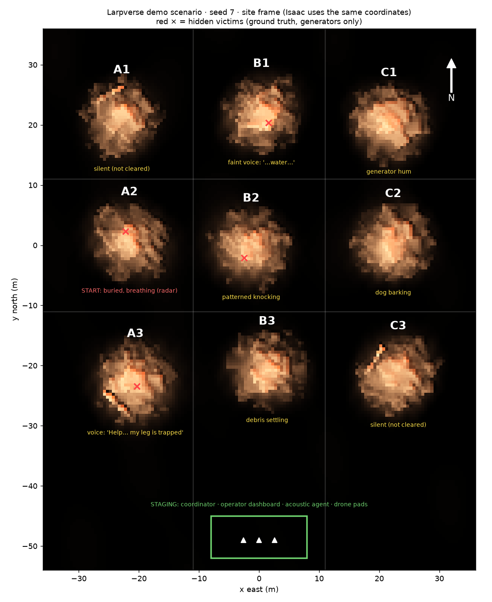

# Larpverse: Isaac Sim handoff

You own the Isaac Sim part of our AgentVerse 2026 robotics demo. This file has everything you and your Claude Code session need.

**Your job: get a presentable, recorded Isaac Sim run of the mission below, as fast as possible.** The decision-making code (localisation, planning, acoustic agent) already runs without Isaac. Isaac provides the 3D world, the drone bodies, the LiDAR sensing and the footage.

> **Coordination:** the orchestrator posts updates and next steps in `docs/FOR_ISAAC_CLAUDE.md`, which changes on every push, so read it after each pull. Report back in `docs/FROM_ISAAC.md` on your own branch `larpverse-isaac`, never on `larpverse-sensing`.
>
> Start your Claude Code session with: *"Read docs/ISAAC_HANDOFF.md and isaac/README.md, then do the bring-up checklist step by step, verifying each step before the next."* There is a fuller paste-ready prompt at the end.

---

## 1. The story we are showing

Three drones search a **3×3 grid of collapsed-building rubble piles**:

1. They take off from the staging area and fly to the start pile.
2. They circle it with a spinning LiDAR to build a 3D map.
3. They score the ground for flat landing cells and land around the pile.
4. Their radars scan for a breathing-like signal under the rubble. Three ranges cross, and a **red ping** marks the spot. The depth is currently a nominal ≈1.5 m; a radar depth estimate is being added.
5. The ping goes to the operator dashboard, and the operator walks to that pile.
6. Meanwhile the landed drones, rotors off, **listen** to the other piles. Audio clips go to an **acoustic agent** (voice detection, speech-to-text, sound classification, then an LLM judging how human and how urgent each sound is). It ranks the piles and **dispatches the drones to the highest-priority pile**, and the cycle repeats.
7. The operator opens the ping, sees the LiDAR model of the pile with the candidate's depth, and digs.

The storyboard is the concept video. Download `larpverse-grid-search.mp4` from https://github.com/rohansharmacode/skysearch/releases/tag/larpverse-storyboard; the original single-pile version is in the same release. The interactive version is `animation/grid-search.html` (open it through the dashboard server). It's being rebuilt on the seed-7 map, so its layout will match your scene. Your Isaac footage should match these shots (section 8).

What we claim, and don't claim:
- The radar returns are generated by a labelled **synthetic** model, not by Isaac RF.
- Pings are **candidate search regions**, never confirmed people.
- Silent piles are "not cleared". No detection is not proof of absence.
- Flat landing geometry says nothing about structural safety.

## 2. The map (same in Isaac, the dashboard and the numpy sim)

Everything is generated from **`sim/scenario.py`** with a seed. **The demo uses seed 7.** One seed always produces the same nine piles, the same ~600 rubble pieces and the same hidden victims and sounds. Isaac builds its stage from exactly this data, so the Isaac scene, the web dashboard and the numpy sim all match.



```
            x = -22 (A)            x = 0 (B)              x = +22 (C)        N ↑
 y = +22    A1 silent              B1 faint voice         C1 generator hum
 (row 1)       (not cleared)          "…water…"  ✕

 y =   0    A2 START ✕             B2 patterned           C2 dog barking
 (row 2)       buried, breathing      knocking  ✕
               (radar finds this)

 y = -22    A3 VOICE ✕             B3 debris settling     C3 silent
 (row 3)       "Help! Can anyone                              (not cleared)
               hear me? My leg is
               trapped."

 y = -47    ────────── STAGING: coordinator · operator dashboard · acoustic agent · 3 drone pads ──────────
```

- ✕ marks hidden victims (ground truth). Only the observation generators and evaluators may read them.
- In the expected demo flow the drones start at **A2** and ping V1, and the acoustic agent ranks **A3** (the clear call for help) top. The drones fly to A3 and ping V2. Next priorities are B1 (faint voice) and B2 (knocking).

| Pile | Centre (x, y) m | Role in seed 7 (truth) |
|---|---|---|
| A1 | (-22.9, 21.0) | silent |
| B1 | (0.4, 22.0) | faint voice, victim V3 at 1.2 m depth |
| C1 | (21.6, 20.5) | generator hum (non-human) |
| A2 | (-21.6, 0.7) | **start**, victim V1 at 1.6 m depth, silent but breathing |
| B2 | (-1.3, -0.3) | knocking, victim V4 at 1.2 m depth |
| C2 | (22.3, 0.4) | dog barking (non-human) |
| A3 | (-20.6, -22.9) | **voice "Help… my leg is trapped"**, victim V2 at 0.9 m depth |
| B3 | (1.3, -20.8) | debris settling (non-human) |
| C3 | (23.2, -21.6) | silent |

Regenerate or inspect the scenario:
```bash
python -m sim.scenario --seed 7 --out scenario.json --truth-out scenario_truth.json
```

## 3. Frames and units (do not change)

- **Site frame:** metres, **x = east, y = north, z = up**, origin at the centre pile at ground level. Isaac's default stage is Z-up in metres, so no conversion is needed. `isaac/scene.py` sets `upAxis = Z` and `metersPerUnit = 1`.
- **Bearings:** degrees counter-clockwise from +x (east). This is the maths convention, not a compass bearing.
- **Pile names:** column A/B/C runs west to east, row 1/2/3 runs north to south.
- **Contract:** the full contract is `contracts/INTERFACES.md`. The dashboard reads `dashboard/data/state.json`, and Isaac must not change its shape.

## 4. Hardware and version

> **Verified on the team's Brev box: Isaac Sim 6.0.1 with Isaac Lab 3.0.** See `docs/ISAAC_VERIFIED_APIS.md` for every GPU-verified fact, with its source in the team's `isaac6-port` branch.
>
> There are two launch routes, chosen with `--launcher auto|lab|kit`:
> - **lab** (default on Brev): `cd /workspace/isaaclab && ./isaaclab.sh -p /workspace/skysearch/larpverse/isaac/run_mission.py …`. Isaac Lab's AppLauncher owns physics and steps the sim, and `--livestream 1|2` is passed through.
> - **kit**: plain `SimulationApp`, for 4.5 and 5.x workstation installs, run with `~/isaacsim/python.sh isaac/run_mission.py …`.


| Option | Use when | Notes |
|---|---|---|
| **Your RTX desktop or laptop** | RTX 4080-class or better, 16 GB+ VRAM, 32 GB RAM, recent NVIDIA driver | Best for recording footage in the GUI |
| **Brev cloud, 1× L40S** (~$1–2/hr) | No suitable local GPU | The "Isaac Sim Launchable" ships **Isaac Sim 5.1**. Use headless mode with livestream, or record with Movie Capture |
| A100 / H100 | **Not supported** | They have no RT cores |

- **Use whichever version your machine already has (4.5, 5.1 or 6.x), and only read docs for that version.** APIs were renamed between 5.x and 6.0, so mixing tutorials wastes hours.
- Our adapter deliberately uses only APIs that are stable across versions: `pxr` (USD), `omni.usd`, `omni.timeline` and `omni.physx` scene-query raycasts. Version-specific code is isolated in `isaac/compat.py`.
- **Do not use Pegasus Simulator** (it breaks on Isaac 6) or OmniDrones (built for Isaac 4.1). We pose the drones kinematically and don't simulate aerodynamics.

## 5. Getting the code and setting up

1. Get the code. It's on the `larpverse-sensing` branch of the team repo, in the `larpverse/` folder. Run every command in this document from inside `larpverse/`:
   ```bash
   git clone https://github.com/rohansharmacode/skysearch.git && cd skysearch && git checkout larpverse-sensing && cd larpverse
   ```
   The same repo's `isaac6-port` branch has Isaac Sim 6.0.1 / Isaac Lab 3.0 API notes that were checked on a Brev GPU (`isaac/probe_isaaclab3.py`, `docs/BREV_SETUP.md`). If you're on 6.x, read them; any differences belong in `isaac/compat.py`.
2. **Install scipy into Isaac's Python first.** Isaac's Python has numpy, but you also need scipy. `GridMission` uses it to rebuild the landing map from Isaac's LiDAR points, and `--radar dsp` uses it too. Without scipy the adapter still runs: it skips feeding LiDAR into the map and prints a warning.
   ```bash
   ~/isaacsim/python.sh -m pip install scipy
   ```
   On Brev with Isaac Lab:
   ```bash
   cd /workspace/isaaclab && ./isaaclab.sh -p -m pip install scipy
   ```
3. You don't need our other virtualenvs for Isaac. The acoustic pipeline runs in its own environment (`.venv-audio`). If it's missing on your machine, the mission falls back to a built-in acoustic stub, so the story still runs.
4. The web dashboard needs only Python:
   ```bash
   cd skysearch/larpverse && python3 -m http.server 8765
   ```
   Then open `http://localhost:8765/dashboard/`. On Brev, open `<VS Code URL>/proxy/8765/dashboard/` instead (port 8080 is taken there). The dashboard polls `dashboard/data/state.json`, which the Isaac run writes live.

## 6. Architecture: what Isaac does and what it doesn't

```
 sim/scenario.py (seed 7) ──► isaac/scene.py   builds USD stage: terrain mesh + ~600 collidable rubble boxes + staging area
           │
           ▼
 sim/grid_mission.py  GridMission  ── the brain (pure numpy, runs inside Isaac's Python)
   step() → drones' poses, phase, landing sites, scans, radar pings, acoustic clips, priorities, dispatch
           │  state dict (contract)                        ▲
           ▼                                               │ ingest_pointcloud(points)  (optional)
 isaac/run_mission.py ── mirrors the state into Isaac every frame:
   • isaac/drone_viz.py  3 quadrotors posed kinematically (visual only, no physics)
   • isaac/lidar.py      spinning LiDAR = PhysX raycasts against the real rubble colliders → point cloud → map
   • isaac/overlay.py    red ping spheres + beacons, amber range rings, yellow acoustic cones, green dispatch line
   • isaac/camera.py     director camera that follows the active pile
           │
           ▼
 dashboard/data/state.json ──► web dashboard (operator view)
```

**Isaac's job:** scene geometry, collision-checked movement, LiDAR sensing and the visuals. The radar breathing returns come from our labelled synthetic generator (`sim/radar_model.py` / `sim/radar_dsp.py`). Isaac's RTX radar does not model breathing through rubble, and we must not claim it does.

**Ground-truth rule (judges will ask):** only the observation generators (radar, acoustic synthesis) and the evaluators may read `scenario.truth`. The planner, localiser and dashboard never see it. The `--show-truth` ghosts in Isaac are display-only, for the video.

### Files you'll touch

| File | Purpose |
|---|---|
| `isaac/run_mission.py` | Entry point. Options: `--seed 7`, `--start-pile B2`, `--radar model\|dsp`, `--speed 4` (sim seconds per wall second), `--headless`, `--livestream`, `--show-truth`, `--replay DIR`, `--out DIR`, `--frames`, `--dry-run`, `--max-steps N`, `--camera director\|free`, `--drone-asset [auto\|URL]`, `--drone-scale 1.6`, `--rtx-lidar`, `--overlay auto\|debug\|usd`, `--rays 96`, `--lidar-range 40`, `--no-keep-open`, `--quiet`.

Added after the API check:
- `--launcher auto\|lab\|kit` chooses the launch route (section 4).
- `--livestream 1\|2` turns on livestreaming.
- `--selftest` runs every risky Isaac call and prints PASS/WARN/FAIL for each.
- `--look pretty` adds an HDRI sky, NVIDIA concrete materials, chipped rubble and dust.
- `--rtx pathtracing` switches to path tracing.
- `--record DIR` saves frames and prints the ffmpeg command. |
| `isaac/look.py`, `isaac/selftest.py` | The presentation look, and the one-command diagnosis. |
| `isaac/compat.py` | Version shims: SimulationApp import, extensions, viewport camera, PhysX raycaster, assets root. |
| `isaac/scene.py` | Builds the stage from the scenario (pxr only). |
| `isaac/drone_viz.py`, `lidar.py`, `overlay.py`, `camera.py` | Drones, LiDAR, overlays and camera, as in the diagram above. |
| `isaac/README.md` | Install details per version, plus troubleshooting. |
| `sim/grid_mission.py` | The multi-pile mission (don't change its decision logic, just call it). |
| `tests/test_isaac_dryrun.py` | Checks the whole loop without Isaac. |

**Status (7 Nov):** all files exist. The `--dry-run` was tested here against the live `GridMission`:
- A full three-pile mission (about 490 sim-seconds, about 110k LiDAR points) ran in about 75 s wall time, peaking at 600 MB of RAM. These numbers change as the mission gets new features.
- The landing heightmap is rebuilt from the LiDAR points.
- `--replay` works on recorded frames.
- `tests/` passes.

The stage build, drone posing and USD overlay were also checked against the standalone USD library (`usd-core`). The omni/Isaac calls themselves have **not** run yet, because nobody on the team has had a GPU. That's your first job (section 9).

## 7. Bring-up checklist (in order; verify each step)

`isaac/README.md` is the single source for the exact commands. This is the short version.

**Brev / Isaac Lab (6.0.1, the team's box).** Set `L=/workspace/skysearch/larpverse`, then run each command from `/workspace/isaaclab`:

1. **Self-test.** Paste every PASS/WARN/FAIL line, plus `selftest.json`, into `docs/FROM_ISAAC.md` on branch `larpverse-isaac`.
   ```bash
   cd /workspace/isaaclab && ./isaaclab.sh -p -m pip install scipy && ./isaaclab.sh -p $L/isaac/run_mission.py --selftest --headless --enable_cameras --out /workspace/selftest
   ```
2. **Only if the self-test reports a `mission_import` FAIL:** run the dry run. It needs no omni, and it isolates Python and dependency problems from Isaac problems.
   ```bash
   ./isaaclab.sh -p $L/isaac/run_mission.py --dry-run --max-steps 60 --out /tmp/d
   ```
3. **Scene check.** Run one step. Look for nine piles, about 600 boxes, the staging area at y ≈ -47, and Z up. Screenshot it.
   ```bash
   ./isaaclab.sh -p $L/isaac/run_mission.py --seed 7 --max-steps 1 --livestream 2
   ```
4. **Live run.** Drones should take off from the pads at y ≈ -49 and fly to A2, and the LiDAR point count should rise during the survey. You should then see landing, the red ping and its beacon, yellow cones, and the dispatch line. The radar is `--radar dsp` by default.
   ```bash
   ./isaaclab.sh -p $L/isaac/run_mission.py --seed 7 --speed 4 --show-truth --overlay usd --look pretty --livestream 2
   ```
5. **Dashboard.** Run `cd $L && python3 -m http.server 8765`, then open `<VS Code URL>/proxy/8765/dashboard/`. It should say "live · state.json" and update as Isaac runs.
6. **Record:** `--record /workspace/frames`, plus `--rtx pathtracing` for hero shots (section 8).

**Workstation (4.5 / 5.x).** Replace `./isaaclab.sh -p` with `~/isaacsim/python.sh` and add `--launcher kit`.

**If something fails:**
- No LiDAR points: the colliders weren't parsed or scene queries are off. See the self-test's raycast step, and `docs/ISAAC_VERIFIED_APIS.md`.
- Black viewport: the camera re-pose fix is already in, so check `--camera free`.
- Overlays missing: use `--overlay usd`.

**Fallback if the live mission import fails inside Isaac:** record frames with the numpy mission on any machine, then replay them in Isaac.
- The replay accepts the folder or its `frames/` subfolder.
- Each frame carries the full heightmap, so copying the frames over is roughly 95 MB.
```bash
cd $L && python -m sim.grid_mission --seed 7 --radar dsp --frames --out dashboard/data
```
```bash
./isaaclab.sh -p $L/isaac/run_mission.py --seed 7 --replay $L/dashboard/data
```

## 8. Making it presentable (this is the point)

**Look.** Ranked by payoff per minute:
1. **Materials.** Boxes currently use flat `displayColor`. Bind real materials: OmniPBR with a concrete texture (Isaac's own materials, or CC0 concrete and brick from Poly Haven) on the rubble, and a dusty ground material on the terrain. Varying roughness and slight colour per piece already helps.
2. **Lighting.** Use a low warm sun (~35° elevation) for long shadows and a dim blue dome. Add a slight fog or haze if your version supports it. Dusk reads as "disaster site" better than noon.
3. **Rendering.** Use RTX Real-Time for interactive work and Path Traced for hero shots if time allows. Use 1920×1080 at 30 fps.
4. **Drones.** Swap the primitive drones for Isaac's quadcopter USD with `--drone-asset` once everything else works. The adapter strips its physics.
5. **Debris props.** Optionally add a few CC0 props (concrete barriers, rebar, a broken wall) from Poly Haven. Check every licence, and avoid Sketchfab models tagged NoAI.

**Shot list for the one-minute video.** Match the concept video:

| # | Shot | Seconds |
|---|---|---|
| 1 | Wide establishing shot of the 3×3 grid at dusk, then drones lifting off from staging | 0–6 |
| 2 | Orbit A2 while the LiDAR sweeps and the point cloud builds (show the debug-draw points) | 6–14 |
| 3 | Top-down view of the landing cells, then the three drones touching down around A2 | 14–19 |
| 4 | Radar rings converge and the red ping plus beacon appear at depth (ghosts on) | 19–26 |
| 5 | Cut to the **web dashboard** (screen recording) as the ping lands, then the acoustic agent panel with transcripts and the priority list | 26–40 |
| 6 | Drones lift off and fly to A3, LiDAR sweep, land, second ping | 40–52 |
| 7 | Dashboard: click the ping to open the LiDAR model with the depth marker | 52–58 |
| 8 | Slow wide pull-back over the whole grid, with pings, cones and drones moving to the next priority | 58–60 |

**Built-in look and recording:**
- `--look pretty` (with `--rtx pathtracing` for hero shots) applies the team's lighting and materials.
- `--record DIR` saves frames, at about 2.2 s per frame on an L40S, or about 6.5 s path traced. Encode them with the ffmpeg command it prints.

**How to record:**
- **Movie Capture:** enable the Window → Movie Capture extension (`omni.kit.window.movie_capture`), choose 1080p at 30 fps, and render the camera path.
- **Simpler:** run with `--speed 2–4` and screen-record the viewport with OBS.
- **Headless cloud (Brev):** use the livestream client or Movie Capture to file.

Record the dashboard separately (OBS) and cut the two together.

## 9. Known risks and the API calls to verify first

**Already verified on 6.0.1 by the team** (`docs/ISAAC_VERIFIED_APIS.md`):
- PhysX raycasts, once scene queries are enabled. The adapter enables them on both launch routes.
- debug_draw.
- The black-viewport fix: re-pose the camera every frame and copy it to the viewport and recording cameras.

**Still unverified:**
- the SimulationApp route on any version;
- viewport camera switching;
- recording and MDL materials on the SimulationApp route;
- our pxr-built stage under Isaac Lab;
- per-vertex terrain colour;
- whether invisible boxes still block LiDAR rays;
- RTX LiDAR.

Older checklist, still useful on 4.5 and 5.x:
1. **Does `get_physx_scene_query_interface().raycast_closest` hit anything** after `force_load_physics_from_usd()`, Play and about 30 updates?
   - A self-test runs at startup.
   - If every ray misses, the adapter falls back to a heightmap LiDAR and logs it. The run still works, but the LiDAR is then not real Isaac sensing, so fix this.
2. **Does setting `get_active_viewport().camera_path` switch the viewport camera?** If not, use `--camera free`.
3. **debug_draw:** check the `draw_lines` / `draw_points` signatures on 5.x/6.x, and whether the lines appear in Movie Capture. **For recordings, use `--overlay usd`**, which draws everything with real prims and avoids debug_draw.
4. **The quadcopter USD path** on your version (`--drone-asset auto` checks it with `omni.client.stat`). The primitive drones are the default.
5. **`--rtx-lidar`:** check the `IsaacSensorCreateRtxLidar` arguments, the annotator name, and whether points come back in the world frame. It's optional, so do it last.
6. **`--livestream`:** check the extension name, `omni.kit.livestream.webrtc`.
7. **Plain vertex colours:** check whether RTX renders `displayColor` with no material bound. If everything looks grey or white, bind materials (section 8, item 1).

Further notes:

- `SimulationApp` import path: `from isaacsim import SimulationApp` (4.5+) or `from omni.isaac.kit import SimulationApp` (older). Handled in compat.
- `get_physx_scene_query_interface().raycast_closest(carb.Float3, carb.Float3, dist)` returns a dict with `hit` and `position`. The direction must be a unit vector, which compat normalises. It only works once PhysX has parsed the stage: play the timeline or call `force_load_physics_from_usd()`.
- The debug-draw module name differs by version (see checklist step 6). The overlay works without it.
- Viewport camera switching uses `omni.kit.viewport.utility`. If it misbehaves, use `--camera free`.
- **RTX LiDAR is optional** (`--rtx-lidar`). Its API moved in 6.0, so don't spend time on it before the PhysX raycast LiDAR works.
- **Performance:** about 600 colliders plus a 31k-vertex terrain is light. If raycasting slows the frame rate, reduce rays per drone in `lidar.py`.

## 10. Paste-ready prompt for your Claude Code session

```
You are helping me run the Larpverse Isaac Sim demo. Read docs/ISAAC_HANDOFF.md, isaac/README.md,
contracts/INTERFACES.md and sim/scenario.py first.

My machine: <GPU model>, Isaac Sim <version> installed at <path> (or pip). OS: <...>.

Goal: a presentable recorded run of seed 7 (start A2 -> ping -> acoustic ranking -> A3 -> ping), matching
the shot list in section 8, as fast as possible.

Work through the bring-up checklist in section 7 one step at a time. After each step, run it, show me the
output, and fix problems before moving on. Only consult Isaac docs for my installed version. Never let
planner/localiser code read scenario.truth. Don't change the state.json contract or sim/ decision logic;
put Isaac-specific fixes in isaac/ (version differences go in isaac/compat.py). When the run works, help me
improve materials/lighting (section 8) and set up Movie Capture for the shots.
```

## 11. What to send back to the team

- A screenshot after checklist step 3 (scene), step 5 (drones moving) and step 9 (full run).
- Raw footage files of the shots, plus your Isaac version.
- Any change you had to make in `isaac/compat.py`. Those are version differences the rest of us need to know about.
