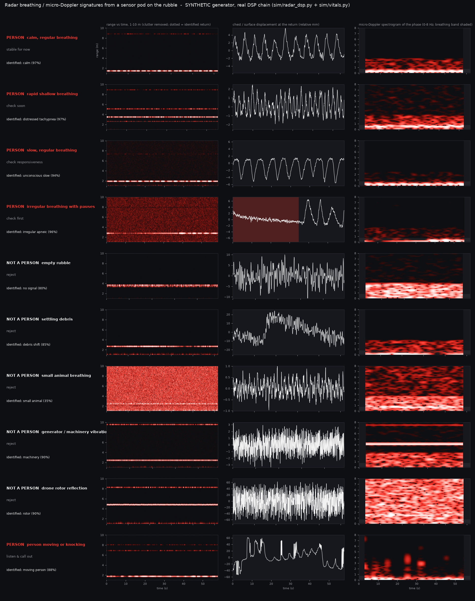

# Radar breathing / micro-Doppler signature library

**What this is:** a library of synthetic radar scans from the drone's belly radar resting on the rubble. It has one class per survivor condition plus six non-human "confounders" the system must not dig for. Each scan goes through the **real** processing chain, which identifies it. The output is the assets for the video HUD and dashboard, a gallery figure, and an honest confusion matrix.

**What it is not:** measured through-rubble data. The generator is ours (`sim/radar_dsp.simulate_if` with motion models in `sim/radar_signatures.py`). The only real radar data we have (Schellenberger 2020, 24 GHz, 0.4 m line of sight) validates the breathing features and pause detection, not rubble propagation or any confounder (docs/VITALS.md).



## Files

| path | what |
|---|---|
| `sim/radar_signatures.py` | truth-side scene generator: `render(cls, seed, dwell)` -> IF cube + truth |
| `sim/vitals.py` | planner side: `identify(iq, params)` (whole scan), `source_of(v, context)` (confounder rejector), new `source*` fields |
| `scripts/build_radar_signatures.py` | `eval` / `report` (confusion matrix), `assets` (npz, png, HUD json, gallery) |
| `assets/radar_signatures/<class>.{npz,png,json}` | one showcase scan per class (see "Exemplars") |
| `docs/img/radar_signatures.png` | gallery: dark, one row per class, red = radar |
| `docs/radar_signatures_eval.json` | confusion matrix and rates (500 scans) |

Reproduce (~8 min in two heavy calls, plus ~2 min for the assets):
```
scripts/heavy.sh .venv/bin/python scripts/build_radar_signatures.py eval --n 25 --seed0 0  --out /tmp/sigA.json
scripts/heavy.sh .venv/bin/python scripts/build_radar_signatures.py eval --n 25 --seed0 25 --out /tmp/sigB.json
.venv/bin/python scripts/build_radar_signatures.py report /tmp/sigA.json /tmp/sigB.json --json docs/radar_signatures_eval.json
scripts/heavy.sh .venv/bin/python scripts/build_radar_signatures.py assets --pick /tmp/sigA.json /tmp/sigB.json
```

## Geometry and radar

- The radar rests on the rubble surface, under the landed drone, and looks down.
- The reflector sits 1.2-3.0 m from the antenna, all through rubble (rubble path = range). The rotor is the exception: it hovers 4-9 m away, above the landed radar.
- Landed-radar scans are steady: landing quality 0.75-0.97. Default clutter comes from `radar_dsp.default_clutter`.
- Radar: 0.4-2.0 GHz FMCW (wavelength ~25 cm at 1.2 GHz), 512 range bins (9.4 cm), 20 Hz frame (slow-time) rate.
- Dwell is 45-60 s. That is the "vitals look"; docs/VITALS.md explains why 20 s is rate-only.
- Propagation: `radar_dsp` default `legacy` mode (0.7 dB/m).

The 20 Hz frame rate matters for micro-Doppler: anything faster than 10 Hz (engine shafts at 25-30 Hz, rotor blades at 50-200 Hz) **aliases** into the 0-10 Hz slow-time spectrum. The spectrograms show those aliased lines and the aliased white flicker, not the true Doppler.

## The classes

Displacement is along the radar line of sight.

| class | physical picture | model parameters | anchor |
|---|---|---|---|
| calm | regular adult breathing | 12-16/min, 5 mm p-p, CV 0.03-0.08 (`sim/physio.py`) | adult resting rate 12-20/min; chest excursion of a few mm [1, 2] |
| distressed_tachypnea | rapid shallow breathing | 26-36/min, 1.5-2.5 mm, CV 0.12-0.25 | START: > 30/min = immediate [3] |
| unconscious_slow | slow, deep, regular | 6-10/min, 5.5-7.5 mm, long end-expiratory pause, few pauses | bradypnoea, NEWS2 bands [4] |
| irregular_apneic | irregular with pauses > 10 s | 8-14/min, CV 0.25-0.45, 0.5-1.5 pauses/min of 10.5-20 s | clinical apnea = cessation > 10 s; real breath holds validated in VITALS.md [2] |
| empty | rubble only | clutter + thermal noise + per-reflector rubble jitter | — |
| debris | settling / shifting rubble | 1-3 sigmoid steps of 2-15 mm over 0.3-3 s + creep 0-4 mm/min; RCS 5-15 dB | — (our model) |
| small_animal | dog / cat at rest | 20-40/min, 0.5-1.5 mm, RCS 8-14 dB below an adult chest; 30% also pant at 3-6 Hz | sleeping dogs mostly < 30/min [5] |
| machinery | generator / pump vibration coupled into the rubble | pure tone 0.8-6 Hz in slow time (aliased 25-30 Hz shaft), 1-3 harmonics, 0.1-1.5 mm, stable to < 0.5% | 4-pole generators turn at 1500 / 1800 rpm (25 / 30 Hz) |
| rotor | a drone above the landed radar, via backlobe / multipath | body sway 2-10 mm at 0.2-1.5 Hz + blade flashes with a new random phase every frame, about as strong as the body | rotor micro-Doppler [6, 7] |
| moving_person | trapped person knocking or shifting | calm breathing + bursts of 3-5 knocks (2-4 Hz, 4-20 mm) every 4-12 s, 40% followed by a body shift | — (our model); knocking is what the call-out asks for |

## Identification (`vitals.identify` -> `vitals.source_of`)

1. **Pick the return.** `radar_dsp.process_if` runs. Its strongest breathing-band candidate in the 1.2-10 m look window wins. Otherwise: a DSP out-of-band periodic flag, then bulk motion. Otherwise: a rotor-like bin beyond 3.5 m. Otherwise: the near-window (rubble) reflector with the largest noise-corrected modulation index.
2. **`vitals.extract`** runs on that bin's motion-compensated slow-time I/Q (the same features as docs/VITALS.md), plus confounder features:
   - level shift: medians of adjacent 10 s stretches;
   - bursts: 1 s frames whose sample-to-sample motion is 4.5x the median;
   - the dominant spectral line: frequency, prominence, share of power;
   - complex-bin spectral flatness (2-9 Hz vs 0.1-0.75 Hz density);
   - 1.5-9 Hz power over the scan's thermal floor.
3. **Rules, in order** (named constants in `sim/vitals.py`):

| rule | verdict (`source`) | hint |
|---|---|---|
| >= 3 separate bursts | moving_person | urgent ("listen and call out") |
| DSP out-of-band periodic flag and no breathing candidate | machinery | reject |
| line >= 0.8 Hz, >= 15 dB above the spectrum, >= 25% of the excess power | machinery | reject |
| flat >= 0.30 and >= 15 dB over the floor, beyond the rubble volume (> 3.5 m) | rotor | reject |
| DSP candidate + breathing pattern + >= 3 breaths (>= 2 around a pause), not overruled by a level shift >= 3x the breath size (never overruled when there is a pause) | human_breathing -> condition (VITALS.md rules) | condition hint |
| ... but chest motion < 0.25x an adult's (path-loss scaled) at >= 18/min | small_animal (confidence 0.35) | reject |
| no breathing rhythm and a level shift >= 1 mm (and 3x the noise) | debris_shift | reject |
| otherwise | no_signal | reject |

`reject` is a new `triage_hint` with dig weight 0.15. A rejected return gets `condition: "unknown"` and a plain `condition_text`, e.g. "pure tone with harmonics -> machinery or generator vibration, not a person".

## Results: 50 randomised instances per class, 45-60 s dwell

Rows are the true class; columns are the verdict (`condition` for a breathing person, else `source`). "DSP detected" = the CFAR produced a breathing-band candidate in the look window.

| true \ verdict | calm | distressed | unconscious | irregular | no_signal | debris | animal | machinery | rotor | moving | recall | DSP detected |
|---|---|---|---|---|---|---|---|---|---|---|---|---|
| calm | **41** | 1 | | | 8 | | | | | | 82% | 90% |
| distressed_tachypnea | | **34** | | | 13 | | 2 | | 1 | | 68% | 78% |
| unconscious_slow | | | **37** | 4 | 9 | | | | | | 74% | 84% |
| irregular_apneic | 8 | | 10 | **23** | 9 | | | | | | 46% | 86% |
| empty | | 2 | | 1 | **47** | | | | | | 94% | 10% |
| debris | | | 2 | 15 | 23 | **10** | | | | | 20% | 46% |
| small_animal | | | | | 26 | | **24** | | | | 48% | 50% |
| machinery | | | | | 32 | | | **18** | | | 36% | 0% |
| rotor | | 4 | | 1 | 19 | | | 6 | **20** | | 40% | 32% |
| moving_person | 1 | | 1 | 4 | 5 | | | | | **39** | 78% | 100% |

- **Is there a person?** (the 4 breathing classes + moving_person vs the other 5): **sensitivity 81%** (203/250) and **specificity 90%** (225/250).
- **Debris vs a breath hold is ambiguous, and we chose to err toward "person".** A settling slab and a real held breath both show a level shift with a quiet stretch. In the real Apnea recordings, breath holds after a deep inhale look exactly like that. So a rhythm with a pause is never overruled by a level shift. The cost: 17 of 50 debris scans are called a person (15 as irregular_apneic, "check first"). The alternative rejected real breath holds, which is the dangerous direction.
- The other non-person scans called a person: 4 rotors and 2 empties as distressed breathing, plus 1 rotor and 1 empty as irregular.
- Exact class: 59% overall. Most "errors" on confounders are **no_signal**. That is still a correct rejection (nothing to dig for), but it names the source wrongly. Machinery is never a DSP breathing candidate (0%), and a weak tone often loses to rubble jitter.
- **Missed people are mostly DSP misses.** 10-22% of breathing scans give no CFAR candidate in the look window and come back no_signal. That is the detection stage (radar_dsp), not the rejector.
- Conditions: irregular_apneic is the weakest (46%). Without a pause in the window it reads as unconscious_slow (10) or calm (8); see docs/VITALS.md.
- small_animal relies on amplitude and is low-confidence by design (0.35). Half are not detected at all (RCS 10 dB lower).
- On the **real** Schellenberger windows (60 s), the rejector keeps 55/57 resting and 9/10 apnea windows as human breathing. Two resting windows with an 11 mm real level shift read as debris_shift, and one Apnea window with real body movement reads as moving_person.

## Exemplars (assets) and the HUD stream

`assets` shows one scan per class: the highest-confidence **correctly identified** instance from the evaluation (render seed and dwell are stored in the npz). The exemplars are curated for the video; the matrix above is the honest picture.

Exemplar verdicts: calm 97%, distressed 97%, unconscious_slow 94%, irregular_apneic 96%, empty no_signal 80%, debris 85%, small animal 35%, machinery 90%, rotor 90%, moving person 88%.

**`<class>.npz`** contains:
- `slow_time_iq` (complex64, 20 Hz) and `displacement_mm` (relative), `t_s`;
- `range_axis_m` + `range_slow_time_db` (frames x bins to 10 m, clutter removed, float16);
- `spec_f_hz`, `spec_t_s`, `spec_db` (STFT of the displacement: 6 s window, 0.5 s hop);
- `verdict` (JSON string), `range_m`, `bin`, `wavelength_m`, `range_res_m`, `fs_slow`, `render_seed`, `dwell_s`, `synthetic=True`.

**`<class>.png`**: range-time map | displacement | spectrogram, dark theme.

**`<class>.json`**: HUD playback stream, format `radar-signature-hud-v1`.

```jsonc
{
  "format": "radar-signature-hud-v1", "class": "irregular_apneic", "label": "irregular breathing with pauses (check first)",
  "synthetic": true, "fps": 10.0, "window_s": 10.0, "units": "mm (relative; amplitude is low-confidence)",
  "range_m": 2.91,                                   // identified return (draw the ping marker here)
  "final": {"source": "human_breathing", "condition": "irregular_apneic", "conf": 0.95, "text": "irregular breathing with 1 pause(s) ..."},
  "wave_mm": [0.12, 0.3, ...],                       // whole displacement at 10 Hz (index = frame)
  "frames": [ {
      "t": 23.0,                                     // seconds since the scan started
      "w": [130, 231],                               // waveform window = wave_mm[w[0]:w[1]] (last 10 s)
      "rate_bpm": 11.2, "condition": "irregular_apneic", "source": "human_breathing",
      "conf": 0.81, "hint": "immediate (check)", "text": "irregular breathing with 1 pause(s) over 10 s, 11/min -> ...",
      "shown": "irregular_apneic"                    // display this: a new verdict must repeat on 2 updates (hysteresis)
  } ]
}
```

The stream is causal. The verdict updates every 2 s from everything seen so far, starting at 15 s (before that, `"text": "listening... (needs 15 s)"`), and is held between updates. HUDs should display `shown`, not the raw `condition`/`source`. Even so, partial windows can mislead, and the exemplars show it:
- empty: a false "distressed" from 21 to 31 s, before settling on no_signal;
- debris: "irregular_apneic" from 37 to 47 s;
- irregular_apneic: no_signal until 49 s, because its pause comes early;
- moving_person: "calm" from 21 to 29 s.

These are real failure modes to know before a live take: show the final verdict, or start the take after 45 s.

## Honest limits

- **Synthetic generator.** Rubble propagation is a scalar loss, every reflector gets a made-up rubble jitter, and the confounder motions are our models with literature-informed ranges. Nothing here has been measured through rubble.
- **Validated only on line-of-sight real data.** The breathing features and pause detection were checked on 24 GHz CW data at 0.4 m in air (docs/VITALS.md). No real confounder recordings were used (no downloads, by request).
- **The frame rate caps micro-Doppler.** At 20 Hz, rotor and engine signatures are aliased. A real rotor classifier would use a fast-time / high-PRF channel (cepstrogram, blade-flash spacing [7]); here the rotor is recognised only as "white flicker beyond the rubble volume".
- **Thresholds were tuned on the same simulator** they are reported on; there is no held-out set.
- **Amplitude is unreliable.** The animal rule depends on it, so it is low-confidence by design.
- **A person who moves is not measurable as breathing.** `moving_person` says "listen and call out", not a condition.
- **Not medical advice.**

## References

1. Schellenberger, S. et al. "A dataset of clinically recorded radar vital signs with synchronised reference sensor signals." *Scientific Data* 7, 291 (2020). doi:10.1038/s41597-020-00629-5 (CC BY 4.0).
2. Li, C., Lubecke, V. M., Boric-Lubecke, O., Lin, J. "A review on recent advances in Doppler radar sensors for noncontact healthcare monitoring." *IEEE Trans. Microwave Theory Tech.* 61(5), 2046-2060 (2013).
3. START triage (Simple Triage and Rapid Treatment): respiratory rate > 30/min -> immediate. SALT: Lerner, E. B. et al., "Mass casualty triage: an evaluation of the data and development of a proposed national guideline," *Disaster Med. Public Health Prep.* 2(S1), S25-S34 (2008).
4. Royal College of Physicians. *National Early Warning Score (NEWS) 2* (2017): respiratory-rate bands (<= 8 and >= 25 score 3).
5. Rishniw, M. et al. "Sleeping respiratory rates in apparently healthy adult dogs." *Res. Vet. Sci.* 93(2), 965-969 (2012).
6. Chen, V. C., Li, F., Ho, S.-S., Wechsler, H. "Micro-Doppler effect in radar: phenomenon, model, and simulation study." *IEEE Trans. Aerosp. Electron. Syst.* 42(1), 2-21 (2006).
7. Harmanny, R. I. A., de Wit, J. J. M., Prémel Cabic, G. "Radar micro-Doppler feature extraction using the spectrogram and the cepstrogram." *European Radar Conference (EuRAD)* (2014).
8. Chen, K.-M., Huang, Y., Zhang, J., Norman, A. "Microwave life-detection systems for searching human subjects under earthquake rubble or behind barrier." *IEEE Trans. Biomed. Eng.* 47(1), 105-114 (2000). (Why low-GHz radar for rubble.)
