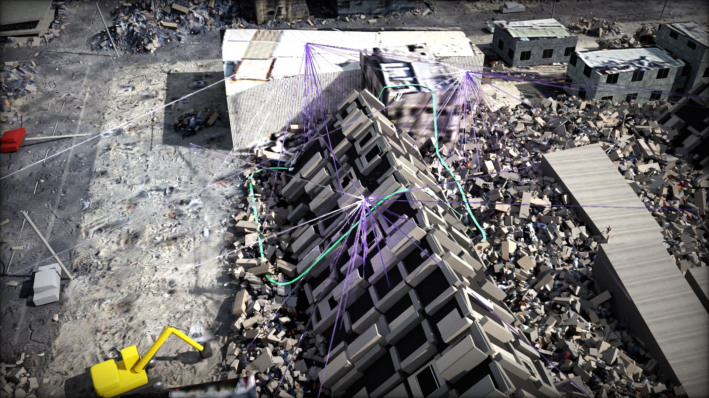
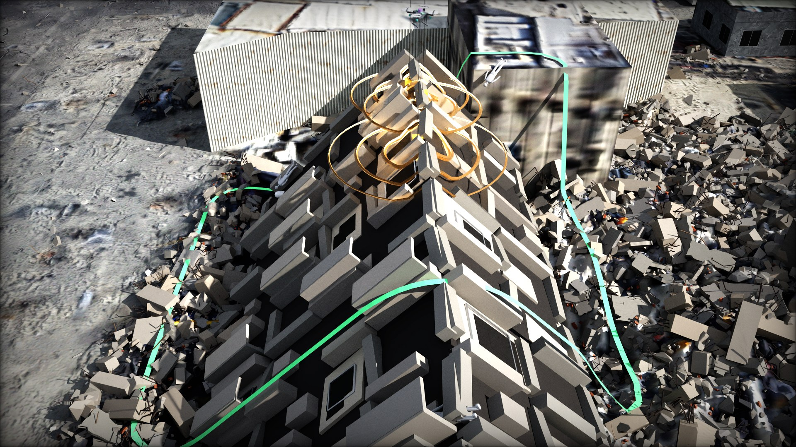
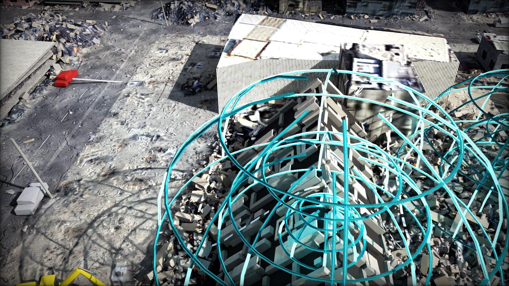
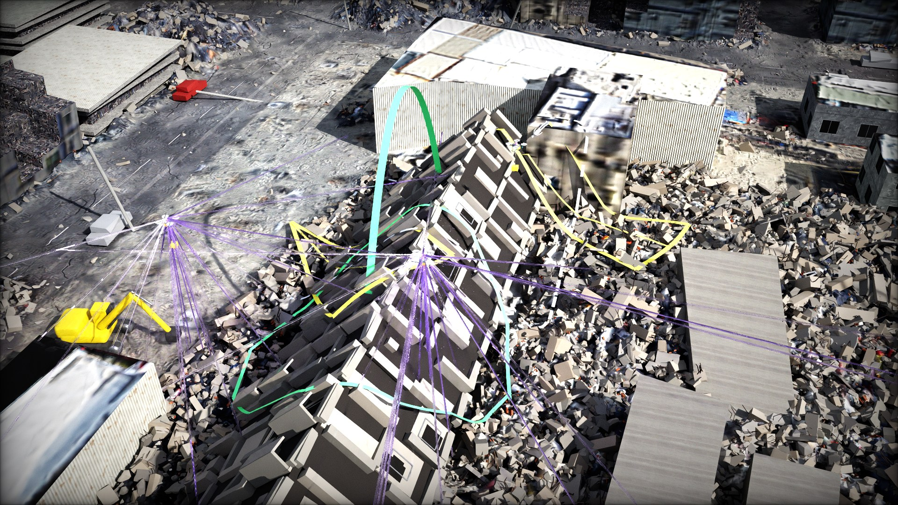
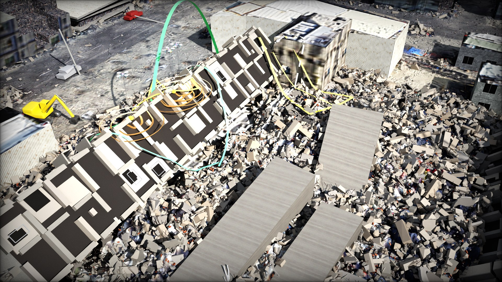
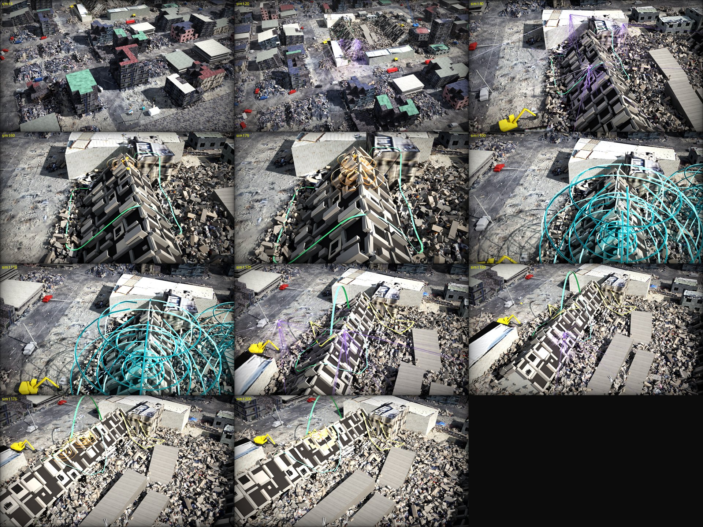
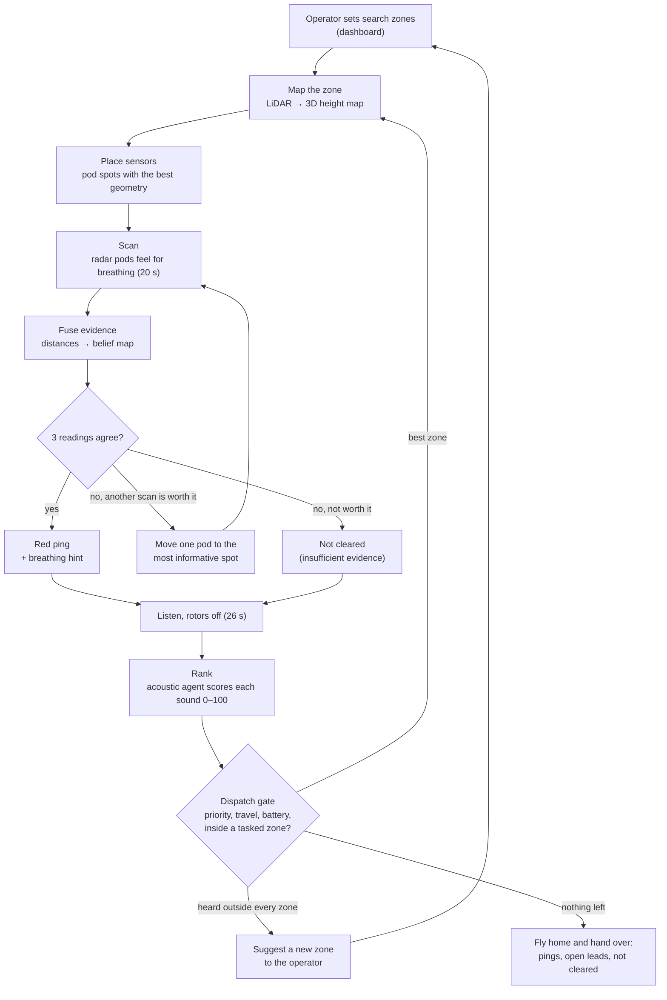
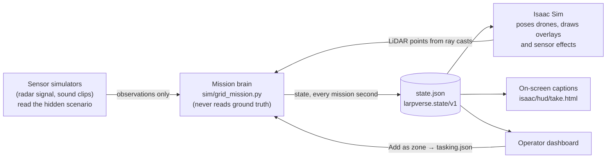

# Larpverse: what you are watching, explained

**AgentVerse 2026 · Robotics track.** This guide is for judges and anyone new to the field. Every technical term is explained when it first appears, and there is a [glossary](#9-glossary) at the end. Sections 1–7 take about 10 minutes to read; sections 8–11 are reference.

---

## 1. In one minute you will see...

Three heavy-lift rescue drones search a collapsed building for trapped people. The building is a 3D reconstruction of the Weiguan Jinlong complex in Tainan, Taiwan, which collapsed in the 2016 earthquake. Everything runs live inside **NVIDIA Isaac Sim**, a robotics simulator with real-time ray-traced graphics. The video is one continuous shot captured from the simulator's live stream: no cuts, no editing.

The drones map the rubble with lasers, lower radar sensors on winch lines to feel for breathing, then switch their rotors off and listen for voices. Halfway through, a person adds a new search zone on the operator dashboard. Nobody tells the drones what to do about it. They re-plan on their own, fly there and start searching. On-screen captions explain each step in plain words, and a status line shows what the drones are sensing at that moment.

**Three things to know before you press play**
1. **It is a simulation, and it says so on screen.** The trapped people, their voices and the radar returns are synthetic. The site is a reconstruction.
2. **The drones are never told where the people are.** The decision-making code only receives sensor readings, as it would in the field.
3. **A red "ping" means "dig here first", never "person found".** Where nothing was detected, the system says "not cleared", never "empty".

---

## 2. Why this matters

**The problem.** When a building collapses, some people survive in voids: air pockets under slabs and furniture. They can live for days, but the chance of a live rescue drops every hour. Rescuers face a huge, unstable pile and do not know where to dig first.

**A real example.** On 6 February 2016 an earthquake brought down the Weiguan Jinlong complex. Reported figures: 114–115 people died in the building, 120–155+ were trapped at first, and about 3,900 emergency workers responded. The last people were pulled out alive 52–60 hours after the quake; the search lasted 7–7.5 days. Sources: [CASE_STUDY_WEIGUAN.md](CASE_STUDY_WEIGUAN.md).

**What rescuers do today.** They call out and listen in silence, use listening devices and search dogs, and carry radar life detectors onto the pile by hand, often standing on rubble that may shift. A wrong guess about where to dig can cost hours.

| Where drones help | Where they cannot (and we do not claim they can) |
|---|---|
| Reach and map the whole site in minutes, without anyone climbing on it | Cameras cannot see into voids under the rubble |
| Lower sensors onto rubble where no person should stand | Radar sees only about 3 m into rubble |
| Listen from three places at once, so they can tell which direction a voice came from | Listening only works with rotors off |
| Keep a ranked list of evidence: where to dig first, and why | They cannot dig, confirm a person or judge if a slab is safe. This build does not model wind, dust or aftershocks |

---

## 3. What you are watching

### The screen

| Where | What it shows |
|---|---|
| Full frame | The live 3D stream from Isaac Sim. |
| Top left | Caption card: "Step N of 8", a title and one sentence. |
| Bottom left | What the drones sense right now: a coloured tag (LIDAR, RADAR, SOUND, OPERATOR, DECISION...), one plain line, and a line of the numbers the drones actually measured (for example a sound's score, compass bearing, SNR and how many drones agree; or a radar scan's range, quality and reach). |
| Top right | Mission clock, for example "t = 120 s · ×4 speed". |
| Bottom right | Honesty line: "Simulation. The trapped people, their voices and the radar returns are synthetic; the drones never see where they are." |

**Speed.** The mission runs at four times real speed (×4): one second of video is 4 seconds of mission time. The minute covers about 3.5 minutes of mission.

### Colour code (the same in 3D, in the captions and on the dashboard)

| Colour | Meaning |
|---|---|
| Purple beams and dots | **LiDAR**, the laser scanner, mapping the rubble. |
| Deep-orange rings on the rubble | **Radar** scanning from a pod. The rings spread to about 3.5 m, roughly how far it sees into rubble. |
| Teal domes | **Sound**: a voice or knock coming out of the rubble while the drones listen. |
| Red beacon | **Radar ping**: a place to dig first. A lead, not a confirmed person. |
| Glowing patch on the rubble (amber to red) | Where the drones currently think a breathing source is most likely (their "belief"). |
| Green arc | **Decision**: the swarm is flying to a new zone. |
| Zone outlines | White dashed = set by the operator, not yet searched. Green = being searched. Grey = searched, **not cleared**. |
| Grey half-buried figures | **Simulated people**, drawn for viewers. The drones are never told where they are. |
| Yellow wedges (fuller overlay only) | The direction a voice came from, as heard by each drone. |

### The minute, second by second

Times come from the latest full rehearsal, **take 2** (seed 7, 8 November). A "seed" is the random number that sets where the invented people are and what they say; the same seed always gives the same scenario. In the live take a person clicks by hand, so times after the click can shift by a few seconds.

| Video | Mission time | What you see | What it means |
|---|---|---|---|
| 0:00–0:01 | 0–5 s | Three drones lift off from the staging lot on the south street. | **Step 1, Launch.** Before launch, the operator marked one zone, **T1a** (the north third of the west fallen tower). That is the drones' only instruction. |
| 0:01–0:12 | 5–46 s | The drones fly about 170 m north and circle T1a. Purple laser beams fan out. | **Step 2, Mapping.** The LiDAR builds a 3D height map from 28,655 points and finds 7 spots where a pod can sit: slope of 30° or less, clear line for the winch. |
| 0:12–0:15 | 47–61 s | Each drone hovers over a spot and lowers a pod on its winch. | **Step 3, Feeling for breathing.** The three spots are picked for the best geometry for **trilateration**: locating a source from several distance readings. |
| 0:15–0:22 | 61–87 s | Orange rings pulse around each pod. | Each radar scans for 20 s. No breathing-like signal. One pod sat badly (quality 0.03 out of 1), so its scan counts for little. |
| 0:22 | 87 s | The rings stop. | Another scan would add almost no information, so the drones stop. The radar reached only about 16% of this zone's rubble: T1a is **beyond radar reach, not cleared**. |
| 0:22–0:31 | 87–125 s | The drones reel in their pods and land beside the pile. Rotors stop. Teal domes swell out of the rubble. | **Step 4, Listening** (26 s, rotors off). The domes are drawn at the hidden sound sources for you. The drones only get what microphones would report: direction, loudness, sound type, any words. |
| ~0:29 | ~116 s | Banner: new search zone added live. A white dashed outline appears around **T1b**, the middle third of the same tower. | **Step 5, Live change.** A person adds the zone on the dashboard. (In rehearsal take 2 a script made this click.) |
| 0:31 | 125 s | "DECISION: Flying to T1b: the strongest voice came from there." A green arc appears. | **Step 6, The swarm re-plans.** Two voices were heard. Near T1b: "Help! Can anyone hear me? My leg is trapped." It scores 82 out of 100, and all 3 drones agree on its direction. T1b is now a search zone, so the swarm goes. The same words in Mandarin near zone CN score 73, but CN is outside every zone, so the drones **suggest** it to the operator instead. |
| 0:31–0:37 | 125–150 s | The drones fly to T1b; purple beams return. | **Step 7, Searching the new zone.** A fresh map (53,774 points) and 7 new pod spots. |
| 0:38–0:46 | 151–183 s | Pods go down; orange rings pulse. | Radar scans in the new zone. |
| 0:46 | 183–185 s | "Possible breathing: checking again from another angle." Data line: "T1b-R1: 2 of 3 required scans agree · 16 breaths/min (0.27 Hz) · depth 1.5 ± 0.8 m". A glowing patch appears where the readings point. | Two of three scans report a breathing-like return (at 2.5 m and 1.4 m), pointing at the same place. A ping needs **three** agreeing readings. The depth shown (1.5 m) is an assumed value: distance readings fix the position on the rubble, not how deep someone is. |
| 0:48–0:54 | 191–214 s | One drone moves its pod about 85° around the pile and lowers it again. | The drones pick the measurement that should shrink the uncertainty most. Take 2 ended at 214 s, before this third reading came in. |
| if it agrees | | A red beacon rises from the rubble. | **Step 8, Breathing-like signal.** "A place for rescuers to dig first. It is a lead, not a confirmed person." With a breathing hint, for example "irregular breathing with pauses, check first". |

### Rehearsal stills (take 2)

Since take 2 the sound domes were made smaller (8 m instead of 14 m) and the overlay simplified, so the final take is cleaner.

| | |
|---|---|
|  |  |
| **0:10.** Purple LiDAR beams from three drones map zone T1a. | **0:19.** Orange radar rings around a winch pod. Grey figures are the simulated people. |
|  |  |
| **0:25.** Rotors off. Teal domes show where sounds come from. | **0:34.** Green arc to the new zone, LiDAR mapping it, yellow wedges for voice directions. |
|  |  |
| **0:44.** Radar pods scanning inside the new zone T1b. | Contact sheet: 11 frames across the take. |

---

## 4. The drones and their sensors

### The drone

**Heavy-lift drones**: eight rotors in four stacked pairs (a "coaxial X8"), in the class of the DJI FlyCart 30 or Agras T50. A big drone can carry a dense LiDAR, a winch and pod, microphones and a loudspeaker, and flies longer. The cost is strong downwash and a big footprint, so it lands beside the pile, never on loose rubble over a void.

| Property | Value | Source |
|---|---|---|
| Size | 3.1 m across, propellers unfolded | FlyCart 30 / T50 spec pages |
| Mass | about 77 kg with sensors (95 kg maximum) | maximum from the spec; 77 kg is our estimate |
| Flight time with sensors | about 25 min | estimate between the spec's 29 min (empty) and 18 min (30 kg) |
| Batteries | 2 × 1,984 Wh; 25% reserve kept, packs swapped at the staging pads | spec, plus our rule |
| Cruise speed in the simulation | 10 m/s | our setting (spec maximum 20 m/s) |

All figures are in `sim/platform.py`, with sources and estimates labelled.

### The sensors

| Sensor | What it physically does | Limits |
|---|---|---|
| **LiDAR** (Ouster OS1-128, tilted 45° forward) | Fires laser pulses and times their echoes, about 1.3 million points a second, to map the surface in 3D. The map shows where a pod can sit. | Sees surfaces only, never inside the rubble. Isaac Sim casts fewer rays than the real device, to keep the frame rate up. |
| **Winch pod** (about 0.5 × 0.5 × 0.25 m, 5 kg, 20 m line) | Lowered from a hovering drone in about 8 s. Carries the radar, 4 microphones and a strobe. Stays seated on slopes up to 30°. | Needs a reachable spot that is not too steep. Moving it costs about 20 s plus lowering and raising. |
| **Through-rubble radar** (low frequency, 0.4–2.0 GHz) | Sends radio waves into the rubble and looks for a chest rising and falling a few millimetres, at 6–30 breaths a minute. Each scan gives a **distance** to that movement, not a position. | Concrete absorbs 10–20 dB of signal per metre. A pod touching the rubble sees about **3–3.6 m** in. From 11 m away it sees about 1.4 m. That is why the radar rides on a pod. |
| **Microphone ring** (8 mics, about 1 m across; our estimate) | With rotors off, records 26 s. Tiny time differences between mics give the **direction** of a sound. The sound is classed (voice, knocking, dog, engine...) and any words transcribed. | Rotors must be off. Machinery and crowds on a real site make it much harder. |
| **Loudspeaker** (129 dB at 1 m class) | For "call out and listen", standard rescue practice. | Not used in this take. |
| **Also on board** | Compute box, mesh radio, GPS mast, navigation lights, blue rescue Wi-Fi antenna. | Wi-Fi feature not part of this take. |

**From breathing to a condition hint.** When a ping is firm, the radar's breathing trace becomes a plain-words pattern: calm and regular, rapid and shallow, slow and regular, irregular with pauses, or unclear. Each pattern gets a dig-order hint that follows the breathing criteria of the START/SALT triage systems rescuers already use, for example "irregular breathing with pauses → possible airway problem, check first". No age guesses, no diagnosis: radar sees chest movement only. Code: `sim/vitals.py`.

---

## 5. How the swarm decides



### The key ideas in plain words

- **Trilateration.** One scan says "something breathing is 1.4 m from this pod", so the source lies on a ring around the pod. Two rings cross in a couple of places; a third settles which. That is why a ping needs three agreeing readings from spread-out pods.
- **Belief map.** Each small cell of the zone holds a probability that a breathing source is there. Every reading updates it (Bayesian updating). The glow on screen is this map.
- **Choosing the next measurement.** When readings disagree, the drones compare every possible next pod spot and ask which would shrink the uncertainty most. This is **expected information gain**, measured in "nats". In take 2 the new angle was worth 0.75 nats. At T1a the best extra scan was worth only 0.06, below the 0.2 threshold, so the drones stopped rather than waste battery.
- **Honest outcomes.** A zone ends as a **ping** (three agreeing readings), **insufficient evidence** (readings that do not agree) or **not cleared** (nothing detected). Never "empty": no detection is not proof of absence.
- **The acoustic agent.** After each listen, every sound is scored for how human, how urgent and how reliable it is, giving each part of the site a priority from 0 to 100. A dog or settling debris scores low, but its area stays "not cleared".
- **The dispatch gate.** The swarm lists its options, checks travel time and the 25% battery reserve, and picks the best. Every decision is logged with its options and reasons. The real decision from take 2:

  | Option | Evidence | Travel | Lowest battery after | Chosen |
  |---|---|---|---|---|
  | Fly to T1b | voice "Help! Can anyone hear me? My leg is trapped.", priority 82 | 8.2 s | 86% | **yes** |
  | Stop and fly home | none | – | 93% | no |

### Why we call it "agentic"

An **agent** senses, decides and acts toward a goal by itself, in a loop. Here the goal is "find the best place to dig, with evidence". Nobody scripts the drones' next step; each one is chosen from what they have just sensed.

| The operator decides | The swarm decides |
|---|---|
| Which zones may be searched; adding new ones | Where in a zone to put each pod |
| Whether to accept a zone the drones suggest | Whether a reading is strong enough, or worth another scan |
| When to stop the mission | Which zone next, and when to go home for batteries |
| Who goes onto the pile (people only) | What to suggest to the operator, and why |

One mission brain (`sim/grid_mission.py`) plans for all three drones, so the "swarm" is a coordinated team, not three independent robots. In a real deployment the brain would run on a computer at the staging area.

**Is there an LLM?** The system can use a large language model (Gemini or Claude) to score sounds and to choose at the dispatch gate. It may only pick from the planner's options, and code checks every pick (battery reserve, no claims such as "confirmed"). **In this take no LLM is called:** scoring and dispatch use deterministic rules, so the run is repeatable. See [AGENTS.md](AGENTS.md).

---

## 6. The unscripted live change

**What happens.** During the take, a person clicks **"Add as zone"** on the team dashboard in a second browser window. That writes a new version of the zone file (`tasking.json`). The mission brain re-reads the file every mission second and, at its next decision point, re-plans with the new zone. The drones' code has no advance knowledge of the zone or of when it will appear.

**Why this proves it is not a canned animation**
- **Without the click, the drones do not go there.** They may only search tasked zones, and T1b was not one. We re-ran the same seed on a laptop with no click: the drones heard both voices, logged them as open leads for ground teams, suggested two zones to the operator, flew home and ended the mission at 145 s.
- **The timing follows the click.** Clicked during listening, the drones go straight to the new zone when listening ends (take 2: click at 116 s, dispatch at 125 s). Clicked after, they have already started home with nothing left to search; they re-plan once back at the pads and fly out again (take 1: listening ended at 113 s, click at 116 s, dispatch at 144 s). Across seeds 1–8 the re-plan came 5–30 mission seconds after the click.
- **Every frame is computed live.** Isaac Sim poses each drone from the mission state, recalculated every mission second. There is no recorded flight path.
- **The drones take part too.** When they hear a voice outside every zone, they propose a zone themselves (the Mandarin voice near CN). The person decides; the drones adapt.

---

## 7. What is real and what is simulated

| Part | Real | Simulated or reconstructed |
|---|---|---|
| **Site** | Layout of the 2016 collapse. The core is rebuilt from screenshots of a university photogrammetry scan (NCKU); the fallen facade is matched to 2016 photos. | A reconstruction, not a survey. The surrounding 320 × 320 m district is generated. |
| **People** | None. | 22 invented people for seed 7, hidden in the rubble at random. Grey figures are drawn for viewers only. |
| **Voices** | Real phrases in English and Mandarin (the scenario also has Taiwanese Hokkien and Indonesian). | No audio is recorded or played in this take. A simple sound simulator produces what the microphones would report, including which area the sound came from. Listening is idealised: a best case. |
| **Radar** | The breathing signal processing is real code. On real radar recordings of resting people it measured breathing rate within 0.39 breaths a minute on average (open air, no rubble). | The raw radar signal is generated. Absorption by rubble is a model built from published figures. |
| **LiDAR** | Isaac Sim casts rays against the 3D scene; the brain maps from those points. The spec is a real product. | Fewer rays than the real device. |
| **Drones** | Sizes, maximum mass and sensors from real products' spec pages (estimates are labelled in `sim/platform.py`). | Motion is computed by our code (smooth paths, tilting into turns). No aerodynamics, wind or flight controller. |
| **Decisions** | Real code, running live: mapping, pod placement, evidence fusion, next-scan choice, ranking, dispatch, zone suggestions. | Nothing faked. |
| **Operator click** | A real person, at a moment they choose. | |
| **Graphics** | Real-time ray tracing on an NVIDIA L40S GPU. | Textures sharpened by an AI upscaler. |
| **Time** | | ×4 speed, as the clock says. |

**The ground-truth wall.** "Ground truth" is the hidden scenario: where the invented people really are. Two kinds of code may read it. **Sensor simulators** use it to generate what a radar or microphone would measure, the way a flight simulator generates the view out of the window. **Evaluators** use it to score a run afterwards. The decision-making code never reads it; an automated test (`tests/test_grid_mission.py::test_brain_never_reads_truth`) checks its source for any access.

---

## 8. Under the hood (for technical judges)

| Layer | What we use |
|---|---|
| Simulator | NVIDIA **Isaac Sim 6.0.1** with Isaac Lab 3.0 on a Brev cloud **NVIDIA L40S** (48 GB), headless. |
| Live stream | Isaac's WebRTC livestream (`--livestream 2`) in a browser, captured with OBS (planned 1920×1080, 30 fps), with the caption overlay as a transparent browser source. |
| Rendering | Kit's RTX Real-Time 2.0 mode (real-time path tracing), **DLAA** (AI anti-aliasing at native resolution) and **DLSS ray reconstruction** (AI denoiser), light motion blur (`--rt-quality 1`). Backup clips can use full path tracing with the OptiX denoiser. |
| Site | `collapse_site.usda`: two fallen 16-storey towers with floor plates, 13 scanned buildings, 193 procedural lots, 44 rubble mounds, plus excavators, a crane and fire trucks. Built with teammate phupha-yao's `3d_model` generator. |
| Textures | Scan textures sharpened ×4 with the Stable Diffusion x4 upscaler, colour-matched to the originals (`isaac/tools/ai_textures.py`). |
| Drone motion | Smooth, overshoot-free paths through the once-per-second mission states, so drones never dip into the rubble. Tilt from acceleration and drag: drones lean in and flare when braking. Spinning rotors, nav lights, strobes. |
| Sensor effects | `isaac/sensor_fx.py`: LiDAR beams, radar pulses, sound domes, belief glow, grey figures. Display only: no colliders, never read by the mission. |



- The brain runs in the same Python process as Isaac Sim (`isaac/run_mission.py`), steps once per mission second and writes its full state to `state.json`. The format is fixed in [contracts/INTERFACES.md](../contracts/INTERFACES.md).
- The captions (`isaac/hud/take.html`) read the same `state.json` every 250 ms, so they show what the brain knows, not what the scenario hides. `isaac/hud/judge.html` is a fuller variant with a mini-map and legend; `isaac/hud/burn.js` burns either into a recorded backup.
- Radar model: 0.4–2.0 GHz sweep (9.4 cm range resolution), 20 s dwell, concrete loss about 10 dB/m below 1 GHz rising to 20 dB/m at 2 GHz on the solid share of the path. Processing: range FFT → clutter removal → breathing-band detection (OS-CFAR) → phase → band-pass. See [RADAR_PENETRATION.md](RADAR_PENETRATION.md).

---

## 9. Glossary

| Term | Meaning |
|---|---|
| **Agent / agentic** | Software that senses, decides and acts toward a goal by itself, in a loop. |
| **Swarm** | Several robots working as one team. Here, three drones coordinated by one mission brain. |
| **Isaac Sim** | NVIDIA's robotics simulator: a 3D world with realistic light and simulated sensors. |
| **Digital twin** | A virtual copy of a real place. Ours is a *reconstruction*: close to the real layout, not survey-accurate. |
| **USAR** | Urban search and rescue: the teams that search collapsed buildings. |
| **LiDAR** | "Light detection and ranging": a spinning laser that measures distances to map surfaces in 3D. |
| **Through-rubble radar** | Low-frequency radio that passes partly through concrete and detects the tiny movement of breathing. |
| **Range ring** | A radar scan gives a distance (range); every point at that distance forms a ring around the sensor. |
| **Trilateration** | Finding a position by combining distances measured from several known points. |
| **Belief map** | A grid of probabilities for where a breathing source is, updated with each reading. |
| **Expected information gain** | How much a planned measurement should reduce uncertainty. Used to pick the next pod spot, or to stop. |
| **Ping** | A candidate search region backed by three agreeing radar readings. "Dig here first", never "person found". |
| **Insufficient evidence / not cleared** | Readings that do not agree / nothing detected. Neither means nobody is there. |
| **Winch pod** | A sensor box lowered on a line from a hovering drone onto the rubble. |
| **Acoustic agent** | The step that scores each sound for how human, urgent and reliable it is, and ranks areas to search. |
| **SNR** | Signal-to-noise ratio: how much louder a sound is than the background, in decibels (dB). |
| **Tasking / dispatch** | The zones the operator allows the drones to search / sending the fleet to the next zone. |
| **Ground truth** | The hidden facts of the simulated scenario. The decision-making code never sees them. |
| **Seed** | A number that fixes the random scenario; the same seed gives the same invented people and sounds. |
| **START / SALT** | Standard triage systems for deciding who needs help first. We use only their breathing criteria. |
| **Path tracing, DLAA, ray reconstruction** | Physically based light simulation, plus NVIDIA's AI methods to smooth edges and remove noise in real time. |
| **WebRTC / OBS** | How Isaac streams its view to a browser / the recorder that captures it. |

---

## 10. Questions judges often ask

**Is this a pre-rendered animation?**
No. The mission brain computes each step live and Isaac Sim draws the drones from it. The operator clicks by hand at a moment the drones cannot predict. Without the click, the drones fly home instead ([section 6](#6-the-unscripted-live-change)).

**Do the drones secretly know where the people are?**
No. Only the sensor simulators and the scoring code read the hidden scenario, and a test checks that the decision code never does. The grey figures and teal domes are drawn for you.

**Did they find someone?**
They found **evidence**: a place to dig, with its uncertainty, which a rescue team must verify. In take 2 the minute ended with two of the three needed readings, so the screen said "possible breathing, checking again".

**The first zone came back with nothing. Was it empty?**
No, and that is the point. Checked afterwards against the hidden scenario (which the drones never saw), T1a holds two invented people who make no sound. The radar reached only about 16% of the zone, so the drones marked it "beyond radar reach, not cleared", not "empty". A commander would keep it on the list for other methods.

**How good is the breathing detection, really?**
The signal processing was tested on real radar recordings: within 0.39 breaths a minute on average, but in open air at 0.4 m with resting volunteers. Through rubble, the signal comes from a model based on published figures (about 3 m of reach). It has not been tested through real rubble.

**Why heavy drones and pods?**
Radar range collapses with distance: from 11 m away the model sees about 1.4 m into rubble; a pod on the rubble sees 3–3.6 m. Lowering a 5 kg pod on a 20 m winch needs a heavy-lift drone, and keeps the 77 kg drone off rubble that might shift onto a void.

**Does listening help, and would this have saved lives in 2016?**
In a separate 30-seed simulation of this site, sectors flagged by listening held 66% of the invented people, against about 1% for radar-only search orders with realistic radar. A first pass over all 8 sectors, each with a reason, took 9.5–12.5 minutes from launch; the 2016 search took days. Caveats: listening there is idealised, there are about 10 invented people per seed rather than 155, a real site is far noisier, and getting drones on site takes time. We make no claim about lives saved. Details: [CASE_STUDY_WEIGUAN.md](CASE_STUDY_WEIGUAN.md).

---

## 11. How to run it

The full runbook is [LIVE_TAKE.md](LIVE_TAKE.md) (GPU box, private tunnel, OBS scene, seed-7 timeline). In short:

```bash
# GPU box (L = <repo>/larpverse, D = $L/dashboard/data)
python3 $L/isaac/tools/add_zone.py --out $D --init T1a --site collapse --seed 7   # pre-launch zone
python3 $L/scripts/serve.py --port 8765 &                                         # dashboard, captions, /api/tasking
./isaaclab.sh -p $L/isaac/run_mission.py --site collapse --site-usd <repo>/collapse_site/collapse_site.usda \
  --seed 7 --photoreal 1 --overlay usd --show-truth --fx 1 --tasking auto --out $D \
  --platform heavy_sar --delivery pod --penetration literature --acoustic stub \
  --scan-ai /workspace/scan_ai --rt-quality 1 --speed 4 --livestream 2 --headless
# During the take: click "Add as zone" on http://localhost:8765/dashboard/
```

**No GPU?** The same mission brain runs on a laptop in about 10 seconds (numpy, no graphics):

```bash
cd larpverse
python3 isaac/tools/add_zone.py --out /tmp/lv --init T1a --site collapse --seed 7
python3 -m sim.grid_mission --seed 7 --site collapse --platform heavy_sar --delivery pod \
  --penetration literature --acoustic stub --tasking auto --out /tmp/lv
```

With no click it ends after T1a, reports the two voices as open leads, suggests two zones and sends the drones home. To rehearse the click, add `--realtime --speed 4` and run `python3 isaac/tools/add_zone.py --out /tmp/lv --at 116` in a second terminal.

---

*Sources in this repo: [LIVE_TAKE.md](LIVE_TAKE.md), [FROM_ISAAC.md](FROM_ISAAC.md), [CASE_STUDY_WEIGUAN.md](CASE_STUDY_WEIGUAN.md), [RADAR_PENETRATION.md](RADAR_PENETRATION.md), [RADAR_VALIDATION.md](RADAR_VALIDATION.md), [VITALS.md](VITALS.md), [AGENTS.md](AGENTS.md), `sim/platform.py`, `sim/grid_mission.py`, `sim/vitals.py`, `sim/tasking.py`, `isaac/run_mission.py`, `isaac/sensor_fx.py`, `isaac/hud/take.html`, and the take 2 rehearsal data in `media/isaac/collapse/take2/`.*
