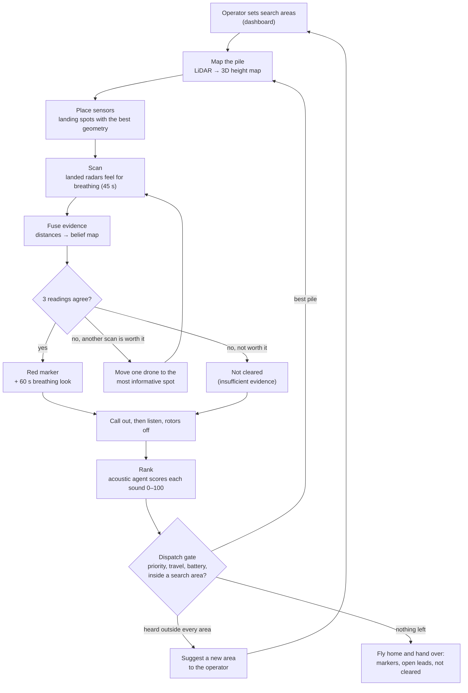
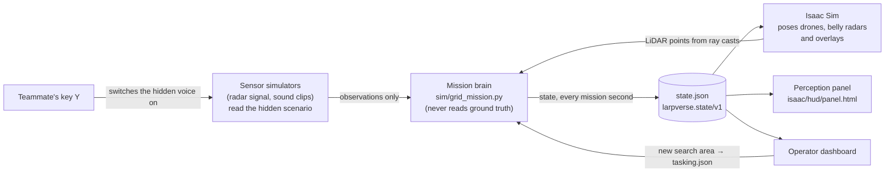

# Larpverse: what you are watching, explained

**AgentVerse 2026 · Robotics track.** This guide is for judges and anyone new to the field. Every technical term is explained when it first appears, and there is a [glossary](#9-glossary) at the end. Sections 1–7 take about 10 minutes to read; sections 8–11 are reference.

---

## 1. In one minute you will see...

Three heavy-lift rescue drones search a field of collapsed-building rubble for trapped people. Everything runs live inside **NVIDIA Isaac Sim**, a robotics simulator with real-time ray-traced graphics. The video is one continuous shot captured from the simulator's live stream: no cuts, no editing. On the left is the 3D view; on the right, a panel says in plain words what the drones are doing and what they are sensing.

The story starts at the command van. The drones lift off, map the first rubble pile with lasers, and land on flat spots so their belly radars rest on the rubble and feel for breathing. When three readings agree, a red marker tells rescuers where to dig first. Then the drones land beside the pile, switch their rotors off, call out through a loudspeaker in Mandarin, Taiwanese Hokkien and English, and listen for voices and knocking.

**The unscripted change.** At a moment they choose, a teammate presses a key that switches on a hidden, simulated voice near another pile. Nobody tells the drones. They can only notice it with their own microphones. If what they hear outranks the other leads, they re-plan and fly there, and the panel says **"Plan changed"** with the reason. The backup change is an operator drawing a new search area on the dashboard.

**Three things to know before you press play**
1. **It is a simulation, and it says so on screen.** The trapped people, their voices and the radar returns are synthetic.
2. **The drones are never told where the people are.** The decision-making code only receives sensor readings, as it would in the field.
3. **A red marker means "check here first", never "person found".** It marks a breathing-like rhythm: a lead, not a confirmed person. Where nothing was detected, the system says "not cleared", never "empty".

---

## 2. Why this matters

**The problem.** When a building collapses, some people survive in voids: air pockets under slabs and furniture. They can live for days, but the chance of a live rescue drops every hour. Rescuers face a huge, unstable pile and do not know where to dig first.

**A real example.** On 6 February 2016 an earthquake brought down the Weiguan Jinlong complex in Tainan, Taiwan. Reported figures:
- 114–115 people died in the building, and 175–289 were rescued alive.
- About 3,900 emergency workers responded.
- The last people were pulled out alive 52–60 hours after the quake. The search lasted 7–7.5 days.

Sources: [CASE_STUDY_WEIGUAN.md](CASE_STUDY_WEIGUAN.md). The video's site is a generic rubble field, not a model of that building.

**What rescuers do today.** They call out and listen in silence, use listening devices and search dogs, and carry radar life detectors onto the pile by hand, often standing on rubble that may shift. A wrong guess about where to dig can cost hours.

| Where drones help | Where they cannot (and we do not claim they can) |
|---|---|
| Reach and map the whole site in minutes, without anyone climbing on it | Cameras cannot see into voids under the rubble |
| Land a radar on rubble where no person should stand | Radar sees only about 3 m into rubble |
| Listen from three places at once, so they can tell which direction a voice came from | Listening only works with rotors off |
| Keep a ranked list of evidence: where to dig first, and why | They cannot dig, confirm a person or judge if a slab is safe. This build does not model wind, dust or aftershocks |

---

## 3. What you are watching

### The screen

The frame is split. The left two-thirds (1280 × 1080) is the live Isaac Sim stream from one moving camera. The right third (640 × 1080) is the perception panel (`isaac/hud/panel.html`), fed by the same run's files. From top to bottom, the panel shows:

| Part of the panel | What it shows |
|---|---|
| Top line | "● LIVE SIMULATION", the mission clock ("mission time 4:35"), and the current speed-up ("sped up ×24 (time-lapse)"). |
| Steps bar | Seven steps: Launch, Map, Radar, Listen, Live change, Re-plan, New area. The current one is lit. |
| Caption | One short title and one sentence about what is happening now. Each caption stays up for at least 5 seconds, so it can be read. |
| What the drones sense right now | A coloured tag (LIDAR, RADAR, SOUND, CHANGE, DECISION, FLYING), one plain sentence, and three to five numbers the drones actually measured. Examples: area mapped; laser points; breathing rate with its likely range; loudness above noise; how many drones agree on a sound's direction. |
| Radar trace | During a radar scan: the chest movement the radar measured, over the scan's seconds. White dots mark the breaths it counted. The scale is relative, because the radar measures the rhythm, not millimetres. |
| Places for rescuers to check first | Each red marker with its breathing pattern and a check-first hint, always with "Aid for rescuers, not a diagnosis." |
| Footer | "Simulation. The trapped people, their voices and the radar returns are synthetic; the drones never see where they are. A lead is a place to check, not a confirmed person." |

**Speed.** The mission is sped up by a different factor in each phase, and the panel always shows the current one:
- about ×6 for lift-off;
- ×7 while mapping;
- ×12 while the landed radars scan;
- ×24 for the drone moves between scans;
- ×17 while the drones listen;
- ×5 for the flight to the next pile.

The roughly 56-second take covers about 10.5 minutes of mission time. Nothing is cut or re-timed afterwards.

### Colour code

| Colour | Meaning |
|---|---|
| Purple dots | **LiDAR**, the laser scanner, mapping the rubble. |
| Orange | The **belly radars** of the landed drones, and the radar breathing trace on the panel. |
| Red marker | **Breathing-like signal**: a place to check first. A lead, not a confirmed person. |
| Yellow | The direction a human-like sound came from, as heard by each drone. |
| Teal | Sound: listening and acoustic priority. |
| Amber | The **CHANGE** tag on the panel: the unscripted live change. |
| Green | **Decision**: the swarm is flying to a new pile. |
| Blue | Rescue Wi-Fi and phones. This feature is switched off for this take. |
| White dashed outlines | Search areas set by the operator. |

### The minute, second by second

These times come from a laptop dry run of the same code and settings: seed 7, the take's pacing, rescue Wi-Fi off. A "seed" is the number that fixes where the invented people are and what they say, so the same seed always gives the same scenario. In the live take the teammate chooses the moment of the change, so times after it can shift by a few seconds.

| Video | Mission time | What you see | What it means |
|---|---|---|---|
| 0:00–0:04 | 0 s | The command van at the staging area; an operator at the screens; three drones on their pads. | Before launch the operator allowed all nine rubble piles to be searched (A1 to C3, 22 m apart) and picked pile A2 to start. That is the drones' only instruction. |
| 0:04–0:07 | 0–20 s | The drones spin up, lift off and fly north. | **Step 1, Launch.** |
| 0:07–0:14 | 20–65 s | The drones circle pile A2; purple laser points paint the rubble. | **Step 2, Mapping.** About 50,000 laser points become a 3D height map. From it the drones find 16 places where a drone can land with its radar resting on the rubble: a slope of 30° or less and enough clear space above to land. |
| 0:14–0:21 | 65–130 s | Each drone lands on a flat spot, so its belly radar rests on the rubble; the radar trace appears on the panel. | **Step 3, Feeling for breathing.** The three spots are chosen for the best geometry for **trilateration**: locating a source from several distance readings. Each landed radar scans for 45 s. One finds a breathing-like rhythm 2.2 m away. One finds nothing. One landed badly (seating quality 0.03 out of 1), so its scan counts for little. |
| 0:21–0:31 | 130–364 s | One drone at a time lifts off, flies to another spot on the pile, lands and scans again. | The drones pick each next spot as the one that should shrink their uncertainty most. After two more scans, three readings agree on one place (mission time 275 s). One drone's radar then takes a 60 s look to read the breathing pattern. |
| ~0:27 | 275 s | A red marker on pile A2. | **Breathing-like signal found.** Panel: "Slow, regular breathing, 9/min: could be deep rest or reduced consciousness; the radar cannot tell which, so call out and check responsiveness." The depth is not measured yet: the distances fix the position on the rubble, not how deep someone is. |
| 0:31–0:41 | 364–541 s | The drones land beside the pile; rotors stop. One plays a call-out in Mandarin, Hokkien and English; then all three listen. | **Step 4, Listening.** The drones hear voices and knocking from several piles. Each sound gets a direction, a loudness and a score for how human and urgent it is. |
| when the teammate chooses | | The CHANGE tag: "A teammate has just switched on a hidden voice near A1. Nobody tells the drones. They have to hear it themselves." | **Step 5, Live change** ([section 6](#6-the-unscripted-live-change)). |
| ~0:41 | ~541 s | DECISION: "Flying to …", with the voice's priority, how many drones agree on its direction, its loudness, and the next best option. | **Step 6, The swarm re-plans.** The swarm flies to the pile with the highest-priority evidence. The caption says "Plan changed" only when that pile is where the new voice came from. |
| 0:41–0:56 | 541–640 s | The drones fly to the new pile, map it and land again. | **Step 7, Searching the new area.** The same steps, in a new place. |

---

## 4. The drones and their sensors

### The drone

**Heavy-lift drones**: eight rotors in four stacked pairs (a "coaxial X8"), modelled on the **DJI FlyCart 30**. A big drone can carry a dense LiDAR, a belly radar, microphones and a loudspeaker, and flies longer. The cost is strong downwash and a big footprint, so it lands only on a flat spot that the LiDAR map shows to be gentle enough.

The DJI is the size reference for the simulation, not the build we would buy. That would be a **Harris Aerial H6HL**: a US-built ArduPilot hexacopter with the same 95 kg maximum take-off mass. It speaks the open MAVLink protocol and has an open payload power and data bus. We rejected the DJI Agras T50 because it is a spray drone with no payload interface. Details: [HARDWARE.md](HARDWARE.md).

| Property | Value | Source |
|---|---|---|
| Size | 3.1 m across, propellers unfolded | FlyCart 30 spec page |
| Mass | about 77 kg with sensors (95 kg maximum) | maximum from the spec; 77 kg is our estimate |
| Mission payload | about 14 kg: 6.0 kg of sensors and electronics, a 4.9 kg belly radar module and a 3.1 kg unallocated reserve | HARDWARE.md (estimates labelled) |
| Flight time with sensors | about 25 min | estimate between the spec's 29 min (empty) and 18 min (30 kg) |
| Batteries | 2 × 1,984 Wh; 25% reserve kept, packs swapped at the staging pads | spec, plus our rule |
| Cruise speed in the simulation | 10 m/s | our setting (spec maximum 20 m/s) |

### The sensors

| Sensor | What it physically does | Limits |
|---|---|---|
| **LiDAR** (Ouster OS1-128, tilted 45° forward) | Fires laser pulses and times their echoes, about 1.3 million points a second, to map the surface in 3D. The map shows where the drone can land. | Sees surfaces only, never inside the rubble. Isaac Sim casts fewer rays than the real device, to keep the frame rate up. |
| **Belly radar module** (4.9 kg) | Mounted on the drone's underside; the drone lands on a flat spot so the radar rests on the rubble. Carries the radar: a USRP B210 software radio sweeping 0.4–2 GHz, with antennas pressed onto the rubble. It also has 4 microphones, a Raspberry Pi 5 and a 99 Wh battery, and is cabled to the drone. | Needs a reachable flat spot that is not too steep. Each move costs a short flight plus landing and lifting off. |
| **Through-rubble radar** | Sends radio waves into the rubble and looks for a chest rising and falling a few millimetres, at 6–30 breaths a minute. Each scan gives a **distance** to that movement, not a position. | Concrete absorbs much of the signal. A 45 s scan from a landed radar sees a breathing chest through about **2.9 m** of rubble directly below it. From 11 m away it sees **less than 1 m**, which is why the radar rests on the rubble. On a firm signal the radar takes one extra 60 s look for the breathing pattern. |
| **Microphone ring** (8 mics on a 1 m ring) | With rotors off, records 26 s. Tiny time differences between mics give the **direction** of a sound. The sound is classed (voice, knocking, dog, engine...) and any words are transcribed. The radar module's 4 mics also take short listens while the drone is landed on the rubble. | Rotors must be off. Machinery and crowds on a real site make it much harder. |
| **Loudspeaker** (130 dB class) | "Call out and listen", standard rescue practice: calls out in Mandarin, Hokkien and English, then plays reassurance, and directions for anyone who can walk. | Used in this take. |
| **Also on board** | Jetson AGX Orin computer, Doodle Labs mesh radio, RTK GPS, an optional FLIR Hadron 640R+ thermal camera, navigation lights, and a GL.iNet rescue Wi-Fi hotspot. | Rescue Wi-Fi is off for this take. |

**From breathing to a check-first hint.** When a marker is firm, the radar's breathing trace becomes a plain-words pattern: calm and regular, rapid and shallow, slow and regular, irregular with pauses, or unclear. Each pattern gets a hint that follows the breathing criteria of the START/SALT triage systems rescuers already use. Two examples:
- "slow, regular breathing: could be deep rest or reduced consciousness; the radar cannot tell which, so call out and check responsiveness";
- "irregular breathing with pauses: check first".

There are no age guesses and no diagnosis: radar sees chest movement only. Code: `sim/vitals.py`.

---

## 5. How the swarm decides



### The key ideas in plain words

- **Trilateration.** One scan says "something breathing is 2.2 m from this radar", so the source lies on a ring around the radar. Two rings cross in a couple of places; a third settles which. That is why a marker needs three agreeing readings from spread-out landed radars.
- **Belief map.** Each small cell of the pile holds a probability that a breathing source is there. Every reading updates it. The glow on screen is this map.
- **Choosing the next measurement.** When readings disagree, the drones compare every possible next landing spot and pick the one that should shrink the uncertainty most. When no further scan would reduce it much, they stop rather than waste battery. (The numbers are in the glossary under *expected information gain*.)
- **Honest outcomes.** A pile ends as a **marker** (three agreeing readings), **insufficient evidence** (readings that do not agree) or **not cleared** (nothing detected). Never "empty": no detection is not proof of absence.
- **The acoustic agent.** After each listen, every sound is scored for how human, how urgent and how reliable it is, giving each pile a priority from 0 to 100. A dog or settling debris scores low, but its pile stays "not cleared".
- **The dispatch gate.** The swarm lists its options, checks travel time and the 25% battery reserve, and picks the best. Every decision is logged with its options and reasons. Here is a real gate from a laptop dry run (seed 7):

  | Option | Evidence | Priority | Travel | Lowest battery after |
  |---|---|---|---|---|
  | Fly to A3 | voice "Help! Can anyone hear me? My leg is trapped." | 76 | 23 s | 67% |
  | Fly to A1 | voice "… Ada yang bisa dengar … Kaki saya terjepit!" (Indonesian: "… can anyone hear … my leg is trapped!") | 71 | 23 s | 67% |
  | Fly to B2 | a shouted reply to the call-out | 64 | 24 s | 66% |
  | Stop and fly home | none | – | – | – |

  The highest priority wins, here A3. In this dry run the hidden voice at A1 had been switched on, but the voice at A3 was stronger, so the drones went to A3: the change is not rigged to win. The panel shows the winner and the next best option, so viewers can see what the drones weighed.

### Why we call it "agentic"

An **agent** senses, decides and acts toward a goal by itself, in a loop. Here the goal is "find the best place to dig, with evidence". Nobody scripts the drones' next step; each one is chosen from what they have just sensed.

| The operator decides | The swarm decides |
|---|---|
| Which areas may be searched; adding new ones | Where on a pile each drone lands |
| Whether to accept an area the drones suggest | Whether a reading is strong enough, or worth another scan |
| When to stop the mission | Which pile next, and when to go home for batteries |
| Who goes onto the pile (people only) | What to suggest to the operator, and why |

One mission brain (`sim/grid_mission.py`) plans for all three drones, so the "swarm" is a coordinated team, not three independent robots. In a real deployment the brain would run on the computer in the command van.

**Is there an LLM?** The rules above work without any AI service. When a Gemini key is present, Gemini also scores and transcribes the sounds and may choose at the dispatch gate. It may only pick from the planner's options, and code checks every pick (battery reserve, no claims such as "confirmed"). The log says which one ran. See [AGENTS.md](AGENTS.md).

---

## 6. The unscripted live change

**What happens.** Hidden in the rubble near pile A1 is a silent, simulated person: a training manikin, not shown to the drones. During the take, a teammate (not the camera operator) presses **Y** in the Isaac window at a moment they choose inside the trigger window. That switches the manikin's voice on: "Tolong! Ada yang bisa dengar saya? Kaki saya terjepit!" (Indonesian: "Help! Can anyone hear me? My leg is trapped!").

From then on, the sound and radar generators include that voice and that chest, coming from the manikin's position. The drones can only notice it with their microphones:
- in a short radar-module microphone listen while the drones are landed on the rubble (every 20 s, and it must be heard twice); or
- in the next rotors-off listen.

If the new voice outranks the other leads, the swarm re-plans and flies to A1. The panel shows the CHANGE tag, then "Plan changed" with the voice's priority and the next best option.

**The backup.** If the key fails, the operator draws a new search area on the dashboard. The mission re-reads the search areas every second (`tasking.json`), and the newest area is an order.

**Why this proves it is not a canned animation**
- **Without the key press, the voice does not exist.** The manikin is silent: A1 has nothing to hear, so its priority stays at 8 out of 100, and the drones move on to the next pile by its own evidence.
- **The drones never read the stage.** The key press reaches only the sound and radar generators, the panel and the camera, never the decision code. Automated tests check this (`tests/test_live.py`), and they also check that an untouched stage replays the scenario exactly.
- **Nothing is scheduled.** The scripted trigger used for testing refuses to run outside a dry run.
- **The timing follows the press.** Pressed while all three drones are landed on the rubble, the voice can be heard within a few seconds of video, in the radar modules' short listens. Pressed later, it is heard at the next rotors-off listen.
- **Every frame is computed live.** Isaac Sim poses each drone from the mission state, recalculated every mission second. There is no recorded flight path.

---

## 7. What is real and what is simulated

| Part | Real | Simulated |
|---|---|---|
| **Site** | | Nine rubble piles of broken slabs, chunks, walls and columns (seed 7), built by our generator. Not a real place. |
| **People** | None. | Invented people hidden in the rubble at random, drawn as partly buried training manikins (no injuries). The drones are never told where they are. |
| **Voices** | 126 audio clips: real recorded shouts (free, CC0-licensed) and text-to-speech voices in Mandarin wording, English, Indonesian and Vietnamese, plus knocks, weak voices, distractors and "through rubble" variants. In the take they play from the manikins' positions through the real listening pipeline: voice detection, sound classification (YAMNet), speech-to-text (Whisper) and direction finding. | The sound path through rubble is a model. The offline speech-to-text is English-only, so without Gemini the Indonesian voice may show as "voice-like, language not identified". A rehearsal may use a labelled synthetic stand-in. |
| **Radar** | The breathing signal processing is real code. On real radar recordings of resting people it measured breathing rate within 0.39 breaths a minute on average (open air, no rubble). | The raw radar signal is generated from the manikins' live positions. Absorption by rubble is a model built from published figures. |
| **LiDAR** | Isaac Sim casts rays against the 3D scene, and the brain maps from those points. The spec is a real product. | Fewer rays than the real device. |
| **Drones** | Sizes, maximum mass and sensors come from real products' spec pages (estimates are labelled in `sim/platform.py` and [HARDWARE.md](HARDWARE.md)). | Motion comes from our flight model: smooth paths, leaning into acceleration, flaring when braking. There are no aerodynamics, wind or flight controller. |
| **Decisions** | Real code, running live: mapping, landing-spot choice, evidence fusion, next-scan choice, call-out, ranking, dispatch. | Nothing faked. |
| **The live change** | A real person presses the key, at a moment they choose. | The voice they switch on is simulated. |
| **Graphics** | Real-time ray tracing on an NVIDIA L40S GPU. | Rubble textures are procedural (made in Blender), not photos of a real site. |
| **Time** | | Sped up per phase, and always shown on screen. |

**The ground-truth wall.** "Ground truth" is the hidden scenario: where the invented people really are. Two kinds of code may read it:
- **Sensor simulators** use it to generate what a radar or microphone would measure, the way a flight simulator generates the view out of the window.
- **Evaluators** use it to score a run afterwards.

The decision-making code never reads it. An automated test (`tests/test_grid_mission.py::test_brain_never_reads_truth`) checks its source for any access.

---

## 8. Under the hood (for technical judges)

| Layer | What we use |
|---|---|
| Simulator | NVIDIA **Isaac Sim 6.0.1** with Isaac Lab on a cloud **NVIDIA L40S** (48 GB), headless. |
| Live stream | Isaac's WebRTC livestream (`--livestream 2`). The capture is the stream next to the panel at 1920×1080, recorded on the GPU machine. |
| Rendering | RTX real-time ray tracing with DLSS (`--take-render`). Full path tracing takes about 6.5 s per frame, so it is never used for the live take. |
| Camera | `--camera director-take`: one continuous camera. Each change of shot is a smooth arc followed through spring smoothing, so it never cuts or jumps (tested in `tests/test_live.py`). |
| Mission loop | The mission brain steps on its own thread, so a slow sound or radar step never freezes a frame. The renderer samples the drones' trajectories every frame. |
| Site and look | The grid piles come from `sim/scenario.py`. Isaac re-materials them with dusty concrete, broken-concrete and brick textures (`isaac/grid_look.py`). The heavy drone and its belly radar are modelled in Blender at true scale (`isaac/tools/blender_drone.py`). |
| Panel | `isaac/hud/panel.html` reads the run's `state.json`, `live.json` and `hud.json` a few times a second. It only shows what the brain knows, never the hidden scenario. |



- The brain runs in the same Python process as Isaac Sim (`isaac/run_mission.py`), steps once per mission second and writes its full state to `state.json`. The format is fixed in [contracts/INTERFACES.md](../contracts/INTERFACES.md).
- Radar model:
  - a 0.4–2.0 GHz sweep (9.4 cm range resolution) and a 45 s landed-radar dwell;
  - concrete loss of about 10 dB/m below 1 GHz, rising to 20 dB/m at 2 GHz, on the solid share of the path.
  - Processing: range FFT → clutter removal → breathing-band detection (OS-CFAR) → phase → band-pass.
  - See [RADAR_PENETRATION.md](RADAR_PENETRATION.md).

---

## 9. Glossary

| Term | Meaning |
|---|---|
| **Agent / agentic** | Software that senses, decides and acts toward a goal by itself, in a loop. |
| **Swarm** | Several robots working as one team. Here, three drones coordinated by one mission brain. |
| **Isaac Sim** | NVIDIA's robotics simulator: a 3D world with realistic light and simulated sensors. |
| **USAR** | Urban search and rescue: the teams that search collapsed buildings. |
| **LiDAR** | "Light detection and ranging": a spinning laser that measures distances to map surfaces in 3D. |
| **Through-rubble radar** | Low-frequency radio that passes partly through concrete and detects the tiny movement of breathing. |
| **Belly radar** | The radar module mounted on the drone's underside. It rests on the rubble when the drone lands. |
| **Dwell** | How long the landed radar stays still on the rubble for one radar scan (45 s; 60 s for the breathing-pattern look). |
| **Range ring** | A radar scan gives a distance (range); every point at that distance forms a ring around the sensor. |
| **Trilateration** | Finding a position by combining distances measured from several known points. |
| **Belief map / posterior** | A grid of probabilities for where a breathing source is, updated with each reading. "Posterior" is the statistics word for the updated belief. |
| **Expected information gain** | How much a planned measurement should reduce uncertainty, measured in "nats". The drones move only if the best next spot is worth at least 0.2 nats. In the dry run the moves were worth 0.22–0.24 nats. |
| **Marker (ping)** | A candidate place to check, backed by three agreeing radar readings. "Check here first", never "person found". |
| **Insufficient evidence / not cleared** | Readings that do not agree / nothing detected. Neither means nobody is there. |
| **Call-out** | Rescue practice: shout "can anyone hear me?", then go quiet and listen for answers or knocking. Here the drones' loudspeaker does it in three languages. |
| **Bearing / DOA** | The compass direction a sound came from ("direction of arrival"), found from tiny time differences between microphones. |
| **Acoustic agent** | The step that scores each sound for how human, urgent and reliable it is, and ranks piles to search. |
| **SNR** | Signal-to-noise ratio: how much louder a signal is than the background, in decibels (dB). |
| **Tasking / dispatch** | The areas the operator allows the drones to search / sending the fleet to the next pile. |
| **Ground truth** | The hidden facts of the simulated scenario. The decision-making code never sees them. |
| **Seed** | A number that fixes the random scenario; the same seed gives the same invented people and sounds. |
| **Manikin / dummy** | A simulated person in the rubble, drawn as a training manikin. The drones are never told where they are. |
| **Hotkey** | A single key press in the simulator window, here Y, which switches the hidden voice on. |
| **Time-lapse** | Playing the mission faster than real time. The factor is always on screen. |
| **START / SALT** | Standard triage systems for deciding who needs help first. We use only their breathing criteria. |
| **Ray tracing, DLSS** | Physically based light simulation, plus NVIDIA's AI upscaling that keeps it real-time. |
| **WebRTC** | How Isaac streams its view to a browser. |

---

## 10. Questions judges often ask

**Is this a pre-rendered animation?**
No. The mission brain computes each step live and Isaac Sim draws the drones from it. A teammate switches on the hidden voice at a moment the drones cannot predict. Without the key press, the voice does not exist ([section 6](#6-the-unscripted-live-change)).

**Do the drones secretly know where the people are?**
No. Only the sensor simulators and the scoring code read the hidden scenario, and a test checks that the decision code never does. The manikins are drawn for you.

**Did they find someone?**
They found **evidence**: on pile A2, three radar distances that agree on one place. A 60 s look then found slow, regular breathing at about 9 a minute. It is a place for a rescue team to check, not a confirmed person, and its depth is not measured yet: distances fix the position on the rubble, not how deep someone is.

**One radar heard nothing. Was that spot empty?**
No. "No detection" never means "nobody there". That drone landed badly, so its radar seated poorly and its scan counts for little, and the radar only sees about 2.9 m down. The drones moved and scanned again rather than conclude anything from it.

**How good is the breathing detection, really?**
The signal processing was tested on real radar recordings: within 0.39 breaths a minute on average, but in open air at 0.4 m with resting volunteers. Through rubble, the signal comes from a model based on published figures: about 2.9 m of reach below a landed radar. It has not been tested through real rubble.

**Why heavy drones, and why land on the pile?**
Radar range collapses with distance. From 11 m away the model sees less than 1 m into rubble, while a radar resting on the rubble sees about 2.9 m. Carrying the 4.9 kg radar module together with the LiDAR, microphones and loudspeaker needs a heavy-lift drone, and the drone lands only on a flat spot chosen from the LiDAR map.

**Does listening help, and would this have saved lives in 2016?**
In a separate 30-seed simulation of a collapse site, sectors flagged by listening held 66% of the invented people, against about 1% for radar-only search orders with realistic radar. A first pass over all 8 sectors, each with a reason, took 9.5–12.5 minutes from launch; the 2016 search took days.

The caveats:
- listening there is idealised;
- there are about 10 invented people per seed rather than over a hundred;
- a real site is far noisier;
- getting drones on site takes time.

We make no claim about lives saved. Details: [CASE_STUDY_WEIGUAN.md](CASE_STUDY_WEIGUAN.md).

---

## 11. How to run it

The full plan is [VIDEO_PLAN.md](VIDEO_PLAN.md) and the brief is [ISAAC_BRIEF.md](ISAAC_BRIEF.md). In short:

```bash
L=/workspace/skysearch/larpverse
cd $L && python3 isaac/live.py --write-tasking default --out dashboard/data      # editable search areas, revision 1
python3 scripts/serve.py --port 8765 &                                           # dashboard, panel, /api/tasking
python3 isaac/live.py --preflight                                                # the real listening pipeline is ready
cd /workspace/isaaclab && ./isaaclab.sh -p $L/isaac/run_mission.py --live --livestream 2 --viz kit --enable_cameras \
    --site grid --seed 7 --photoreal 1 --veg 0 --camera director-take --overlay usd --radar dsp \
    --live-pace clear --comms 0 --hud off --overlay-style simple
# right column (640x1080): http://localhost:8765/isaac/hud/panel.html?state=../../dashboard/data/state.json
# the unscripted change: a teammate presses  Y  in the Isaac window, at a moment they choose
```

**No GPU?** The same mission runs on a laptop as a dry rehearsal (numpy, no graphics). The scripted trigger stands in for the key press and only works in a dry run:

```bash
cd larpverse
python3 isaac/live.py --write-tasking default --out /tmp/take
python3 isaac/run_mission.py --dry-run --live --camera director-take --acoustic stub --allow-stub-acoustic \
    --live-pace clear --comms 0 --max-steps 640 --out /tmp/take --test-trigger "activate:hidden2@300"
```

---

*Sources in this repo: [VIDEO_PLAN.md](VIDEO_PLAN.md), [ISAAC_BRIEF.md](ISAAC_BRIEF.md), [FROM_ISAAC.md](FROM_ISAAC.md), [HARDWARE.md](HARDWARE.md), [SEED7_STORY.md](SEED7_STORY.md), [CASE_STUDY_WEIGUAN.md](CASE_STUDY_WEIGUAN.md), [RADAR_PENETRATION.md](RADAR_PENETRATION.md), [RADAR_VALIDATION.md](RADAR_VALIDATION.md), [VITALS.md](VITALS.md), [DUMMY_AUDIO.md](DUMMY_AUDIO.md), [AGENTS.md](AGENTS.md), `sim/platform.py`, `sim/grid_mission.py`, `sim/vitals.py`, `isaac/live.py`, `isaac/run_mission.py`, `isaac/hud/panel.html`.*
