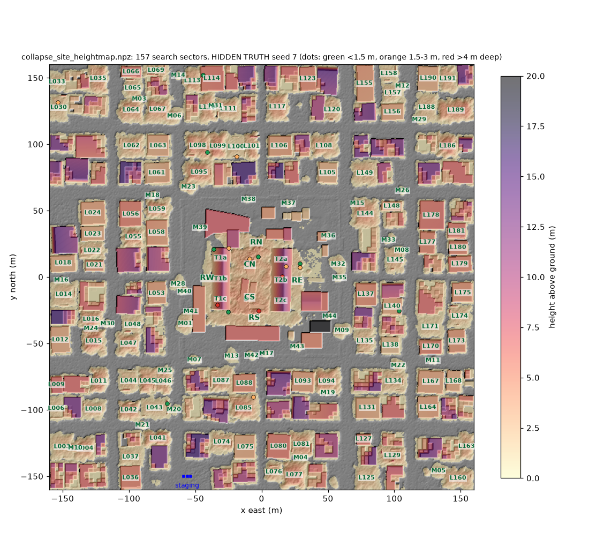
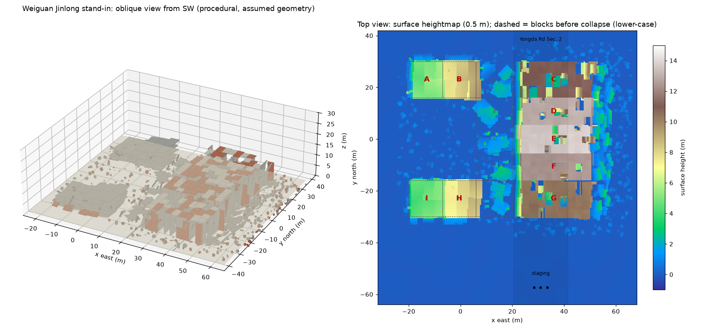
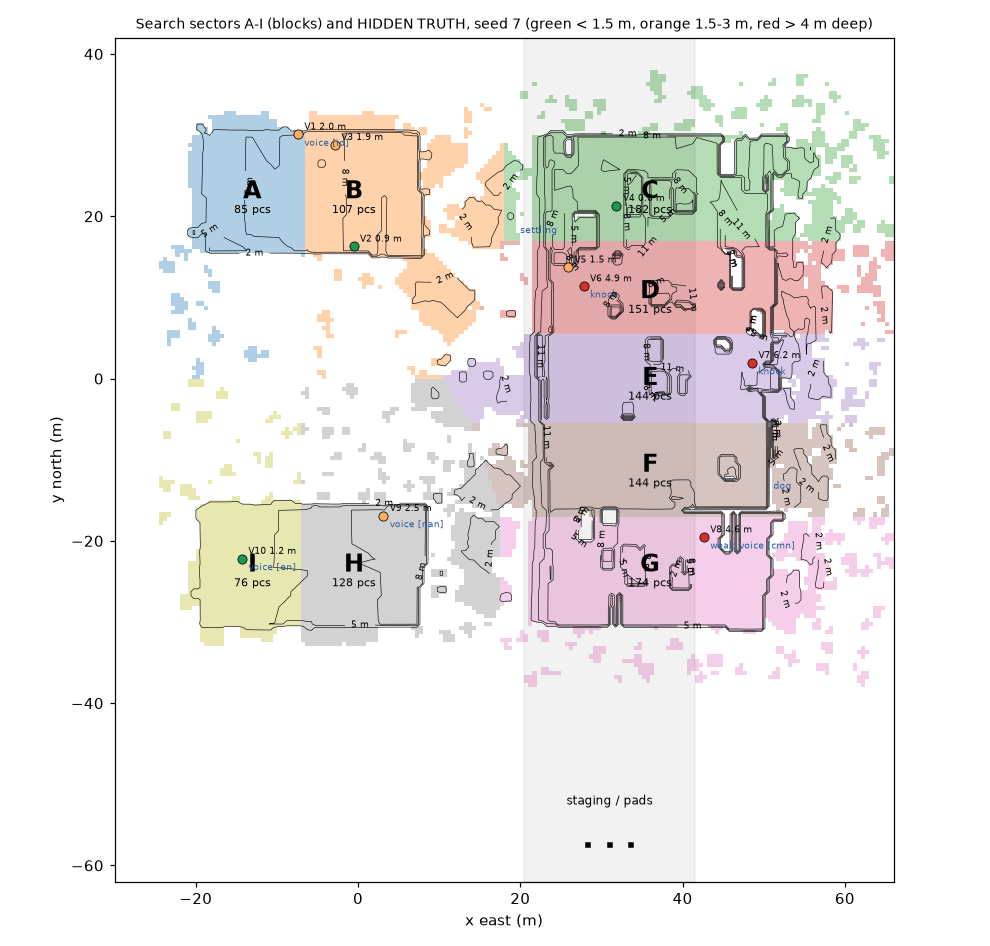
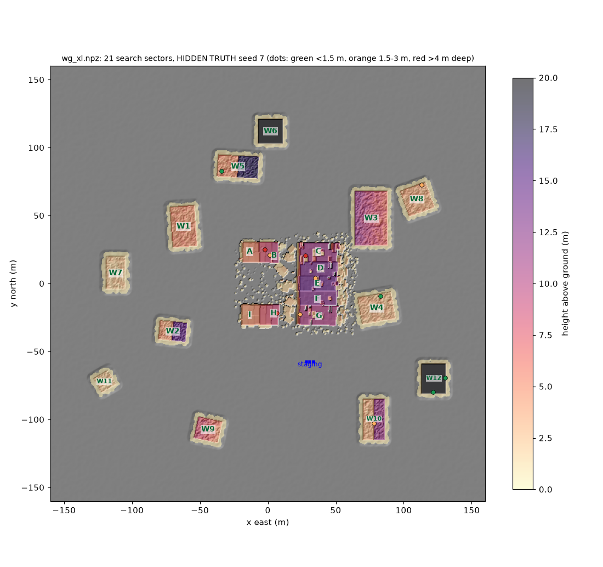

# Weiguan Jinlong case-study site

The demo can run on the Weiguan Jinlong building collapse (Yongkang District, Tainan, 6 Feb 2016)
in place of the synthetic 3x3 grid. There are two sources:

| Site | Call | Status |
|---|---|---|
| **Collapse site (primary demo)**: the Isaac teammate's 320 m map built from the scan | `make_scenario(seed, site="collapse")` (alias `weiguan-real`), `sim/site_collapse.py` | ready; see the next section |
| Procedural stand-in | `make_scenario(seed, site="weiguan")`, `sim/site_weiguan.py` | ready; fallback; keeps sim, dashboard and animation consistent |
| External map (Isaac team's mesh, expanded district) | `make_scenario(seed, site="mesh:<path>[?sectors=weiguan]")` or `make_scenario_from_mesh(path, ...)`, `sim/site_mesh.py` | loader ready; tested on a procedural stand-in of the expanded map |
| Synthetic grid | `make_scenario(seed)` / `site="grid"` | default, unchanged (seed-7 public JSON md5 `c4ad614a…`) |

Both return the same `Scenario` structure (piles = search sectors, `ground_height`, `heightmap`,
`public_dict`, hidden `truth`), so GridWorld and the mission work unchanged. Before running a mission on a
non-grid site, the mission and Isaac code have to stop using the module constants (see "Integration").

## Collapse site (primary demo)

Source: the Isaac teammate's `collapse_site/` (team repo branch `3d_model`). Entry file: `collapse_site.usda`
(sublayers `geo/terrain.usdc`, `geo/buildings.usdc`, `geo/debris.usdc`). It is 320 x 320 m in our frame
(metres, x east, y north, z up; origin = centre of the scanned Weiguan site). It contains:

- the two fallen 16-storey towers and the broken floor plates, rebuilt from the photogrammetry screenshots
- 13 scanned buildings
- 193 procedural lots: 63 collapsed, 41 pancake, 48 standing, 32 tilted, 9 open
- 44 rubble mounds
- terrain tiles with colliders
- 56k debris instances (visual only)

**Heightmap.** Built with usd-core from the terrain and building meshes (1.89 M triangles; debris and the
2 km horizon apron are skipped). It is max-z rasterised at 0.5 m over [-160, 160]² into 640 x 640 cells. The
surface spans -0.25 to 24.0 m (99th percentile 13.6 m; 51 % of cells are more than 1 m above ground). No
cells were empty. Bare ground is a morphological opening of the surface, which comes out at street level
(about 0 m).

- Rebuild: `.venv/bin/python -m sim.site_collapse --build [--usd <collapse_site.usda>]`. Output goes to
  `data/maps/` (gitignored).
- Committed copy: `assets/maps/collapse_site_heightmap.npz` (1.6 MB). The sim and the dry run don't need the USD.
- USD search order: `--usd`, then `$LARPVERSE_COLLAPSE_SITE`, then `<repo>/collapse_site/`, then
  `<repo>/../collapse_site/` (the teammate's `skysearch/collapse_site/` next to `skysearch/larpverse/`), then
  `assets/collapse_site/`, then `../collapse_site_src/collapse_site/`.

**Sectors (157).** The footprints come from the teammate's generator, imported read-only
(`generator/sitecfg.py`, `outer_layout.make_layout()` = the layout baked into the USD). Lot `L###` is the USD
prim `Surroundings/<type>_###`.

| Sectors | Count | What |
|---|---|---|
| `T1a` `T1b` `T1c`, `T2a` `T2b` `T2c` | 6 | the west and east fallen towers, in thirds from north to south (ridges 9.7 m and 11.7 m) |
| `CN` `CS` | 2 | the rubble field between the towers, with the floor plates (about 6 m) |
| `RN` `RS` `RW` `RE` | 4 | core rubble zones around the towers |
| `L###` | 104 | collapsed (63) and pancaked (41) lots |
| `M01`..`M44` | 41 | rubble mounds (3 tiny ones fall below 0.5 m / 12 m² and are dropped) |

The real A–I block letters cannot be mapped onto the two scanned towers with any confidence, so they are
named T1/T2.

Standing buildings and tilted lots are not sectors. The 13 scanned buildings and 80 lots are listed in
`site_info.obstacles` with their polygon and estimated height (tallest: the SE tower at 24 m), and their cells
are cut out of the sector masks.

Every sector has a CCW `polygon` on `piles[]` and on `sectors[]` (contracts v1.2.1), plus `kind`, `usd_prim`,
`area_m2`, `max_h`, `centre` and `bbox`.

Check with `sim.recon.segment_mounds` on the full heightmap:

- 152 of 157 sectors are covered by a recon mound. The 5 that are not are low mounds under recon's
  thresholds.
- 24 recon proposals fall outside every sector. They are standing or tilted buildings (6–14 m) that recon
  does not classify as standing. See Requests.

**Staging.** An open lot at the south edge beside the N-S street x = -63.5: base (-56, -152.5), pads
(-58.6 / -56 / -53.4, -150). It is 16 x 9 m and clear to under 0.3 m. Every street intersection has wreckage
within 8 m.

**Truth.** Generated by `make_truth`, with RNG salt 2018. The start sector (the reported collapse) is one
of the tower thirds. The eight acoustic roles (3 voices in cmn/nan/en/id, a weak voice, 2 knocks, a dog,
settling) sit in the 12 core sectors. About 8 silent victims are spread over the lots and mounds.

Seed 7: start T1a, 22 victims, 3 deeper than 4 m. Depth is measured below the 0.5 m heightmap, and `z` is
absolute. A mesh has no explicit voids, so victims are placed under covered cells near steep faces.

**Isaac:**

    ./isaaclab.sh -p <skysearch>/larpverse/isaac/run_mission.py --site collapse \
        --site-usd <skysearch>/collapse_site/collapse_site.usda --headless --show-truth --speed 4
    # options: --site-lights auto|site|ours|both, --no-scan-textures, --photoreal 1

What this does:

- `isaac/scene.py` references the USD at `/World/CollapseSite` and keeps our physicsScene. It builds no terrain
  or boxes of its own; the site's triangle-mesh colliders take the PhysX LiDAR rays (checked with usd-core: 600
  site meshes, all with CollisionAPI). Staging props and the truth ghosts (at `v["z"]`) are added as usual.
- `--site-lights auto` keeps the site's Sun/Sky, except under `--photoreal`, where ours replace them. In that
  case `/World/CollapseSite/Lights` is deactivated.
- `--photoreal` adds no extra debris scatter, because the site has its own.

**Licence: `--no-scan-textures`.** The core textures come from screenshots of a third-party photogrammetry
model (NCKU Museum on Sketchfab; licence unknown, and it may carry a NoAI tag). Before showing the site
publicly, check that licence and credit the author if it is CC-BY.

Until that's cleared, run with `--no-scan-textures`. It blanks every texture file named `scan_*`,
`facade_tower*` and the four core terrain albedo tiles (`terrain_r1c1/r1c2/r2c1/r2c2`). OmniPBR then falls
back to its constant colour, and UsdUVTexture to a grey fallback. This is checked in usd-core; on the GPU it
is best effort. The geometry is derived from the same screenshots too, so `--no-scan-textures` does not make
the site licence-clean.

## Procedural stand-in

## Sources (facts used)

- zh.wikipedia 維冠金龍大樓: anchor 23.0051432 N, 120.2608904 E; 16 storeys + 1 basement; nine blocks
  A–I in a U shape facing west; toppled from west to east across Yongda Road Section 2 ("horizontal
  collapse"); roughly a third of the structure stayed above ground.
- The NCKU Museum photogrammetry model (Sketchfab) has no stated licence or download, so it is not used.

## Assumptions (procedural stand-in)

Everything below is a modelling choice, not a survey.

- **Frame**: metres, x east, y north, z up; origin = the wiki anchor, taken as the centre of the original
  footprint; street level z = 0 (flat).
- **Footprint** ~40 m E-W x 60 m N-S. A spine of five 14 m-deep blocks along the east side (x 6..20) and
  two 14 m-deep wings to the west (y 16..30 and -30..-16), so the U opens west. Block letters run
  round the U from the north-west tip: A B (north wing), C (NE corner), D E F (spine), G (SE corner),
  H I (south wing). The real lettering is not known to us.
- **Storey pitch** 2.9 m. **Yongda Road Sec. 2** runs N-S right east of the spine, x 20.5..41.5
  (21 m incl. sidewalks).
- **Collapse**: the spine pivoted about its east base edge and lies on its side across the road (x 21..~58).
  Floor slabs are near-vertical "fallen books": storeys 1–3 crushed tight at the base, 4–13 ~2.9 m apart
  (room voids ~2.6 m wide), 14–16 shattered past the far kerb. The former courtyard facade is now the top
  surface at 10–14 m (C 11, D 13, E 13.8, F 12.4, G 10.2 m), with ~24 % of panels missing: openings into
  the room voids. Former N-S partitions are horizontal shelves or lean-to wedges inside the rooms; E-W end
  walls stay vertical. The old spine footprint keeps a crushed basement layer and sheared column stubs
  leaning east. The wings pancaked in place (5–7 layers, 0.6–1.2 m pancake voids), dragged east; tops
  A 5.2, B 8.6, H 8.0, I 4.8 m. 430 chunks of spill across the road, round the ends and into the courtyard.
- **Sectors** = blocks, mapped to where their debris lies: A (-13, 23), B (-0.5, 23), C–G at x = 36 on the
  toppled stack (y 23, 10.7, 0, -10.7, -23), H (-0.5, -23), I (-13, -23). Pieces belong to the nearest
  centre. Each sector also has a low Gaussian core mound (1.4–3.4 m, same formula as the grid) for the
  compacted rubble that boxes don't model.
- **Staging** on Yongda Road south of the debris at (31, -55), assumed closed to traffic; pads
  (28.4 / 31 / 33.6, -57.5). Bounds (-32, -64, 68, 42): 200 x 212 cells at 0.5 m.
- Geometry uses a fixed RNG (one real site): 1191 boxes (C 182, D 151, E 144, F 144, G 174, A 85, B 107,
  H 128, I 76).

## Hidden truth

Separate RNG streams (`[seed, 2016, 1]` placement, `[seed, 2016, 99]` physiology); geometry never depends on
them. `make_truth` (shared with the mesh loader):

- Start sector (reported collapse spot) gets a shallow, radar-findable survivor (+ a second one 60 %).
- One acoustic role per other sector: voice x3, weak_voice, knock x2, dog, settling. The knocks and the
  weak voice go to sectors with > 5.5 m of cover, at 4–7 m depth: radar-unreachable, acoustic-only.
- Victims sit in free space (not inside any box, 0.35 m above the core) under cover: `depth` = height of the
  0.5 m heightmap minus `z` (same definition as `GridWorld.target_position`), plus `z` (absolute),
  `face_dist` (3D distance to the nearest exposed surface), `depth_class`, `radar_reachable` (<= 3 m),
  `physio` (every breathing state appears once), `breathing_hz` (0.2–0.33, grid convention).
- Voices are multilingual: `lang` cmn / nan (Taiwanese Hokkien) / en / id, `text` for TTS, `tts_lang`,
  `fleurs` code (FLEURS has no Taiwanese: use TTS), `text_en`, `romanised`. The Hokkien lines are
  approximate; have a speaker check them before they go on camera.
- Within a sector, victims are sorted shallowest first (the radar generator uses the first).
- Seed 7: start B; 10 victims, 3 deep (D 4.9 m knock, E 6.2 m knock, G 4.6 m weak voice), 7 within reach.

## Verification

- `tests/test_site_weiguan.py` (7 tests, ~3 s): grid seed-7 public + truth md5 unchanged, determinism,
  geometry independent of seed, 9 sectors A–I, pieces in bounds (<= 2000), victims in voids with
  consistent depth, 4 languages, GridWorld windows, mesh `.npz` / `.ply` loading, expanded map naming.
- Exporter: grid `scenario_seed7.js` regenerates byte-identical to HEAD; `--site weiguan` writes
  `animation/scenario_weiguan.js` (183 KB).
- Mission (with the module constants monkeypatched, since `grid_mission` has no `--site` yet):
  `--seed 7 --radar dsp --acoustic stub` visits B -> A -> H -> I -> D in 788 s sim; pings B-R1, A-R1, H-R1,
  I-R1 land within 0.4 m of the true victims; D ends "insufficient evidence" (landing sites 9–16 m off the
  victim on the stack); E (deep knock) stays an open lead when the 24-scan budget runs out.

## Sending us a map (interchange format)

Send whichever is easiest; all in the **site frame**: metres, x east, y north, **z up**, origin at the
anchor above (23.0051432 N, 120.2608904 E), z = 0 at street level.

1. **Heightmap `.npz` (preferred, simplest)**, `np.savez_compressed`:
   - `origin` float[2]: (x, y) of the lower-left corner of cell (0, 0); `res` float: cell size (0.5 m)
   - `z` float32[h, w]: top surface (max height) per cell, row-major, **y outer** (row j = y), NaN = no data
   - optional `ground` float32[h, w] (bare ground under the rubble) or `ground_z` scalar; otherwise we
     estimate it (morphological opening, 110 m window)
   - optional `footprints`: JSON string `{"W1": [[x, y], ...], ...}`: one polygon per building (debris
     extent). Sector names come from here.
   - optional `meta`: JSON string with `geo` {lat, lon, bearing_deg, name}, `base_xy`, `drone_pads`,
     `sectors` {name: [x, y]} (centres; e.g. Weiguan blocks A–I).
2. **Decimated mesh** `.ply` (ascii or binary little-endian, triangles or polygons) or `.obj`, same frame,
   ideally with the ground plane included (otherwise empty areas take the lowest vertex height). Y-up
   exports: add `?up=y` to the site string. A point cloud `.ply` (no faces) also works.
3. **USD** `.usd/.usda/.usdc`: read with `pxr` (metersPerUnit and upAxis honoured) once usd-core is in
   `.venv`; until then export one of the above.

Decimate to <= ~1 M triangles; 0.5 m detail is all the planner uses. Building footprints are worth the
effort: without them sectors are connected components above 1 m, split by k-means above 900 m², named
W1..Wn by distance from the anchor (`W3a`, `W3b` for splits). With `?sectors=weiguan` (or `meta.sectors`)
the central wreck is cut into the block sectors A–I.

    .venv/bin/python -m sim.site_mesh their_map.npz --sectors weiguan --render /tmp/map.png --public-out /tmp/pub.json
    .venv/bin/python -m sim.scenario --site "mesh:their_map.npz?sectors=weiguan" --out /tmp/sc.json

A mesh scenario has no box pieces: `ground_height` returns the loaded surface, so Isaac's terrain mesh,
the LiDAR ray-caster and GridWorld all see the rubble. Victims go to covered cells near steep faces
(70 % bias), `z` checked to be above the estimated ground; voids are not known, so they are not checked.

## Expanded map (HYPOTHETICAL surroundings)

Weiguan in the centre plus twelve damaged buildings within ~150 m (`EXPANDED_LAYOUT` in
`sim/site_mesh.py`). **These buildings are fictional**: in the 2016 earthquake Weiguan was the only
collapse in this block. They give a district-scale search: several wreck types, a standing 12-storey
block as a flight obstacle, ~21 sectors. Yongda Road and the staging area stay clear.

| Name | Centre (m) | Footprint (m) | Storeys | State |
|---|---|---|---|---|
| W1 | (-62, 42) | 18 x 30 | 7 | pancake |
| W2 | (-70, -35) | 20 x 14 | 5 | partial (half standing) |
| W3 | (72, 48) | 16 x 40 | 8 | lean (toppled, lying heap) |
| W4 | (80, -18) | 25 x 20 | 4 | pancake |
| W5 | (-22, 86) | 30 x 16 | 6 | partial |
| W6 | (2, 112) | 18 x 18 | 12 | standing, damaged (36 m: obstacle) |
| W7 | (-112, 8) | 14 x 24 | 3 | pancake (shophouse row) |
| W8 | (110, 62) | 20 x 20 | 5 | pancake |
| W9 | (-42, -108) | 22 x 16 | 6 | lean |
| W10 | (78, -100) | 16 x 30 | 4 | partial |
| W11 | (-120, -72) | 12 x 12 | 3 | pancake |
| W12 | (122, -70) | 18 x 22 | 7 | standing, damaged |

`python -m sim.site_mesh out.npz --synth` writes this as a 640 x 640 `.npz` in the interchange format
(Weiguan stand-in pasted in the centre, footprints and meta included), so the loader, mission and dashboard
can be exercised before the real export lands. Loading it takes ~0.5 s; the mission (patched) runs it
but stops at the first sector because the drones hit the 18–36 m standing parts (see below).

## Integration (owners: mission, Isaac, animation)

- `sim/grid_mission.py`: take `site=` / `--site`, call `make_scenario(seed, start_pile, site=site)`, and use
  `getattr(sc, "bounds" | "base_xy" | "drone_pads" | "geo", <module constant>)` instead of `SITE_BOUNDS`,
  `BASE_XY`, `DRONE_PADS`, `SITE_GEO`; site name in `state.site.name`.
- Flight: cruise altitude must clear the tallest terrain on the leg (W6 36 m, W12 21 m, Weiguan 14 m).
- `sim/acoustic_grid.py`: `PILE_NAMES` is hard-coded to A1..C3 (only affects the RNG salt for excluded
  piles); use the scenario's pile names.
- `isaac/scene.py`, `isaac/photoreal.py`, `isaac/run_mission.py`, `mapping/slam.py`: same constants;
  `run_mission.py` needs `--site`. Victim capsules: use `v["z"]` when present (depth is below the
  heightmap, which on Weiguan is the facade top, not `ground_height`).
- Animation: `scenario_weiguan.js` has the same layout as `scenario_seed7.js` plus `site`, `bounds`,
  `geo`, `site_info` (road, blocks before the collapse) and `story.victims[].y` / `lang`; the terrain grid
  follows the bounds.
