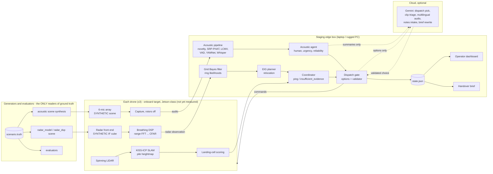

# Larpverse: technical report

**Autonomous multi-drone search of collapsed-building rubble.** AgentVerse 2026, robotics track.
Case study: the Weiguan Jinlong building collapse, Yongkang District, Tainan, 6 February 2016.

Status: 2026-11-07, written against commit `9907ad6` plus the uncommitted work of other builders noted inline. Short version: [TECHNICAL_REPORT_ABSTRACT.md](TECHNICAL_REPORT_ABSTRACT.md).

> **How to read this report.** Every number has a source (a doc, a file or a command) and a caveat. "Real" means real-world data or a real library. "Synthetic" means we generated it. The system produces **candidate search regions** and a **pile priority list** for rescuers. It does not detect, confirm or diagnose anyone. Silent piles are **not cleared**.

## Open placeholders

Other builders are producing these inputs now. Each «PENDING» marker in the text points to one row below. None of these numbers may be quoted until the source doc exists.

| Marker | Fills from | State at writing |
|---|---|---|
| «PENDING: EVAL-GRID» | `docs/EVAL_GRID.md` (`sim/evaluate_grid.py`: acoustic dispatch vs nearest-first vs raster, N seeds) | doc absent |
| «PENDING: ACOUSTIC-REAL» | `docs/ACOUSTIC_VALIDATION.md` (`acoustic/validate_real.py`: DroneAudioSet, ESC-50, teammate recordings) | doc absent; `docs/acoustic_real_validation.png` exists, uncommitted |
| «PENDING: ACOUSTIC-GEMINI» | `docs/ACOUSTIC_GEMINI.md` (`acoustic/eval_gemini.py`: stage-1 recall / false-forward, stage-2 language ID, CER, translation F1, latency, cost) | doc absent; modules committed in `06013f5`, not yet wired into the mission |
| «PENDING: VITALS» | `docs/VITALS.md` (`scripts/validate_vitals.py`, `sim/vitals.py`) | doc absent; `docs/vitals_validation.png` exists, uncommitted |
| «PENDING: RADAR-PEN» | `docs/RADAR_PENETRATION.md` (sources and calibration of the penetration model; decision on the default preset) | doc absent; code landed in `0eab65b` |
| «PENDING: SITE-WEIGUAN» | `docs/SITE_WEIGUAN.md` (`sim/site_weiguan.py` assumptions) | doc absent; `docs/img/weiguan_site.png`, `weiguan_sectors.png` exist, uncommitted |
| «PENDING: B5-RERUN» | `python -m sim.evaluate --n 30 --budget 6` on current code | only a 16:33 run on older code |
| «PENDING: SEED7-RERUN» | seed-7 demo mission after the acoustic fix (BL-3, `eb8cdba`) and the coordinator outlier rule | latest committed-state run predates both |
| «PENDING: ISAAC-CLIP» | re-recorded Isaac footage (teammate, after R2-002) | first recording has no ping (R2-005) |
| «PENDING: GEMINI-LIVE» | first live Gemini dispatch run (BL-11) | key saved 19:58; first calls hit HTTP 429, logged as `fallback` |

---

## 1. Problem and operational context

### 1.1 Urban search and rescue in collapse rubble

After a building collapse, people who survive are usually trapped in **voids**: spaces left between pancaked floor slabs, beside stairwells and under leaning walls. Urban search-and-rescue (USAR) teams locate them with search dogs, listening devices, search cameras pushed into gaps, and sometimes radar life detectors, and then dig or breach towards them. Each breach takes hours, so the questions that decide the outcome are **which pile to work first** and **where on that pile to dig**.

The decision-maker is the **incident commander or USAR team leader** at the site. They have few crews and few devices. They need to know three things: where to look, how sure the evidence is, and what has not been checked yet. A false "person found" alarm costs crew-hours. A false "nobody here" can cost a life.

### 1.2 Why cameras and thermal imaging are not enough

- **RGB and thermal cameras see surfaces.** A person under 1–2 m of concrete has no line of sight to any camera. Rubble is also a good thermal insulator, and its surface temperature is driven by sun and weather, so it hides a buried body's heat signature.
- **Sound travels through gaps,** so voices, knocks and tapping can reach the surface. But rotor noise from a hovering drone swamps it. This is why our drones **land and stop their rotors** before listening.
- **Low-frequency radar** (roughly under 3 GHz) can partly penetrate rubble and pick up the millimetre chest motion of breathing. Higher bands (24 and 77 GHz mmWave) do not get through concrete (`docs/RESEARCH.md`). Penetration is limited to a few metres at best (§4.2.3).
- **Terrain is hazardous.** Placing sensors by hand means people climbing unstable piles. Drones can place sensors without that exposure. But a flat landing spot says nothing about whether the pile below is structurally safe (§9).

### 1.3 Triage

Field triage (START, and SALT for mass casualties) sorts people by respiration, perfusion and mental status. A radar can observe only one of these: chest-wall motion. Our vital-sign features therefore produce at most a **respiratory triage hint** for ordering the dig (§4.2.6). They are an aid for rescuers, never a diagnosis.

### 1.4 Case study: Weiguan Jinlong building, Tainan, 2016

The facts below are from the sources the dashboard cites (zh.wikipedia 維冠金龍大樓; Taipei Times, 22 Feb 2019), checked in commit `5429e92`:

- On 6 February 2016 at 03:57 local time, a magnitude 6.4 earthquake centred in Meinong District, Kaohsiung, struck southern Taiwan.
- The Weiguan Jinlong building was a residential complex from the early 1990s: 16 storeys plus a basement, in nine blocks (A–I) in a U shape facing west.
- The whole building toppled from west to east across Yongda Road Section 2. 115 people died there. The search was declared over on 13 February.
- Anchor used for the site frame: 23.0051432 N, 120.2608904 E (`sim/scenario.py: SITE_GEO`).

We use the case study for **framing and geometry only**. The 3×3 demo grid is synthetic. The Weiguan site model (§3.4) is a procedural stand-in built from public descriptions, not a survey. Victim positions in our scenarios are invented and say nothing about the real event.

---

## 2. System overview

### 2.1 Architecture



The loop for each pile: **survey → land → radar → (relocate → rescan)* → ping or insufficient evidence → listen → rank → dispatch**. The same seeded scenario (`sim/scenario.py`) drives the numpy simulator, Isaac Sim and the dashboard.

### 2.2 Where each component runs

This is the intended deployment split. **Today everything runs on one laptop CPU with no GPU, and Isaac runs on a cloud L40S.** No component has been timed on drone hardware.

| Component | Intended host | Measured today |
|---|---|---|
| LiDAR odometry (KISS-ICP), pile map, landing cells | drone | 0.38 s registration per 23k-point sweep on the laptop CPU (300 sweeps: 114 s), offline (`map_B2/metrics.json`) |
| Radar breathing DSP | drone | not separately timed |
| Mic capture | drone | n/a |
| Bayes fusion, EIG planner, ping logic | staging edge | 0.71 s mean compute per single-pile mission (30 seeds, `eval/results.json`, older code) |
| Acoustic pipeline and agent fallback | staging edge | ≈81 s wall per 26 s listen on the laptop CPU, cache miss (review pass 1); needs a GPU or smaller models for real time |
| Dispatch gate, brief, dashboard | staging edge | n/a |
| Gemini | cloud, optional | 25 s timeout (acoustic 60–90 s), one retry; latency «PENDING: GEMINI-LIVE» |

Without a network or key, every LLM step falls back to deterministic code, and recorded answers replay offline (§6).

### 2.3 Data flow and contracts

Frames and schemas are fixed in `contracts/INTERFACES.md`: site frame in metres, x east, y north, z up, origin at the rubble centre; bearings in degrees counter-clockwise from +x; time in sim seconds. Drones receive commands (`goto_land_scan`, …) and return **radar observations** (`range_candidates`, `confidence`, `quality`, `breathing_hz`, `doppler_moving`, `max_reliable_depth_m`) and **acoustic clips** (bearing, cone width, class, transcript, scores). The coordinator writes one `state.json` (schema `larpverse.state/v1` with grid extensions v1.1) that the dashboard polls every second.

### 2.4 The ground-truth boundary

The scenario holds hidden truth: victim positions, depths, breathing patterns, sound sources. Only three kinds of code may read it:

1. **Observation generators:** `sim/radar_model.py` and `sim/radar_dsp.py` (via the scene description it is given), and `acoustic/scene.py` (scene synthesis).
2. **Evaluators:** `sim/evaluate.py`, `sim/evaluate_grid.py`, `acoustic/eval_assign.py`, `acoustic/eval_gemini.py`.
3. **Display-only ghosts** in Isaac under `--show-truth`, for video.

The localiser, planner, coordinator, grid mission, agents and dashboard never read it. `tests/test_grid_mission.py::test_brain_never_reads_truth` greps the brain modules for `.truth`, `.targets` and `victims`, and `tests/test_agents.py` asserts that `truth`/`targets` keys never reach a prompt. One leak is documented: the `--acoustic stub` path fabricates clips from truth (fast, for tests and evaluation). It labels itself `acoustic_source: "stub-from-truth"`, logs a warning at every listen, and the dashboard shows a banner.

---

## 3. Simulation environment

### 3.1 Scenario generator (`sim/scenario.py`)

One integer seed fixes the whole site. The demo uses seed 7.

| Parameter | Value |
|---|---|
| Layout | 3×3 piles, columns A/B/C west→east, rows 1/2/3 north→south, 22 m spacing, centres jittered ±1.5 m |
| Pile mound | peak height 2.6–3.7 m, semi-axes 5.0–6.2 m × 4.4–5.6 m, random rotation and lump |
| Pieces per pile | 40 slabs (1.2–3.4 × 0.8–2.2 × 0.14–0.3 m, tilted ±32°), 26 chunks (0.3–1.0 m), 0–2 columns, 50% chance of a 5-segment brick wall stub; concrete or brick. Seed 7: 621 pieces |
| Site | bounds x −36…36, y −54…36 m; staging at (0, −47); three pads at y = −49 |
| Heightmap | 0.5 m cells, mounds plus rasterised pieces |
| Hidden truth | start pile always holds victim V1 (depth 1.2–1.9 m); the other eight piles are shuffled over {voice, weak voice, knock, dog, generator, settling debris, silent ×2}; voice, weak-voice and knock piles hold a victim (depth 0.8–1.8 m, within 2.8 m of the centre); breathing 0.2–0.33 Hz; a physiological state per victim (§4.2.6) |

Seed-7 roles (truth, for evaluation only): A2 start (V1, breathing only), A3 voice "Help! Can anyone hear me? My leg is trapped." (V2), B1 weak voice "hello… is anyone there… water…" (V3), B2 knocking (V4), C1 generator, C2 dog, B3 settling debris, A1 and C3 silent. Map: `docs/img/isaac_grid_map.png`.

**Known bias (R1-007, open).** V1 is always placed at the start pile, so the first ping is guaranteed by construction. We state the assumption as "the start pile is the reported collapse point with a known missing person". `sim/evaluate_grid.py` also reports its metrics without that victim.

### 3.2 Flight and battery model

Flight is **kinematic**: no flight controller, aerodynamics or wind. Drones fly straight legs at an 8 m cruise altitude (staggered per drone, and at least 3 m above the terrain on the path), 4 m/s horizontal, 2 m/s climb, 1.2 m/s descent (`sim/coordinator.py: KinematicFlight`). The battery model is a rough budget, not a measured airframe: 0.16% per second of flight, 16% per pile (survey, landings, scans, listen), a 25% reserve, and a 60 s pack swap at the pads (`sim/grid_mission.py`).

### 3.3 Isaac Sim integration (`isaac/`)

Isaac provides the 3D world, drone bodies, LiDAR geometry and footage. **The decisions come from the same numpy code** (`GridMission`), imported into Isaac's Python.

- **Versions.** Isaac Sim `6.0.1-rc.7` with Isaac Lab `3.0.0` on the NVIDIA Brev launchable (1× L40S, 48 GB, driver 595), headless (`docs/FROM_ISAAC.md`, `docs/ISAAC_VERIFIED_APIS.md`). Earlier docs assumed the launchable ships 5.1; it does not.
- **Launcher.** `--launcher lab` (default): Isaac Lab `AppLauncher` with cameras enabled, stepped through `isaaclab.sim.SimulationContext` with `enable_scene_query_support=True`. Without that flag, raycasts silently return no hit. `--launcher kit` (plain `SimulationApp`) is kept for 4.5/5.x but is unverified on 6.x. All version-specific calls are isolated in `isaac/compat.py`. The 5.x core API crashes under Isaac Lab 3 and is never imported.
- **Stage** (`isaac/scene.py`). A USD stage from the scenario: a triangle-mesh terrain collider plus about 600 box colliders (`UsdPhysics.CollisionAPI`), and the staging area. Drones are visual quadrotors posed kinematically through pxr each frame, with no rigid bodies.
- **LiDAR** (`isaac/lidar.py`). PhysX scene-query raycasts (`raycast_closest`) against the real colliders: 16 channels from −4° to −80°, 96 rays per frame by default, 40 m range, with the pattern rotated by a golden-ratio turn each frame so frames fill the circle. Hits accumulate per pile into a point cloud and rebuild the heightmap the landing scorer uses. RTX LiDAR is optional (`--rtx-lidar`) and falls back to PhysX.
- **Overlays** (`isaac/overlay.py`). Red ping spheres, amber range rings, yellow acoustic cones, a green dispatch line.
- **Photoreal pipeline** (`isaac/photoreal.py`, `--photoreal 1` or `--look pretty`, from the teammate). Each box is swapped for an irregular concrete piece of the same size and pose (slab with bent rebar, block or rock, triangle collider; the box is deactivated so LiDAR sees the same geometry). It adds visual-only debris, gravel, NVIDIA MDL materials, an HDRI dusk sky, haze, vegetation and an operator figure.
- **Recording.** `--record DIR` writes PNG frames per camera on a virtual clock (`--rec-cams director,chase:d1,fpv:d2,top`, `--rec-res`, `--rec-fps`, `--rec-speed`, `--rec-stop-t`, `--rtx realtime|pathtracing --spp N`). A `timeline.csv` logs phases, pings and dispatches.

GPU bring-up (18:25, seed 7, `--photoreal 1`, 40 steps):

| Check | Result |
|---|---|
| Stage | 621 rubble pieces |
| Photoreal | 621 irregular pieces (183 with rebar), 34,200 debris stones, 4,572-face ground |
| LiDAR | 17,440 points at step 20, 30,048 at step 40; heightmap rebuilt from 10,359 points; 16 landing patches at A2 |
| Drones | d1 62.9 m, d2 67.6 m, d3 63.0 m flown by t = 40 |
| Cameras | PNGs from all 5 cameras |

**Limitation found in review (R2-002, R2-005).** In the first full recording (`lv2`), A2 never pinged. One "trusted" scan contradicted the consensus and vetoed the fix for 170 s. The recording stopped at t = 250 before any dispatch. The coordinator now flags such a scan as an outlier once at least two later strong scans agree (§5.4), and the teammate is to re-record with a gate on `timeline.csv` «PENDING: ISAAC-CLIP». Because Isaac rebuilds landing sites from its own LiDAR, an Isaac run can tell a different story from the CPU run on the same seed (R2-012).

### 3.4 Weiguan site model (`sim/site_weiguan.py`, uncommitted at writing)

`make_scenario(seed, site="weiguan")` returns a scenario with the same structure as the grid, so the mission, Isaac and the exporter run on it unchanged.

- **Facts used** (zh.wikipedia): the anchor coordinate; 16 storeys plus basement; nine blocks A–I in a U opening west; toppled west to east across Yongda Road Section 2; roughly a third of the structure above ground afterwards.
- **Assumptions** (stated in the module): an original footprint of about 40 × 60 m; a 2.9 m storey pitch; a spine of five blocks lying on its side across a 21 m road, with near-vertical slabs and about 2.6 m room voids; wings pancaked in place in 5–7 layers with 0.6–1.2 m voids; nine search sectors mapped onto where each block's debris now lies; staging on the closed road to the south. The block lettering mapping is a modelling choice.
- Geometry uses a fixed RNG (one real site). Only the hidden truth depends on the seed.
- The NCKU Museum photogrammetry model of the wreck has no stated licence or download, so we did not use it (BL-19).

Figures `docs/img/weiguan_site.png` and `docs/img/weiguan_sectors.png` exist. «PENDING: SITE-WEIGUAN» for the full assumption list and validation. The dashboard can draw the synthetic grid on a georeferenced OpenStreetMap or Esri basemap of the real site. Review R2-016 notes this can imply real victim positions, so the chip should read "Case study (layout synthetic)".

### 3.5 Simulated vs real

| Part | Real | Simulated |
|---|---|---|
| Site, rubble, victims | case-study facts (§1.4) | layout, pieces, victims, sounds (procedural, seeded) |
| 3D world, LiDAR geometry | Isaac Sim 6.0.1 PhysX raycasts on GPU; numpy ray-caster on CPU | both cast against our procedural geometry |
| SLAM | KISS-ICP 1.3 (real library) | its input sweeps and odometry |
| Flight | n/a | kinematic, no wind |
| Radar | breathing DSP chain, validated on real 24 GHz recordings | every radar return through rubble (labelled synthetic generator) |
| Vital signs | feature extractor, run on real CW recordings «PENDING: VITALS» | breathing patterns of buried victims |
| Acoustics | Silero VAD, YAMNet, faster-whisper, SRP-PHAT/LCMV; real-audio validation «PENDING: ACOUSTIC-REAL» | demo scenes: Piper TTS voices, numpy knocks and generator, one ESC-50 dog clip, free-field propagation |
| LLM agent | real REST client, validator, fallback | live Gemini runs so far rate-limited «PENDING: GEMINI-LIVE» |
| Dashboard | real; polls the mission state | n/a |

---

## 4. Perception

### 4.1 LiDAR, SLAM and landing cells

#### 4.1.1 Sensor and trajectory (`mapping/raycast_lidar.py`, synthetic)

A spinning 32-channel unit tilted to look down: elevations −18° to −80°, 0.5° azimuth step, 10 Hz, 0.5–40 m range, Gaussian range noise σ = 2 cm, and Livox-style beam jitter. That gives about 23k beams per sweep. Each sweep is taken at one pose, so KISS-ICP deskewing is off. The trajectory is one orbit around the pile at 9.5 m radius and 11 m altitude, with altitude bob and roll/pitch wobble. A drifting VIO-like odometry prior integrates perturbed increments (3% scale error, 0.5°/s yaw bias, random walk).

#### 4.1.2 SLAM (`mapping/slam.py`)

1. Each sweep is registered by **KISS-ICP 1.x** (MIT) against its local voxel map (0.2 m voxels, at most 5 points per voxel, 20 ICP iterations). The initial guess is `last_pose · odom_delta`, so the odometry increment replaces KISS-ICP's constant-velocity model.
2. If KISS-ICP is missing, or the estimate drifts more than 5 m from odometry, the code falls back to ground-truth poses plus noise and says so in the metrics.
3. Registered sweeps are voxel-downsampled at 0.1 m (Open3D 0.20, or numpy hashing), then rasterised to a 0.5 m heightmap on a 32 m window around the pile.
4. Landing cells are scored on the SLAM heightmap. Ground-truth poses and terrain are used only afterwards, for the metrics.

Results (seed 7, pile B2, 300 sweeps; `python -m mapping.run --seed 7 --pile B2`, commit `110fdd2`; `dashboard/data/map_B2/metrics.json`; figure `docs/slam.png`):

| Metric | KISS-ICP + odometry prior | Odometry only |
|---|---|---|
| ATE RMSE | **3.6 cm** (max 7.1 cm) | 1.51 m |
| Final drift | 3.3 cm | 1.97 m |
| Mean rotation error | 0.17° | 7.57° |
| Heightmap MAE vs true terrain | 4.7 cm (91.3% of cells within 10 cm) | 13.0 cm (65.6%) |
| Landing-cell IoU vs truth | **0.983** (precision 0.997, recall 0.985) | 0.937 |
| SLAM landing sites valid on true terrain | **16 / 16** | 11 / 16 |
| Runtime (laptop CPU) | 150 s total: ray-cast 27 s, registration 114 s, mapping 9 s | |

Caveats: one pile, one seed, our own ray-caster on our own geometry, run offline. Part of the 4.7 cm height error is rasterisation: ground-truth-pose LiDAR has the same 5.1 cm MAE against the true terrain. In the mission, `--slam` uses 120 sweeps per pile (about 50 s of flight). `scripts/demo.sh` does not turn it on by default (R1-043), so the demo uses the scenario heightmap.

#### 4.1.3 Landing-cell scoring (`sim/landing.py`)

For every 0.5 m cell, fit a plane by least squares to its 3×3 neighbourhood (a 1.5 m footprint; the docs' "every 1 m cell" is a simplification):

$$z(\Delta x,\Delta y) \approx \bar z + a\,\Delta x + b\,\Delta y,\qquad a=\frac{\sum \Delta x\, z}{6\,r^2},\; b=\frac{\sum \Delta y\, z}{6\,r^2}$$

with r = 0.5 m. Then the slope is $\theta=\arctan\sqrt{a^2+b^2}$ and the roughness is the RMS residual of the nine samples about the plane. For plausible cells, the code also computes:

- **clearance:** distance to the nearest cell more than 0.30 m above the fitted plane, within 3 m;
- **step:** the largest |height − plane| inside the 0.9 m rotor radius;
- **approach:** whether any terrain pokes into a 15° half-angle descent cone over 6 m.

| Limit | Value |
|---|---|
| Slope | ≤ 12° on flat ground; ≤ 20° on a **perch** on the rubble (adaptive legs plus a self-levelling radar mount) |
| Roughness | ≤ 0.07 m |
| Step | ≤ 0.35 m |
| Clearance | ≥ 0.9 m |
| Score | 0.35·max(0, 1 − θ/10°) + 0.35·max(0, 1 − rough/0.06) + 0.20·min(1, clear/3) + 0.10·[approach ok] |
| Selection | ≤ 16 sites within 14 m: up to 8 perches first (2.5 m spacing), then flat ground (4 m spacing), ranked by score − 0.012·distance; up to 6 rejected sites kept, with their reason, for display |

Perches exist because of the radar's penetration limit: the closer the antenna is to the void, the more rubble it can see through (§4.2.3).

The **expected scan quality** of a site (`sim/sensor_model.py`) is

$$q = \exp\!\big(-(\rho/0.045)^2\big)\,\exp\!\big(-(\max(0,\theta-12°)/9°)^2\big)\,\big(1-e^{-T/8}\big),\quad q\in[0.02,0.97],$$

where ρ is the roughness (×0.6 on a perch), θ − 12° is the tilt the levelling mount cannot remove, and T is the 20 s dwell. The generator draws the actual touchdown quality around this value. It has an 8–25% chance of a much rougher touchdown than mapped (loose debris below the 0.5 m map resolution) and a 6% chance of a gust or interference.

### 4.2 Radar

#### 4.2.1 Signal model (`sim/radar_dsp.py`, PART 1: **labelled synthetic generator**)

Isaac does not model RF breathing through rubble, so the raw radar signal is generated. The generator is told where its reflectors are by `sim/radar_model.py`, the only non-evaluation module that reads truth. It produces the complex IF cube that a stepped-frequency or FMCW radar delivers after dechirping:

$$x[m,n]=\sum_k A_k\, e^{\,j\left(\phi_k+\frac{4\pi}{\lambda_c} r_k(t_m)\right)}\, e^{\,j2\pi \frac{r_k(t_m)}{\Delta r}\frac{n}{N}}+w[m,n],\qquad w\sim\mathcal{CN}(0,1)$$

| Parameter | Value |
|---|---|
| Sweep | 0.4–2.0 GHz (B = 1.6 GHz, f_c = 1.2 GHz, λ_c = 0.25 m) |
| Range resolution | Δr = c/2B = 9.4 cm |
| Fast-time samples | N = 512 complex, unambiguous range 48 m |
| Slow time | 20 Hz frames, 20 s dwell (400 frames) |
| Reflector amplitude | $A = 70\cdot 10^{(\sigma_{dB}-L_{rubble})/20}/R^2$ (chest 0 dB, standing person 8 dB, clutter 12–28 dB) |
| Clutter | antenna leakage at 0.3 m, ground bounce at about 0.6 m, 3–6 rubble reflectors at 1–22 m |
| Breathing | chest displacement 4–8 mm at 0.2–0.33 Hz, with rate and amplitude wander and a 10% second harmonic; in the physiological model, depth is relative to 5 mm (§4.2.6) |
| Platform motion | scaled by (1 − q): drift of two 4 mm sinusoids at 0.01–0.04 Hz plus a 3 mm ramp, and 5 mm band-limited jitter at 0.08–2.5 Hz; 50% of it not common-mode (tilt), plus 4 mm per-reflector wobble |
| Distractors | optional walking person (range migration) and a vibrating non-human source (e.g. 1.2 Hz, 3 mm) |

The module docstring still says "1–3 GHz, 2 GHz bandwidth, 7.5 cm resolution". The code above is authoritative (Requests).

#### 4.2.2 DSP chain (`sim/radar_dsp.py`, PART 2: the real processing, planner side)

The chain sees only the IF cube and the radar parameters.

1. **Range FFT.** Hann window along fast time gives X[m, k] (slow time × range bin).
2. **Platform-motion estimate.** Take the strongest static bin beyond 1 m (`min_range`), unwrap its phase and convert to displacement $d_{ref}=\angle X\cdot\lambda_c/4\pi$. The 0.05–3 Hz RMS of $d_{ref}$ gives the **measured scan quality** $q=1-\mathrm{rms}/7\,\mathrm{mm}$, scaled for dwell.
3. **Motion compensation.** Common-mode phase rotation $X\cdot e^{-j4\pi d_{ref}/\lambda_c}$. Then, per bin, a complex least-squares regression on [$d_{ref}$, linear trend] removes the residual (tilt) part.
4. **Bulk-motion detection.** 32-frame segments (hop 16): energy at Doppler ≥ 2 Hz per bin, OS-CFAR with threshold ×8. Detections at a fixed range in at least 40% of segments are platform jitter or vibration and are dropped. The longest range-continuous chain must migrate at ≥ 0.15 m/s with ≤ 0.5 m residual to count as a moving person, which becomes a separate `doppler_moving` observation.
5. **Static clutter removal.** Subtract the slow-time mean per bin.
6. **Respiration-band power.** Hann-windowed slow-time FFT (2048 points). Power in 0.1–0.5 Hz (respiration) and in 0.7–3 Hz (periodic, but not breathing) per bin.
7. **CFAR.** Ordered-statistic CFAR across range: 16 training and 3 guard cells, 75th percentile, floored at the median. A candidate needs SNR > 4 (6 dB) and must be a local maximum within ±3 bins. Range is refined with a parabolic sub-bin fit.
8. **Phase extraction.** For the candidate bin, the slow-time phasor becomes a displacement waveform, using either PCA linear demodulation (the default in simulation) or a Kasa circle fit to remove the static vector followed by `unwrap(angle(·))` (arctangent demodulation, used on real CW data).
9. **Band-pass.** 4th-order Butterworth, 0.1–0.5 Hz, zero-phase (`sosfiltfilt`).
10. **Rate.** Zero-padded periodogram (Welch for records ≥ 90 s), with a parabolic peak in the band giving `breathing_hz`. Also computed: **peakiness** (share of in-band power within ±0.08 Hz of the peak) and **band ratio** (respiration power over 0.1–3 Hz power, before filtering).
11. **Confidence.**
$$c=\sigma\!\left(\tfrac{\mathrm{SNR_{dB}}-9}{3}\right)\,(0.25+0.75\,c_{pk})\,(0.15+0.85\,c_{rt}),$$
with $c_{pk}=\mathrm{clip}((\text{peakiness}-0.35)/0.4)$ and $c_{rt}=\mathrm{clip}((\text{ratio}-0.25)/0.5)$. It is halved when the rate sits within 0.02 Hz of a band edge, and reduced when the ± Doppler sidebands are asymmetric (breathing is phase modulation and symmetric; a slow walker is one-sided). Candidates under 0.2 are dropped, and at most 4 are kept.
12. **Output.** The radar observation schema, plus `max_reliable_depth_m`: the rubble this scan could see through directly below, from its measured quality.

Figure: `docs/radar_dsp.png` (range profile, band power, CFAR and spectrum for one synthetic scan). The older `--radar model` path (a direct noise model with dropouts and multipath false returns) still exists. `--radar dsp` has been the default since BL-8 because the model radar never pinged A3 in seed 7 (R1-005).

#### 4.2.3 Penetration through rubble: physics and limits

The generator attenuates each return by a two-way rubble loss computed over the true slant path below the LiDAR surface (`rubble_path`, 40-point line integral). The **"literature"** preset uses:

- one-way loss of solid concrete $\alpha_c(f)$ = 10 dB/m at or below 1 GHz, rising linearly to 20 dB/m at 2 GHz and above (cited in code as the FHWA ground-penetrating-radar rule of thumb);
- a **solid fraction** of 0.65 for the slant path through a collapse pile (the rest is voids);
- power averaged over the sweep, so deep returns ride on the sub-1 GHz part of the band:

$$L_{2way}(\ell)=-10\log_{10}\Big\langle 10^{-2\ell\,(0.65\,\alpha_c(f))/10}\Big\rangle_f$$

That gives 15.4 dB for 1 m of rubble and 42.5 dB for 3 m. The detection threshold (chest amplitude for 90% strong-candidate detection) was measured per quality level: −17, −15 and −11 dB at q = 0.95, 0.6 and 0.3 (12 scans per 3 dB step, seeds 0–11). Together these give the **reach**: the rubble path through which a breathing chest is still detected in 90% of scans.

| Slant range | Reach, q = 0.9 | q = 0.6 | q = 0.3 |
|---|---|---|---|
| 2 m (perched above the void) | **2.9 m** | 2.8 m | 2.5 m |
| 5 m | 1.7 m | 1.6 m | 1.3 m |
| 8 m | 1.2 m | 1.0 m | 0.75 m |
| 11 m (flat ground beside the pile) | 0.76 m | 0.64 m | 0.38 m |


*Figure: modelled reach versus slant range (`docs/img/report_radar_reach.png`, made from `reach_path_m`). Synthetic model, not a measurement.*

This matches the order of magnitude in the literature we cite: low-frequency UWB for rubble, projects such as RADIOTECT aiming at 1–2 m of rubble, and roughly 3 m as the useful limit (PLAN decision log). The planner, the coverage map and each scan's `max_reliable_depth_m` use the same `reach_prob` function, a logistic in (reach − path) that is 90% at the reach. So deep victims become **acoustic-only leads**, and a pile reports how much of its volume (and of its top 2 m) was within radar reach.

**Honest status.** The default preset is still **`legacy`** (`PENETRATION_DEFAULT = "legacy"` in `sim/grid_mission.py`, and the process default in `radar_dsp.py`). Legacy is a flat 0.7 dB/m one-way loss for any rubble. It lets the radar "see" through about 30 m of rubble from 2 m away, which is physically unrealistic. It is kept so the pre-review seed-7 demo reproduces, "pending decision". The PLAN decision log records the realistic model (≈3 m) as decided. Until the default flips, **demo pings are produced under optimistic propagation** (`state.json: mission.radar_penetration`). «PENDING: RADAR-PEN» for the sources, calibration and the decision.

Other limits, all unmodelled: multipath inside voids, rebar mesh (the parameter exists but is 0 dB/m), moisture, heartbeat (not claimed), and more than one breather in a range bin.

#### 4.2.4 Real-data validation of the DSP (`docs/RADAR_VALIDATION.md`)

The extractor (steps 8–10, arctangent mode) ran on **real** recordings: Schellenberger et al. 2020 (Sci Data 7:291, CC BY 4.0). That is a 24 GHz six-port CW radar about 0.4 m from the chest of a supine, resting, healthy subject, recorded at 2 kHz and decimated to 20 Hz. The reference is thoracic impedance through the same band-pass and peak picker. Sliding windows with a 10 s hop.

| Subject | Mean ref rate | MAE (30 s) | Within 2 bpm (30 s) | MAE (20 s) | Waveform \|r\| |
|---|---|---|---|---|---|
| GDN0001 | 7.7 bpm | 0.17 | 97% | 0.33 | 0.96 |
| GDN0002 | 12.3 bpm | 0.07 | 100% | 0.46 | 0.94 |
| GDN0003 | 7.5 bpm | 0.95 | 88% | 1.46 | 0.85 |
| **Pooled (176 windows)** | | **0.39 bpm** (median 0.07) | **95%** (91% within 1 bpm) | 0.75 | |

PCA demodulation on the same data gives 0.90 bpm MAE, so arctangent is the right choice on real data. Figure: `docs/radar_real_validation.png`.

**What this does not show:** anything through rubble. It is line of sight at 40 cm, a different radar type (CW, 24 GHz), three cooperative still subjects in the resting scenario only, and a shared peak picker with the reference. Resting rates (7–12 bpm) sit close to the 6 bpm band edge, and isolated wrong peaks in GDN0003 were not investigated.

#### 4.2.5 From scans to pings

Each scan yields at most a few **ranges**: rings around the sensor. Position comes only from fusing several scans (§5). Depth is not observable from a few ranges without a strong prior, because position and depth trade off. The localiser therefore assumes a nominal burial depth of 1.5 m ± 0.5 m. A depth estimator exists (`Localiser.estimate_depth`): grid posterior over 0.2–3.0 m from the supporting slant ranges, marginalised over the mode's xy covariance by sigma points. It reports `depth_source: "radar_estimate"` only with at least 3 supporting scans and posterior σ ≤ 0.45 m. Otherwise it reports `nominal`. In the seed-7 runs inspected (§8.6), every ping was `nominal`. The dashboard says "≈1.5 m (nominal) · assumed, not measured".

#### 4.2.6 Vital-sign features and triage hint (`sim/vitals.py`, `sim/physio.py`, `dashboard/vitals.js`; uncommitted at writing)

**Synthetic side** (`sim/physio.py`, generator only). Each victim has a hidden breathing state:

| State | Rate (bpm) | Depth (× calm adult, about 5 mm) | Interval CV | Apnoeas > 10 s per min |
|---|---|---|---|---|
| calm | 12–16 | 0.9–1.1 | 0.03–0.08 | 0 |
| distressed_tachypnea | 26–36 | 0.3–0.5 | 0.12–0.25 | 0 |
| unconscious_slow | 6–10 | 1.1–1.5 | 0.05–0.12 | 0–0.3 |
| irregular_apneic | 8–14 | 0.6–1.2 | 0.25–0.45 | 0.5–1.5 |
| child_calm | 20–28 | 0.35–0.55 | 0.04–0.10 | 0 |

Seed 7 sets one of each triage-relevant pattern: A2 distressed tachypnoea, A3 calm, B1 irregular apnoeic, B2 child.

**Planner side** (`sim/vitals.py`, never sees truth). It works on the complex slow-time samples of a candidate bin:

1. arctangent demodulation when the I/Q arc is wide enough (≥ 0.6 rad, with ring-residual and phase-step sanity checks); else linear demodulation scaled by the path-loss amplitude estimate;
2. movement and artefact frames: 1 s frames whose 0.9–3.5 Hz RMS is more than 5× the scan median;
3. rate from both the spectral peak in 0.1–0.75 Hz (6–45 bpm) and time-domain breath peaks (time domain wins with ≥ 3 clean intervals);
4. robust breath-interval CV and an inspiration:expiration proxy;
5. apnoea: a 3 s moving-RMS envelope below 25% of the breathing level for more than 10 s;
6. a signal quality index (SQI) from band SNR, movement fraction, breath count and scan quality;
7. a rule-based classifier with documented thresholds: > 30 bpm fast; < 11 slow; CV > 0.20 irregular, < 0.09 regular; patterns `regular_calm`, `rapid_shallow`, `slow_deep`, `irregular_with_pauses`, `fast_small`, `unclear` (SQI < 0.35).

The **triage hint** follows only the respiratory arm of START/SALT: > 30/min → immediate; irregular or pauses → immediate (check); regular 10–20 → delayed. Age from amplitude ("possible child") is capped at 0.45 confidence, because amplitude is confounded by range, aspect and rubble loss. The dashboard turns the hint into a chip (immediate / urgent / assess / delayed) and a **dig-order score** = triage weight (shrunk towards "assess" by pattern confidence) × localisation certainty × accessibility (depth). It labels all of this as an aid, never a diagnosis.

Real-data check (`scripts/validate_vitals.py` on CW recordings, including apnoea scenarios where possible): «PENDING: VITALS». Figure `docs/vitals_validation.png` exists, uncommitted.

### 4.3 Acoustics

#### 4.3.1 Scene synthesis (`acoustic/scene.py`, **synthetic**; the only acoustic reader of truth)

- **Arrays.** Each landed drone carries a 6-mic uniform circular array (radius 0.15 m, 0.3 m aperture). 16 kHz, 26 s window, rotors off. In the standalone pipeline the drones sit 8.6 m from the pile centre at 120° spacing; in the mission they sit at the landing sites actually used.
- **Propagation.** pyroomacoustics free field.
- **Rubble.** A crude, labelled low-pass plus attenuation: cutoff $f_c=4000/(1+1.6d)$ Hz and −3 dB per metre of burial depth d (voice 0.4 m, weak voice 1.0 m, knock 0.8 m).
- **Sources.** Piper TTS (`en_US-lessac-low`) for speech; synthesised knocks, a diesel generator (50 Hz harmonics with 25 Hz firing modulation) and debris settling; one ESC-50 dog clip (CC BY-NC).
- **Ambient.** Gusty wind below 120 Hz per mic, plus white sensor noise.

#### 4.3.2 Localisation and association (`acoustic/dsp.py`, `assoc-v6` in commit `eb8cdba`; the working tree has bumped it to `assoc-v7`)

1. **Per drone, per 0.5 s block:** STFT (512-point, hop 256) and PHAT-weighted cross-spectra of every mic pair over 300–4000 Hz. One set is built from time-frequency cells more than 4× the bin median (transients) and one from the whole window (stationary sources).
2. **SRP-PHAT map** on a 1° azimuth grid in coherence units, then **CLEAN**: take the peak, subtract the array's point-spread function for that direction (gain 0.8), and repeat (≤ 6 components, ≥ 0.05 absolute and ≥ 0.2× the strongest). This removes a loud source's sidelobes before they become fake peaks.
3. **Multi-drone association.** A pile gets a block if at least 2 drones have a component within a gate of 2.5 × the combined σ (3.5° measurement noise plus the angular size of a 2 m source offset), or one drone has a strong (≥ 0.35) component that points at no other pile. Each component explains one pile only. **Visited and excluded piles take part as explainers**, so the loud source under the landed drones is not handed to a neighbour.
4. **Per pile:** mean bearings, a bearing likelihood over all nine piles (**association confidence**), and the share of blocks where a rival pile fits almost as well. A clip is `ambiguous` if fewer than two drones agree, the pile is not the most likely one, confidence is under 0.6, or most of the clip overlaps a stronger source. Ambiguous clips have reliability capped at 0.45 and priority capped at 19, one below the dispatch threshold, so they are listed but never trigger dispatch alone.
5. **Separation.** Beamform towards the pile: delay-and-sum, or min-norm **LCMV** with unit gain on the target and nulls towards the other associated sources (diagonal loading 0.1). Then estimate SNR. Clips under 2 dB SNR are dropped.

#### 4.3.3 Recognisers and the acoustic agent (`acoustic/models.py`, `acoustic/run.py`, `acoustic/agent.py`)

- **Silero VAD v5** (ONNX, MIT): speech ratio.
- **YAMNet** (TFLite, Apache-2.0): 521 AudioSet classes grouped into voice, shout, knocking, dog, engine, debris and noise. Two documented heuristics only boost group scores: knock periodicity (onset autocorrelation) and mains/engine harmonicity.
- **faster-whisper** `base.en` (CTranslate2 int8). Transcripts are kept as evidence only if VAD ≥ 0.3 (≥ 0.5 for non-speech classes), `no_speech_prob` < 0.6, `avg_logprob` > −1.0, the text is not a known hallucination ("thank you for watching"), and it does not repeat a talker already owned by another pile (cross-talk suppression).
- **Agent.** For each clip, an LLM (Gemini, or Claude if only that key is set) or the deterministic fallback returns human, urgency and reliability in [0, 1] and a rationale. The fallback uses class scores, VAD and distress keywords ("help", "trapped", "hurt"…, each +0.35 urgency). Reliability is then multiplied by (0.5 + 0.5 × association confidence). Pile priority is deterministic code:

$$\text{priority}=100\cdot h\cdot(0.35+0.65\,u)\cdot(0.45+0.55\,r)$$

- **Pile statuses.**
  - `radar_ping` (top human lead) or `lead`: human ≥ 0.4;
  - `dismissed_nonhuman`: heard, judged non-human, **still not cleared**;
  - `no_signal_not_cleared`: nothing heard; priority stays at a baseline of 8.

  A later silent listen never lowers an earlier lead.

#### 4.3.4 Two-stage multilingual pipeline (`acoustic/novelty.py`, `acoustic/gemini_audio.py`; user design, committed in `06013f5`, not yet wired into `acoustic/run.py` or the mission at writing)

**Stage 1: open models, local, always on** (novelty filter).
1. **Background profile:** an explicit background segment with its loudest 30% dropped, or minimum statistics (the quietest 30% of frames).
2. **Denoise:** `noisereduce` spectral gating, or a built-in Wiener-style subtraction.
3. **Novelty per 16 ms frame** on a 40-band log-mel (60–7600 Hz), against the background:
   - **band:** mean of the 5 largest robust z-scores;
   - **Mahalanobis distance:** shrunk covariance, divided by √bands;
   - **flux:** robust z of positive spectral flux;

   novelty = max(median₅(½(band + maha)), ½ flux).
4. **Segment:** hysteresis 4.0 on and 2.5 off, gaps under 1.6 s merged, minimum 0.08 s, padded 0.25 s, split at 15 s.
5. **Cheap triage** with Silero VAD and YAMNet display names: `likely_human` (speech, shout, cry, moan, cough, breathing, knock, tap…), `likely_other` (dog, engine, siren, glass, debris…, dismissed), `background` (dismissed) or `uncertain`. Only `likely_human` and `uncertain` go to stage 2. Dismissed clips stay in the output as "dismissed: dog" and similar.

**Stage 2: Gemini audio understanding.** The denoised mono 16 kHz WAV (≤ 15 s) is sent inline to Gemini (`gemini-audio-v2` prompt). It returns: human vocal activity; languages (BCP-47, prompted for Mandarin, Taiwanese Hokkien, English, Indonesian, Vietnamese, Tagalog, Thai); a verbatim transcript and English translation; sound type; distress indicators (trapped, injured, can't breathe, child, multiple people, water request, location hint, …); people count; location hints; confidence; and a rationale of at most 25 words. The prompt tells the model not to let the rescue context make it hear calls for help, and never to say a person is confirmed. On failure or without a key: local Whisper (multilingual if on disk) plus multilingual distress keywords, marked `by: "fallback"`.

**Stage 3: per-sector priority.** The same formula as §4.3.3, with distress indicators raising urgency.

**Evaluation design** (`acoustic/eval_gemini.py`):
- **Stage 1:** real events (FLEURS speech in 4 languages, ESC-50 human and non-human classes, Piper distress phrases) mixed into 20 s beds at +10, 0 and −5 dB SNR. Beds are ambient wind, a **real DroneAudioSet rotor recording**, and a generator.
- **Stage 2:** language ID, transcript CER, translation token-F1 against parallel FLEURS English, distress-tag recall, latency and cost.

Results: «PENDING: ACOUSTIC-GEMINI». Interim files exist in `eval/acoustic_gemini/` but are not cited.

#### 4.3.5 Validation

**Pile assignment** (`acoustic.eval_assign report --algos v1-baseline,assoc-v6`, cached runs; real models with the fallback agent on **synthetic scenes**; 5 seeds {3, 7, 11, 19, 23}, 15 mission listens, start pile excluded):

| Algorithm | Detect P/R | Human-lead P/R | Confident P/R | False confident human leads | False human leads (any) | Voice pile dispatched first |
|---|---|---|---|---|---|---|
| v1-baseline | 1.00 / 0.84 | 0.62 / 0.79 | 0.62 / 0.79 | 16 | 16 | 4/5 |
| **assoc-v6** | 0.99 / 1.00 | **0.92** / 0.73 | **1.00** / 0.67 | **0** | 2 | **5/5** |

These numbers are for `assoc-v6`; `assoc-v7` (uncommitted at writing) has not been re-evaluated. The fix removed every confident false lead. **The cost is recall.** In seed 7 the faint voice at B1 is now found and dispatched to in listen 2, but the **knocking victim at B2 is scored "engine"/non-human** in listens 2 and 3 (human 0.24 and 0.10). B2 would be "dismissed, not cleared" if the radar never visited it. Knocks are now the weak class. Caveats: five seeds, synthetic scenes, fallback agent.

**Real audio** (DroneAudioSet with rotor noise, ESC-50, teammate recordings: detection precision/recall and Whisper under drone noise versus SNR): «PENDING: ACOUSTIC-REAL».

---

## 5. Localisation and planning

### 5.1 Grid Bayes filter (`sim/localise.py`)

The filter works on the 2D search layer of the active pile: a 30 m window at 0.5 m cells. It never sees truth.

**Prior from LiDAR only.** Let M be the smoothed mask of cells more than 0.4 m above the local ground and within 13 m of the height-weighted mound centroid. Then

$$p_0(c)\propto f+(1-f)\,M(c),\qquad f=0.08.$$

**Predicted range** to cell c, from sensor s, at nominal depth $d_0=1.5$ m below the surface $z_c$:

$$r_c=\sqrt{\lVert \mathbf{x}_c-\mathbf{s}_{xy}\rVert^2+\big(s_z-(z_c-d_0)\big)^2}$$

**Range uncertainty**, combining scan quality and depth uncertainty projected onto the line of sight:

$$\sigma_c=\sqrt{\sigma_r(q)^2+\big(\sigma_d\,|\Delta z|/r_c\big)^2},\qquad \sigma_r(q)=0.25+0.4(1-q)\ \text{m},\ \sigma_d=0.5\ \text{m}$$

**Ring-likelihood mixture with an outlier floor.** One scan with ranges $\rho_k$ and confidences $c_k$:

$$L(c)=\varepsilon+\min\!\Big(1,\ \sum_k w_k\, e^{-\frac12\left(\frac{\rho_k-r_c}{\sigma_c}\right)^2}\Big),\qquad w_k=c_k\,q,\ \varepsilon=0.015$$

The floor ε means a scan that contradicts the others (multipath, clutter, a bad landing) cannot zero the belief. It is down-weighted, not trusted absolutely. The update is additive in log space: $\log b\leftarrow\log b+\log L$.

- **No detection is not evidence.** A scan with no candidates updates nothing. It is logged as "no detection", never treated as absence.
- **Moving returns** (`doppler_moving`) go to a separate random-walk track (Gaussian blur with σ = 0.7 √Δt m) and never touch the stationary belief.

### 5.2 Mode extraction and the insufficient-evidence logic

The belief is smoothed. Local maxima in a 5×5 window above 30% of the global peak become modes (merged within 2 m, at most 6). Each cell is assigned to its nearest mode within 4 m, giving per mode a mass $p_{mass}$, a mean and a covariance. The **95% region** is the smallest set of cells that holds 95% of the belief. The result is `candidate` only if all of the following hold:

- the dominant mode holds ≥ 0.70 of the belief;
- no second mode holds ≥ 0.15 (otherwise "ambiguity: two modes x m apart");
- the dominant mode's semi-major σ is ≤ 2.0 m.

The coordinator then requires **3 independent strong ranges** through the mode (agreement > 0.5 and conf × q ≥ 0.35). Three noisy ranges cannot identify one faulty range, so a contradicting "trusted" scan (q ≥ 0.5, conf × q ≥ 0.4, agreement < 0.25) blocks the fix until **at least two later strong scans** agree with the consensus. Then it is flagged as an **outlier** in the ping's evidence, not deleted. This was the R2-002 fix. Otherwise the pile ends `insufficient_evidence`: the region stays open and the pile is **not cleared**.

`p_mass` is a **share of this pile's belief**, not the probability that a person is there (`p_kind: "share_of_pile_belief"`, R1-008). The dashboard says "belief share" and, for weak candidates, shows support (n of 3) instead.

### 5.3 Expected-information-gain scan selection (`sim/planner.py`)

**Initial three sites: trilateration geometry.** Draw 48 hypotheses $x_i$ from the prior. For each candidate site s, the range-information contribution of a hypothesis is

$$J_s(x_i)=\frac{p_{det}(x_i,s)}{\sigma_{range}^2}\,\mathbf{u}_{si}\mathbf{u}_{si}^\top,$$

where u is the unit horizontal direction from the site to the hypothesis. Over all triples of sites, choose

$$\arg\max_{\{s_1,s_2,s_3\}}\ \mathbb{E}_i\Big[\log\det\Big(\textstyle\sum_{j} J_{s_j}(x_i)+0.05\,I\Big)\Big].$$

This rewards angular spread, short ranges and good landing quality. Drones are then assigned to the three sites by the permutation with the least total travel time.

**Adaptive relocation.** With belief b over its support (cells above $10^{-4}$ of the peak), the expected information gain of one scan from site s is estimated by Monte Carlo with K = 96 samples:

$$\mathrm{EIG}(s)=\mathbb{E}_{x\sim b}\Big[p_{det}(x,s)\,\big(H(b)-H(b\mid y)\big)\Big],\qquad y=r_s(x)+\nu\,\sigma_{range}(q_s,\ell),\ \nu\sim\mathcal N(0,1).$$

The posterior $b\mid y$ uses the same ring likelihood with weight 0.75q. The detection term

$$p_{det}=\sqrt{q}\,e^{-(r/25)^2}\cdot \mathrm{reach\_prob}(r,\ell,q)$$

includes the penetration limit (§4.2.3), with ℓ the rubble path to the hypothesis. That is why the planner prefers perches above a void. The planner picks the (drone, site) pair maximising $\mathrm{EIG}-\lambda t_{travel}$ with λ = 0.004 nats/s, and reports a score $\mathrm{clip}(\text{net}/\ln 2,0,1)$ and a plain-words reason, such as "separates two modes 3.1 m apart: predicted ranges 7.2 vs 9.8 m (EIG 0.56 nats, 14 s flight)".

**Baseline** (`fixed_next`): ignore the belief and take the site most angularly separated from those already used.

### 5.4 Stopping, relocation and the per-pile loop

At each decision the coordinator does one of the following:
- **stops** with a ping (the conditions in §5.2);
- **stops** with `insufficient_evidence` when the per-pile budget (8 scans in the grid mission, 6 in the single-pile evaluation) is used, no reachable site is left, or the best next scan is worth **< 0.2 nats** after at least 3 scans;
- otherwise **relocates** the best drone and rescans.

Every decision is written to the log with its evidence, in plain words.

### 5.5 Autonomy loop across piles (`sim/grid_mission.py`)

| Parameter | Value |
|---|---|
| Mission radar-scan budget | 24 scans (all piles, all drones) |
| Per-pile time cap | 600 s |
| Listening window | 26 s, rotors off, after each pile |
| Dispatch threshold | acoustic priority ≥ 20 |
| Revisits | an open lead may be revisited (max 2 visits) only if the radar can reach ≥ 50% of its top 2 m from the sites used; ranked at half its priority |
| Battery | 25% reserve; an option that breaks it becomes a `battery_swap` option (return, 60 s swap, fly out) |
| Coverage | share of pile volume (1 m cells within 9 m, > 0.4 m above ground, sampled every 0.5 m in depth) within reach of some scan, overall and for the top 2 m |

After each listen, the **dispatch gate** builds scored options: dispatch to each candidate pile (priority, travel time, battery after, evidence, flags `below_threshold | nonhuman | silent | unreachable | battery_swap`), a revisit or rescan of an open lead, and stop (`pile_budget_used`, `scan_budget_used`). The argmax is the highest-priority reachable option at or above the threshold, else stop. Baselines for evaluation: `--dispatch nearest` (nearest unvisited, no listening) and `--dispatch raster` (fixed order A1 B1 C1 C2 B2 A2 A3 B3 C3).

### 5.6 Planned: operator tasking zones and reconnaissance mode (contract v1.2, not yet implemented or evaluated)

Two extensions are specified in `contracts/INTERFACES.md` (v1.2) and are being built at writing (BL-25). Nothing in §8 covers them.

- **Tasking zones.** Before launch, the operator draws search polygons on the dashboard. A local ops server (`scripts/serve.py`, `POST /api/tasking`) validates them and writes `tasking.json`. The mission searches only inside tasked zones and re-reads the file each step. It reports per-zone status (`unsearched … searched_no_ping | ping | lead | beyond_radar_reach`) and coverage (LiDAR-mapped, radar-reached, listened). A searched zone without a ping is shown as "searched, not cleared". Acoustic leads outside every zone become `zone_suggestions` for the operator to accept.
- **Reconnaissance mode.** With no zones tasked, the drones run three steps:
  1. a coverage flight (boustrophedon or spiral, about 12–15 m above the highest mapped point) builds a fresh LiDAR map, because post-collapse satellite imagery is stale;
  2. they perch on flat cells and listen with rotors off for about 15–20 s;
  3. they segment rubble mounds into `zone_proposals` ranked with acoustic leads, which the operator accepts or edits.

  In-flight audio is used only for very loud events, because of rotor ego-noise.

---

## 6. Decision-making agents

### 6.1 "Numbers propose, the agent decides, code verifies"

The LLM is bounded by design (`docs/AGENTS.md`, `docs/agent-decisions.html`):

1. **Numbers propose.** The planner and gate compute every option and its evidence deterministically.
2. **The agent decides.** It picks one option id and writes a rationale of at most two sentences.
3. **Code verifies.** A validator accepts or rejects the pick. On any failure, the deterministic choice runs and the decision is labelled `by: "fallback"`. Without a decider it is labelled `argmax`.

`agents/` is stdlib only (urllib REST, no SDK), so it imports in every environment, including Isaac's Python. The provider is Gemini (`gemini-3.5-flash`) when `GEMINI_API_KEY` is set, else Anthropic, else none.

### 6.2 Where an LLM can act

| Entry point | Module | LLM output | Validator and fallback |
|---|---|---|---|
| Dispatch gate | `agents/gemini_decider.py` | option id + rationale | id must be listed; no option leaving any drone under the 25% reserve, `no_go` or `unreachable`; banned-claim regex ("confirmed", "survivor(s) found", "person found", …, with negation guards); else the highest-priority valid option, else stop |
| Per-clip acoustic triage | `acoustic/agent.py` | human, urgency, reliability, rationale | values in [0, 1]; else the keyword/score fallback |
| Multilingual audio (stage 2) | `acoustic/gemini_audio.py` | structured audio analysis | schema validation; else Whisper + keywords |
| Operator notes intake | `agents/intake.py` | pile priors, ignored-sound piles, no-go piles | multipliers clamped to [0.3, 3]; unknown piles dropped; keyword fallback |
| Handover brief | `agents/brief.py` | rewrite of template facts | no banned claims, no unknown pile ids, every ping id kept; else the template; visited open leads read "searched, no ping" |

### 6.3 What the LLM never sees or does

- **Ground truth.** Prompts are built from observable state; `truth`/`targets` keys are stripped; a test asserts it.
- **The numeric loop.** It never touches the radar DSP, the Bayes filter, EIG or flight.
- **Invented options.** It can only choose among listed options.
- **Claims of confirmation.** Banned by regex in the decider and the brief.
- **Breaking the mission.** Every failure returns `None` and the deterministic path runs. Timeout is 25 s (60–90 s for audio), with one retry on 429/5xx. A token-bucket throttle, backoff on 429s and replay landed with the audio path in `06013f5`.

### 6.4 Record and replay

Every successful call is cached in `agents/cache/llm.jsonl` (gitignored), keyed by provider + model + prompt. The acoustic judge has a per-feature cache. `LLM_REPLAY=1` forces cache-or-fallback, never the network, so a live demo is reproducible offline. The acoustic analysis cache is keyed by seed, start pile, snapped drone positions, exclusions and (after R2-003) the algorithm version (`assoc-v6`), so a code change cannot be masked by stale clips.

**Status.** Expected cost is about 5 calls and ~10k input tokens per mission. The first live calls (19:55) hit HTTP 429 and were logged as `fallback`. Every decision in the runs inspected for this report is `argmax` or `fallback`. «PENDING: GEMINI-LIVE»

---

## 7. Operator interface (`dashboard/`)

A static web app (three.js 0.160.0 vendored for offline use). It polls `state.json` every second. `?state=<path>&poll=<ms>` selects a replay. Layout is checked at 400 px and 1440 px.

| Feature | How the claim is kept honest |
|---|---|
| Site map: piles, drones, landing sites, range rings, belief, acoustic cones, dispatch arrow | Red dots are labelled **"candidate search region · not a confirmed person"**; the map key ("How to read this map") explains every mark |
| Basemap: OSM / Esri of the Weiguan site via `site.geo`, LiDAR relief fallback offline | Case-study chip and a facts popover with sources; layout is synthetic (R2-016 asks for that to be said on the chip) |
| Pile priority list | statuses `ping`, `lead`, `dismissed_nonhuman`, `no_signal_not_cleared`; silent and non-human piles read **"not cleared"** |
| Radar candidates | **belief share** (not "probability"); support n/3 for weak candidates; **depth "≈1.5 m (nominal) · assumed, not measured"** unless `depth_source` is `radar_estimate`; outlier scans listed |
| Ping detail (3D) | the ping inside the pile's LiDAR point cloud, labelled "candidate search point", omitted for weak candidates |
| Dispatch decisions | every option with priority, travel, battery after, evidence and flags; the choice and a badge: GEMINI / ARGMAX / FALLBACK |
| Acoustic agent | per-listen selector; clips with id, beam drone, bearing ±, SNR, VAD, association (confident/ambiguous), transcript, scores, `by` (llm / fallback); "Recorded audio · cached analysis" when replayed |
| Source banners | `stub-from-truth` acoustic runs and demo data are bannered |
| Vitals and dig order (in progress, `dashboard/vitals.js`) | triage chips with tooltips citing the START respiratory criterion only; "aid, not diagnosis"; low-confidence child flag |
| Summary and brief | "Open leads for ground teams"; piles not cleared listed explicitly |

Screenshots: `docs/screenshots/grid-final.png`, `grid-dispatch-t384.png`, `ping-detail-A2-R1.png`.

---

## 8. Evaluation

Everything is **simulation** unless marked **real data**. n = sample size.

### 8.1 Summary table

| What | Result | n / spread | Source | Caveat |
|---|---|---|---|---|
| Breathing DSP, **real data** | MAE **0.39 bpm**; 95% of windows within 2 bpm | 176 windows of 30 s, 3 subjects; per-subject MAE 0.07–0.95 | `docs/RADAR_VALIDATION.md` | line of sight, 24 GHz CW, 0.4 m, resting, no rubble |
| SLAM pose error | ATE **3.6 cm** vs 1.51 m odometry only | 1 pile, 1 seed, 300 sweeps; max 7.1 cm | `map_B2/metrics.json` | own ray-caster and geometry |
| Landing map | IoU **0.983**; 16/16 sites valid (odometry only 11/16) | same run | same | geometry, not structural safety |
| Planning vs fixed sites, single pile | resolved **43% vs 10%**; 95% area **100 vs 285 m²**; median error 0.52 vs 0.77 m; truth in 95% region 93% vs 93%; 0 false alerts each | 30 seeds, 6-scan budget | `eval/results.json` (16:33) | older code and model radar; «PENDING: B5-RERUN» |
| Acoustic pile assignment | false confident human leads 16 → **0**; human-lead precision 0.62 → 0.92, recall 0.79 → 0.73; voice pile first 5/5 | 5 seeds, 15 listens | `acoustic.eval_assign` (`eb8cdba`) | synthetic scenes; knocks now missed (§4.3.5) |
| Multi-pile dispatch: acoustic vs nearest vs raster | «PENDING: EVAL-GRID» | | `docs/EVAL_GRID.md` | defaults to the truth-fed acoustic **stub**, cleaner than the real pipeline; the doc must say which was used |
| Acoustic front end, **real audio** | «PENDING: ACOUSTIC-REAL» | | `docs/ACOUSTIC_VALIDATION.md` | |
| Novelty filter + Gemini audio | «PENDING: ACOUSTIC-GEMINI» | | `docs/ACOUSTIC_GEMINI.md` | |
| Vital-sign patterns, **real data** | «PENDING: VITALS» | | `docs/VITALS.md` | |
| Gemini live dispatch | «PENDING: GEMINI-LIVE» | | | first calls rate-limited |

### 8.2 Single-pile planning (`sim/evaluate.py`)

Same seeds, same 6-scan budget, same per-scan noise streams (the generator's RNG is keyed by seed and scan index, so policies see identical noise per scan), model radar, single-target mock world. Adaptive: 5.5 scans on average, 156 s of mission time, 0.71 s compute. Fixed: 5.8 scans, 169 s, 0.24 s. "Resolved" means the result ended `candidate`. Mean error (1.35 vs 1.26 m) is similar because unresolved runs dominate it. The gain is in resolving and in shrinking the region, not in point accuracy. No confidence intervals were computed. With n = 30, a binomial 95% interval on 43% is roughly ±18 points, and on 10% roughly ±11, so the difference is larger than the noise but the exact ratio is not.

### 8.3 Adaptive vs fixed vs grid policies

The planned grid comparison (acoustic priority vs nearest-first vs fixed raster; victims pinged within the budget, time to first ping, false leads, scans spent on empty piles; reported with and without the start-pile victim) is «PENDING: EVAL-GRID».

### 8.4 Radar on real data

See §4.2.4. No through-rubble data was used.

### 8.5 Acoustics on real data

«PENDING: ACOUSTIC-REAL». The synthetic-scene assignment results are in §4.3.5.

### 8.6 Seed-7 demo missions (single runs, synthetic radar and scenes)

| Run | Path | Pings (t) | Notes |
|---|---|---|---|
| 19:20, known good (`docs/DEMO.md`, cached acoustics before BL-3, argmax, `legacy` penetration) | A2 → A3 → B2 → C3 → C3 | A2-R1 (95), A3-R1 (180), B2-R1 (336) | 24/24 scans, 745 s; the B1 faint voice was attributed to empty C3, which cost 12 scans; B1 ended "non-human" |
| 19:55 (`dashboard/data/state.json`, cache miss, Gemini 429 → fallback, `--piles 3`) | A2 → A3 → C3 | A2-R1 (126), A3-R1 (383) | 21 scans, 680 s; ping errors vs truth 0.04 m (A2) and 0.28 m (A3), horizontal; both depths `nominal`; B1 still "dismissed_nonhuman" |

The BL-3 fix (`eb8cdba`) changes the seed-7 acoustic story: B1 found, B2 knock dismissed (§4.3.5). «PENDING: SEED7-RERUN» for the mission result.

---

## 9. Safety, ethics and limitations

### 9.1 Failure modes

| Failure | Consequence | Mitigation in the design | Residual risk |
|---|---|---|---|
| **Missed person (critical)** | a living person not prioritised | silent and non-human piles end **not cleared**, never "cleared"; the brief lists them; coverage reports what the radar could not reach | it happened in our own runs: B1 before BL-3, B2's knocks after it (§4.3.5, §8.6) |
| No detection read as absence | crews leave a pile | empty scans never update the belief; UI wording "no detection is not proof of absence" | a commander may still infer it; training issue |
| False lead | crew-hours on an empty pile | a ping needs 3 agreeing strong ranges; ambiguous acoustic leads are capped below the dispatch threshold | an acoustic lead can still spend scans (C3, 12 scans) |
| Over-trusting a ping | dig in the wrong place or depth | belief share, 95% region, support, assumed depth all shown; "stationary ≠ trapped, periodic ≠ human" | position error is small in simulation; real-world error unknown |
| Penetration overestimated | deep victims "covered" by radar | literature preset limits reach to about 3 m and reports coverage | **the default is still the optimistic legacy preset** (§4.2.3) |
| Structural safety | drone lands, people follow onto an unstable pile | landing scoring is geometry only, and stated as such | no structural assessment at all |
| LLM error | wrong dispatch or misleading text | listed options only; validator; banned claims; fallback; every decision labelled | rationale text can still be wrong while the pick is valid |
| Triage hint misread as diagnosis | wrong dig order or a medical decision | respiratory criterion only; "aid, not diagnosis"; child flag capped at 0.45 | amplitude and rate from radar through rubble are unvalidated |
| Ground-truth leak | inflated results | boundary tests; stub labelled `stub-from-truth` | evaluators default to the stub for speed (EVAL-GRID must say so) |

Not handled in this build: drone loss mid-mission, aftershocks, radio loss, dust, rain, GNSS loss, more than three drones, and moving people beyond the Doppler track.

### 9.2 Privacy and ethics

- Audio is used only to score human presence and urgency. Transcripts are stored in mission state for the commander. There is no speaker identification.
- Real audio sent to a cloud LLM leaves the site. The design keeps stage 1 local and forwards only flagged clips, and `LLM_PROVIDER=none` keeps everything on the edge box.
- Data licences: ESC-50 and the one dog clip are CC BY-NC (non-commercial). The Piper voice terms are still to be checked. DroneAudioSet is MIT. Schellenberger is CC BY 4.0.
- The case study is a fatal disaster (115 deaths). We use public facts only, label the layout synthetic, and place no invented victims on the real map without that label (R2-016).

### 9.3 Honest gaps

1. Radar returns through rubble are synthetic, and the default propagation is optimistic.
2. The acoustic demo scenes are synthetic (TTS, free field). Real-audio results are pending.
3. Depth is assumed in every ping inspected.
4. Flight is kinematic; there is no flight controller.
5. Nothing has been timed on drone hardware.
6. Gemini has not completed a live mission run.
7. Results come from one demo seed plus small seed sets (3–30).
8. A victim is always placed at the start pile.

---

## 10. Engineering process and reproducibility

### 10.1 Multi-agent build loop

The repo was built in about 24 hours by an **orchestrator** Claude Code session dispatching up to 8–9 parallel **builder** agents, plus a human Isaac teammate with their own Claude session on a GPU box.

- **Rules** (`docs/agents/RULES.md`):
  - each builder edits only its assigned files and checks `git status` first;
  - shared files belong to the orchestrator, and requests go to it;
  - commits go through `scripts/commit.sh` (path-scoped, under a lock, never pushed by builders);
  - heavy jobs go through `scripts/heavy.sh` (FIFO queue, 3 slots, memory cap, low priority) on a 14 GB laptop;
  - the ground-truth rule holds throughout.
- **Plan and decisions.** `docs/PLAN.md` holds the backlog (BL-1 … BL-20) and a dated decisions log. `contracts/INTERFACES.md` is the integration contract.
- **Reviews.** Two independent reviewer passes ran the product as a judge would:
  - pass 1: 46 findings (5 P0);
  - pass 2: 23 new findings (5 P0), re-verification of pass 1 (29 verified, 8 partly), and 10 items for the Isaac teammate.

  They caught the acoustic misattribution, the depth overclaim, "p 0.98" on a failed localisation, the replay parameter bug, the unversioned acoustic cache and the Isaac outlier veto. Most honesty wording in this report traces to those findings.
- **Coordination with the GPU teammate** went through `docs/FOR_ISAAC_CLAUDE.md` and `docs/FROM_ISAAC.md` on separate branches. Our code is mirrored to `rohansharmacode/skysearch`, branch `larpverse-sensing`, folder `larpverse/`.
- **Tests.** 63 test functions in 7 files (`tests/`):
  - localiser;
  - radar DSP;
  - mapping;
  - grid mission, including the truth-boundary grep and seed-7 dsp story tests;
  - agents (fake HTTP, no network);
  - acoustic, with a committed seed-7 fixture;
  - Isaac dry run.

  Pass 1 recorded 45 passed, 3 skipped.

### 10.2 Reproduce

```bash
# environment (CPU)
uv venv .venv && uv pip install --python .venv numpy scipy matplotlib pytest kiss-icp open3d
bash acoustic/setup.sh                                    # optional real acoustic models (~900 MB, .venv-audio)

# seed-7 autonomous mission -> dashboard/data/state.json
.venv/bin/python -m sim.grid_mission --seed 7 --radar dsp --out dashboard/data
#   options: --acoustic auto|real|stub  --decider none|gemini  --penetration legacy|literature
#            --dispatch acoustic|nearest|raster  --slam  --piles N  --scans N  --frames
python3 -m http.server 8765    # then http://localhost:8765/dashboard/
scripts/demo.sh --direct       # one-command demo (x4, --piles 3), prints result + handover brief

# evaluations
.venv/bin/python -m sim.evaluate --n 30 --budget 6                    # single pile: adaptive vs fixed
scripts/heavy.sh .venv/bin/python -m sim.evaluate_grid --seeds 1-5    # grid policies (then --report)
scripts/heavy.sh .venv-audio/bin/python -m acoustic.eval_assign all   # acoustic pile assignment
.venv/bin/python -m mapping.run --seed 7 --pile B2                    # SLAM + landing agreement
nice -n 19 .venv/bin/python scripts/validate_real_breathing.py data/radar_real/GDN000*_1_Resting.mat \
    --plot docs/radar_real_validation.png                             # real radar (data gitignored)
.venv/bin/python -m pytest -q tests

# Isaac (GPU, Brev launchable)
cd /workspace/isaaclab && ./isaaclab.sh -p .../larpverse/isaac/run_mission.py --selftest
.../isaac/run_mission.py --seed 7 --headless --radar dsp --photoreal 1 --record out/run --rec-stop-t 380
```

Real datasets are fetched by scripts into the gitignored `data/` (sources in `data/radar_real/SOURCE.md` and `data/audio_real/SOURCE.md`). LLM answers replay from `agents/cache/` with `LLM_REPLAY=1`.

---

## 11. Future work

1. **Real radar through real rubble.** A sub-2 GHz UWB module on a drone, tested at a USAR training rubble site against known voids. Calibrate `A90_DB` and the solid fraction, then flip the default to the measured model.
2. **Measured depth.** Use more slant ranges from perches at different heights, or a vertical aperture, so `radar_estimate` becomes the norm.
3. **Acoustics.**
   - Recover knock recall without bringing back false leads (a dedicated knock detector, pattern regularity across listens).
   - Validate on real recordings with rotor noise.
   - Wire the novelty → Gemini path into the mission.
   - Re-tune association on field array geometry.
4. **Flight.** PX4 in the loop instead of kinematics; wind; landing-gear contact on slabs.
5. **On-drone timing.** KISS-ICP, landing scoring and the radar DSP on Jetson-class hardware.
6. **Robustness.** Drone loss and reassignment, radio loss with on-drone fallbacks, aftershock pauses, dust.
7. **Evaluation at scale.** 100+ seeds with confidence intervals, on the real acoustic pipeline (not the stub), on both the grid and the Weiguan site, with the start-pile victim decoupled.
8. **Human factors.** Test the dashboard wording with USAR team leaders, and integrate with INSARAG marking and reporting conventions.

---

## 12. References

**Radar and penetration**
- Schellenberger, S., Shi, K., Steigleder, T., et al. (2020). A dataset of clinically recorded radar vital signs with synchronised reference sensor signals. *Scientific Data* 7:291. doi:10.1038/s41597-020-00629-5. Data: figshare doi:10.6084/m9.figshare.12186516 (CC BY 4.0).
- RADIOTECT project: through-rubble radar detection of trapped people (target 1–2 m of rubble), as cited in `docs/RESEARCH.md`.
- U.S. Federal Highway Administration (FHWA), ground-penetrating radar guidance: concrete attenuation of roughly 10–20 dB/m at 0.4–2 GHz, as used in `sim/radar_dsp.py`. Exact document to be cited in «PENDING: RADAR-PEN».
- Yang, et al. (2019). UWB through-wall life detection at low SNR. *Applied Sciences* 9(2):355.
- Hang, et al. (2019). Review of radar-based life detection (cited in `docs/RESEARCH.md`).

**Mapping**
- Vizzo, I., Guadagnino, T., Mersch, B., Wiesmann, L., Behley, J., Stachniss, C. (2023). KISS-ICP: In Defense of Point-to-Point ICP. *IEEE Robotics and Automation Letters* 8(2). Software v1.3, MIT.
- Zhou, Q.-Y., Park, J., Koltun, V. (2018). Open3D: A Modern Library for 3D Data Processing. arXiv:1801.09847. v0.20, MIT.
- MIT RubbleSim: procedural drop-and-settle rubble recipe (design reference, `docs/RESEARCH.md`).

**Audio**
- Silero Team. Silero VAD v5 (2024), MIT. github.com/snakers4/silero-vad.
- Radford, A., Kim, J. W., Xu, T., Brockman, G., McLeavey, C., Sutskever, I. (2023). Robust Speech Recognition via Large-Scale Weak Supervision (Whisper). *ICML 2023*. Implementation: faster-whisper (SYSTRAN, CTranslate2), MIT.
- YAMNet, TensorFlow Models (Apache-2.0), trained on AudioSet: Gemmeke, J. F., et al. (2017). Audio Set: An ontology and human-labeled dataset for audio events. *ICASSP 2017*.
- Scheibler, R., Bezzam, E., Dokmanić, I. (2018). Pyroomacoustics: A Python package for audio room simulations and array processing algorithms. *ICASSP 2018*. MIT.
- Conneau, A., et al. (2023). FLEURS: Few-shot Learning Evaluation of Universal Representations of Speech. *IEEE SLT 2022/2023*.
- DroneAudioSet. ahlab-drone-project, Hugging Face dataset (2025), MIT. huggingface.co/datasets/ahlab-drone-project/DroneAudioSet.
- Piczak, K. J. (2015). ESC: Dataset for Environmental Sound Classification. *ACM Multimedia 2015*. CC BY-NC 3.0.
- Piper TTS (rhasspy), voice `en_US-lessac-low`; noisereduce (MIT).

**Simulation and LLM**
- NVIDIA Isaac Sim 6.0.1 and Isaac Lab 3.0 documentation; Brev Isaac launchable.
- Google Gemini API (`gemini-3.5-flash`), REST `generateContent` with JSON schema and inline audio.

**Triage**
- START (Simple Triage and Rapid Treatment), Hoag Hospital and Newport Beach Fire Department, 1983.
- Lerner, E. B., et al. (2008). Mass casualty triage: an evaluation of the data and development of a proposed national guideline (SALT). *Disaster Medicine and Public Health Preparedness* 2(S1).

**Case study**
- zh.wikipedia, 維冠金龍大樓 (Weiguan Jinlong building): location, structure, collapse, casualties.
- Taipei Times, 22 February 2019 (Weiguan collapse follow-up).
- Map tiles © OpenStreetMap contributors; Esri World Imagery.

**Project documents.** `docs/PLAN.md`, `contracts/INTERFACES.md`, `docs/RESEARCH.md`, `docs/RADAR_VALIDATION.md`, `docs/AGENTS.md`, `docs/ISAAC_HANDOFF.md`, `docs/ISAAC_VERIFIED_APIS.md`, `docs/FROM_ISAAC.md`, `docs/DEMO.md`, `docs/review/2026-11-07-pass-1.md`, `docs/review/2026-11-07-pass-2.md`.
