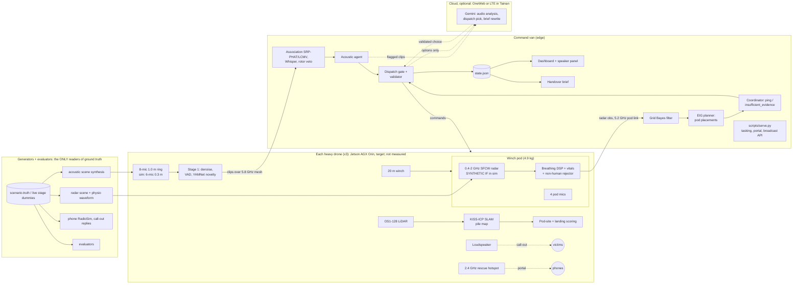
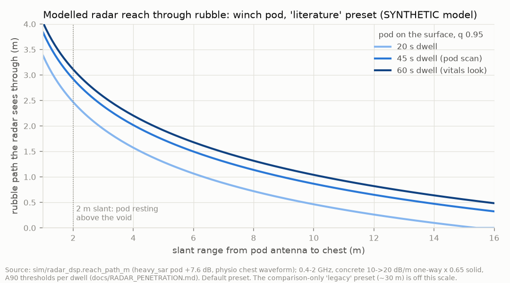

# Larpverse: technical report

**Autonomous heavy-drone search of collapsed-building rubble.** AgentVerse 2026, robotics track.
Case study: the Weiguan Jinlong building collapse, Yongkang District, Tainan, 6 February 2016.

Status: 8 Nov 2026. Brought up to date against HEAD `8600905`, using review pass 3 (`docs/review/PASS3_CLAIMS.md`, `a79a4c1`). Short version: [TECHNICAL_REPORT_ABSTRACT.md](TECHNICAL_REPORT_ABSTRACT.md).

> **How to read this report.** Every number has a source (a doc, a file or a command) and a caveat. "Real" means real-world data or a real library. "Synthetic" means we generated it. The system produces **candidate search regions**, a **pile priority list** and a breathing **condition** read for rescuers. It does not detect, confirm or diagnose anyone, and it infers no age. Piles without a ping are "searched, **not cleared**".

## Open placeholders

| Marker | Fills from | State at writing |
|---|---|---|
| «PENDING: SEED7-CANON» | the mission agent's canonical seed-7 doc (config + command + result) | not landed. Until it lands we say: **A2 pings (radar-only, silent); further pings vary by pod seating** |
| «PENDING: B5-RERUN» | `python -m sim.evaluate --n 30 --budget 6` on current code | only a 7 Nov 16:33 run on older code |
| «PENDING: ISAAC-CLIP» | the teammate's GPU take (`docs/FROM_ISAAC.md`) | nothing in the take plan has been rendered on a GPU yet |
| «PENDING: GEMINI-DISPATCH» | a live Gemini dispatch decision in `agents/cache/llm.jsonl` | Gemini **audio** ran live (§4.3.5); the dispatch decider has 0 recorded live decisions |
| «PENDING: FHWA-SOURCE» | the specific FHWA GPR document and the RADIOTECT link | `RADAR_PENETRATION.md` names the rule of thumb without a document |
---

## 1. Problem and operational context

### 1.1 Urban search and rescue in collapse rubble

After a building collapse, people who survive are usually trapped in **voids**: spaces between pancaked slabs, beside stairwells and under leaning walls. Urban search-and-rescue (USAR) teams find them with search dogs, listening devices, search cameras and sometimes radar life detectors. Then they dig or breach towards them, and each breach takes hours. The decisions that matter are **which pile to work first** and **where on it to dig**. The decision-maker is the incident commander or USAR team leader. They need to know where to look, how sure the evidence is, and what has not been checked.

### 1.2 Why it matters, and why current tools fall short

All figures in this section are sourced in `docs/IMPACT_EVIDENCE.md` and `data/impact_params.json`.

- **Time kills fast.** Of the people Kobe's fire brigade extricated in 1995, 80.5% were alive on day 1, 28.5% on day 2 and 21.8% on day 3. At Weiguan, 164, 7 and 4 people came out alive on days 1–3. Nobody was found alive after 62.3 h (Chiu & Tseng 2018). In the Weiguan victims, extrication time was the strongest predictor of death (Pan et al. 2019).
- **Cameras and thermal imagers see surfaces.** A person under 1–2 m of concrete has no line of sight to any camera, and rubble insulates their heat.
- **Listening devices only find people who can call or tap.** In Bam (2003), 28% of injured survivors were unconscious when rescued (via Rom & Kelman 2020).
- **Radar life detectors are carried onto the pile one spot at a time.** Vendors claim 4.5–7 m (GSSI LifeLocator, trade press); this has not been independently verified.
- **Higher radar bands do not go through concrete.** Penetration is a few metres even at low frequency (§4.2.3).

Our claim is narrow. In simulation, the system:
- puts a breathing radar and a microphone on many spots of a pile **without anyone standing on it**;
- **prioritises** where to dig sooner;
- can flag silent or unconscious breathing within about 2.9 m of rubble beneath the pod.

It also misses victims, and it does not do the extrication. At Weiguan, getting the last live victims out took 12–29 h each, and that was the bottleneck, not finding them (IMPACT_EVIDENCE §4).

### 1.3 Triage

START and SALT triage sort people by respiration, perfusion and mental status. A radar sees only chest-wall motion. Our vital-sign output is therefore a **breathing condition** with a respiratory triage hint for ordering the dig (§4.2.6). It is an aid for rescuers, not a diagnosis. There is no age or child inference (user decision, 7 Nov).

### 1.4 Case study: Weiguan Jinlong, Tainan, 2016

Facts are from IMPACT_EVIDENCE §4 (Tainan City Fire Bureau e-paper; Pan et al. 2019; Chiu & Tseng 2018; Taipei Times 2019; zh.wikipedia):

- **The event.** A magnitude 6.4 earthquake struck at 03:57 on 6 February 2016, centred in Meinong District, Kaohsiung.
- **The building.** Weiguan Jinlong was 16 storeys plus a basement, nine blocks A–I in a U shape facing west. It toppled from west to east across Yongda Road Section 2.
- **People.** **309** people were in the building (76 uninjured, 118 injured, 115 dead; Pan 2019a). **175** were rescued alive and **115** died.
  - Rescuers extricated 290 people (175 alive and 115 dead). About 19 got out on their own, so "194 rescued" is wrong.
- **Search effort.** About 2,000 rescuers and 23 dogs worked the site. Manual search reached its limit at 64 h, when heavy demolition began.
- **Site frame anchor:** 23.0051432 N, 120.2608904 E (`sim/scenario.py: SITE_GEO`).

The case study is for framing only. The public demo uses a synthetic 3×3 grid (§3.4). Victim positions in our scenarios are invented and say nothing about the real event.

---

## 2. System overview

### 2.1 The concept of operations

Three heavy-lift drones (FlyCart 30 / Agras T50 class, 3.1 m span) leave a command van at the staging area. For each pile:

1. **Survey.** One orbit with a dense LiDAR, KISS-ICP SLAM into a pile map.
2. **Pod placement.** Each drone **hovers** (or lands off the pile) and **lowers a 4.9 kg radar + microphone pod on a 20 m winch** onto the rubble surface, close to the current lead.
   - Each placement takes about 8 s to lower, 45 s to scan and 8 s to raise.
   - The pod is lifted and re-placed where the planner expects the most information.
3. **Fuse.** Ranges from the pod scans are fused into a belief. Three agreeing strong ranges give a **ping**: a candidate search region. A firm ping gets one extra 60 s "vitals look", which yields a breathing condition.
4. **Listen and call out.** The drones land **off the pile** with rotors off.
   - They listen to the other piles, play a call-out (zh-TW, Taiwanese Hokkien, English) and listen for replies.
   - They also run an open rescue Wi-Fi hotspot that phones can join by choice.
5. **Rank and dispatch.** An acoustic agent ranks the piles. A dispatch gate chooses the next pile under battery and budget rules, with Gemini or a deterministic fallback, and code checks every pick.
6. **Repeat** until the budget is spent. The commander gets a dig order and a handover brief listing pings, open leads and piles not cleared.

### 2.2 Architecture



### 2.3 Where each component runs

The intended split is below. **Today the mission runs on one laptop CPU and Isaac on a cloud L40S. Nothing has been timed on drone hardware.**

| Component | Intended host | Measured today |
|---|---|---|
| LiDAR odometry, pile map, pod-site and landing scoring | drone (Orin) | 0.38 s per 23k-point sweep, laptop CPU, offline |
| Radar breathing DSP, vitals, rejector | pod / drone | not separately timed |
| Stage-1 audio (denoise, VAD, novelty) | drone | not separately timed |
| Fusion, planner, acoustic association and agent fallback, gate, dashboard | command van | about 50–62 s per real-pipeline listen on the laptop CPU (VIDEO_PLAN.md); unmeasured on the L40S |
| Gemini audio analysis, dispatch pick, brief rewrite | cloud, optional | audio median 1.6–1.8 s per clip (ACOUSTIC_GEMINI.md); dispatch «PENDING: GEMINI-DISPATCH» |

### 2.4 Communications (docs/COMMS_ARCHITECTURE.md, docs/HOTSPOT.md)

- **Heavy data stays on the drone.** About 130 Mbps of raw LiDAR, 9 Mbps of raw audio and about 450 MB/s of raw radar samples never leave the drone or pod. The mesh carries map deltas, detections, short clips and thumbnails, about 2 Mbps per drone.
- **Three radio layers, all clear of the radar's 0.4–2 GHz sweep:**
  - a 5.8 GHz Doodle Labs mesh between the drones and the van, multi-hop;
  - a 5.2 GHz Wi-Fi link from each drone to its pod (the winch line carries no conductors);
  - an open 2.4 GHz rescue hotspot for phones.
- **The van** has a 9–12 m pneumatic mast (10.5 m in the link budget). Its internet uplink in Tainan is **OneWeb via Chunghwa Telecom, or LTE**; Starlink was not commercially available in Taiwan and is the option elsewhere.
- **Degraded comms.** Without the mesh, the drones finish their search, store data on 2 TB NVMe and forward it later. Without the cloud, the rules decider and vetted templates take over.
- **Security.** The mesh is AES-256 encrypted, MAVLink is signed, and phones can reach only the portal.

### 2.5 The ground-truth boundary

Hidden truth means victim positions, depths, breathing states, sound sources, phones, and in the live take the stage dummies. Only the following may read it:

1. **Observation generators:**
   - `sim/radar_model.py` and `sim/radar_dsp.py` (radar scene + `sim/physio.py` chest waveform);
   - `acoustic/scene.py` (audio synthesis);
   - `sim/comms.py` RadioSim (phones);
   - `sim/callout.py` response generator (replies to call-outs).
2. **Evaluators:** `sim/evaluate*.py`, `acoustic/eval_*.py`, `scripts/validate_*.py`.
3. **Display-only ghosts** in Isaac (`--show-truth`).

The localiser, planner, coordinator, mission, agents and dashboard never read it. `tests/test_grid_mission.py::test_brain_never_reads_truth` greps the brain modules, and `tests/test_agents.py` asserts that `truth`/`targets` keys never reach a prompt. In the live take, the mission never reads the Isaac stage: it re-plans only from generator outputs, operator tasking and the phone portal (ISAAC_BRIEF §1).

The `--acoustic stub` path fabricates clips from truth for speed (tests, the grid evaluation). It labels itself `stub-from-truth` everywhere, and `--live` refuses to start with it.

---

## 3. Simulation environment

### 3.1 Scenario generator (`sim/scenario.py`)

One seed fixes the whole site. The demo uses seed 7.

| Parameter | Value |
|---|---|
| Layout | 3×3 piles A1–C3, 22 m spacing, centres jittered ±1.5 m; staging and pads to the south |
| Pile | mound 2.6–3.7 m high; 40 slabs, 26 chunks, 0–2 columns, sometimes a brick wall stub; seed 7: 621 pieces |
| Heightmap | 0.5 m cells |
| Hidden truth | the start pile always holds victim V1 (depth 1.2–1.9 m); the other piles are shuffled over voice, weak voice, knock, dog, generator, debris and silent; victims sit at the voice, weak-voice and knock piles (depth 0.8–1.8 m); each victim has a breathing state (§4.2.6) and, with some probability, a phone |

**Seed-7 truth** (for evaluation only):

| Pile | Role | Breathing state |
|---|---|---|
| A2 | start pile, silent victim | `unconscious_slow` |
| A3 | voice ("Help! Can anyone hear me? My leg is trapped.") | `distressed_tachypnea` |
| B1 | weak voice ("…water…") | `irregular_apneic` |
| B2 | knocking | `calm` |
| C1 | generator | – |
| C2 | dog | – |
| B3 | settling debris | – |
| A1, C3 | silent | – |

**Known bias (R1-007).** The start pile always holds a victim, so the first ping is guaranteed by construction. We state it as "the start pile is the reported collapse with a known missing person". The grid evaluation also reports an independent-start set (§8.2).

### 3.2 Platform model (`sim/platform.py`, docs/HARDWARE.md, docs/PLATFORM.md)

| Item | `heavy_sar` (default) |
|---|---|
| Airframe | FlyCart 30 / Agras T50-class coaxial X8: 3.085 m span, 95 kg MTOW. The sim reference is the FlyCart 30; the recommended build is a Harris Aerial H6HL-class ArduPilot hexacopter (MAVLink native) |
| Mission payload | **14.0 kg**: 6.0 kg on the airframe, 3.1 kg winch (20 m line, 5 kg minimum load), 4.9 kg pod. Electronics draw 82 W typical, 139 W peak |
| Endurance | **23.9 min** to 0%, about **17.9 min** usable with the 25% reserve (estimate from the spec's hover curve) |
| Pod | 0.4–2 GHz SFCW radar (USRP B210), 0.48 × 0.48 m antenna face (+7.6 dB receive aperture vs the small radar), 4 mics, Raspberry Pi 5, IMU, 99 Wh; 5.2 GHz link to the drone |
| Drone sensors | Ouster OS1-128 LiDAR; 8-mic 1.0 m ring; 130 dB-class loudspeaker; optional thermal; Jetson AGX Orin 64 GB; RTK GNSS |
| Cost (estimates, Nov 2026 list or reseller prices, no supplier quotes) | about $61k per drone on a FlyCart 30, about $87k on an H6HL; the command van adds about $51k |

**Caveat.** Every sensor except the radar pod is off the shelf. The pod is a custom design that has been **designed, not built or tested**.

### 3.3 Flight model (`sim/flight_motion.py`, docs/MOTION.md)

`SmoothFlight` is the default (`--flight smooth`):
- jerk-limited C2 multirotor trajectories (quintic S-curve legs, corner blending, a brake term on re-plans);
- 10 m/s cruise, 3 / 2 m/s climb / descent, 2.5 m/s² horizontal acceleration, 2 m/s³ jerk;
- tilt from acceleration (25° limit), 45°/s yaw, a flare at landing, 7 cm RMS hover drift;
- 8 s winch lower and 8 s raise.

On a 1500 s seed-7 mission, velocity jumps went from 471 to 0. Isaac samples the trajectory at render time (`isaac/motion.py`).

This is a **trajectory model**: there is no flight controller, aerodynamics or wind load. `--flight kinematic` (straight legs at constant speed) remains for comparison. The grid evaluation (§8.2) was generated before SmoothFlight became the default, so it uses kinematic flight.

### 3.4 Sites

| Site | What it is | Public? |
|---|---|---|
| `grid` (default) | synthetic 3×3 piles (§3.1) | **yes: the video take runs here** |
| `weiguan` (`sim/site_weiguan.py`) | procedural stand-in for the toppled U-shaped block, from public descriptions (docs/SITE_WEIGUAN.md) | yes, labelled "layout synthetic" |
| `collapse` (`sim/site_collapse.py`, the teammate's 320 m USD) | reconstruction whose core geometry and textures derive from screenshots of the NCKU Museum photogrammetry model | **no**: private only, until NCKU permission or a procedural core exists (PLAN 8 Nov) |

The dashboard can draw the synthetic layout on an OpenStreetMap or Esri basemap of the real site. It must read "layout synthetic" whenever it does: this was a fatal disaster.

### 3.5 Isaac Sim (`isaac/`)

- **Versions.** Isaac Sim **6.0.1** (build 6.0.1-rc.7) with Isaac Lab 3.0, on an NVIDIA Brev L40S (`docs/ISAAC_VERIFIED_APIS.md`). The launcher is Isaac Lab `AppLauncher` with scene queries enabled; version-specific calls are isolated in `isaac/compat.py`.
- **Stage.** A USD stage built from the scenario: a terrain collider and about 600 rubble colliders. The photoreal pass (`--photoreal 1`) adds irregular concrete with rebar, MDL materials, an HDRI and haze. Drones are posed per frame from the motion model.
- **LiDAR.** PhysX scene-query raycasts against the real colliders: 16 channels from −4° to −80°, 96 rays per frame by default, 40 m. The hits rebuild the heightmap the mission uses.
- **Take assets:** the command van (`--van`), training-manikin dummies with spatial audio (`--dummies`), the winch pod hanging plumb with sway, rotor blur discs, and an omni.ui perception HUD (`isaac/hud.py`), which also writes `hud.json`/`live.json` for the dashboard.
- **Live mode** (`--live`). The stage dummies **are** the generators' victims. A teammate can switch on a hidden dummy (hotkeys Y/U, a HUD button, or a dashboard zone). The mission perceives the change only through its generators and re-plans. Its listens run on the **real acoustic pipeline** (a persistent `.venv-audio` worker fed the live dummy WAVs). A loud pre-flight refuses to fall back to stub acoustics.
- **Status.** The first GPU bring-up (7 Nov) passed every checklist step. The single-take plan (§11) is dry-run tested on the CPU; **nothing in it has been rendered on a GPU yet** «PENDING: ISAAC-CLIP».

### 3.6 Simulated vs real

| Part | Real | Simulated |
|---|---|---|
| Site, rubble, victims | case-study facts (§1.4) | layout, pieces, victims, sounds, phones |
| LiDAR geometry, SLAM | Isaac PhysX raycasts; KISS-ICP 1.3 | the scene they see |
| Flight | – | smooth trajectory model, no flight controller |
| Radar | breathing DSP and vitals features, checked on real 24 GHz line-of-sight recordings | every through-rubble radar return (synthetic IF + physio waveform) |
| Acoustics | recognisers (Silero VAD, YAMNet, Whisper, SRP-PHAT/LCMV), checked on real recordings with rotors off | demo and take audio: recorded and TTS clips, synthesised through a rubble model, free field |
| Gemini | live audio analysis (251 clips) | the dispatch decider has not run live |
| Hotspot | link budget from published sources | every phone, message and RSSI reading |
| Hardware | parts and prices from datasheets (estimates) | pod not built; nothing flown |

---

## 4. Perception

### 4.1 LiDAR, SLAM and placement scoring

#### 4.1.1 Sensor and SLAM (`mapping/`)

**Simulated sensor.** A synthetic spinning 32-channel ray-caster: −18° to −80°, 0.5° azimuth step, 10 Hz, 40 m, σ = 2 cm, about 23k beams per sweep. The drone flies one orbit at 9.5 m radius and 11 m altitude, with a drifting odometry prior (3% scale error, 0.5°/s yaw bias).

**SLAM.**
1. KISS-ICP 1.x registers each sweep (0.2 m voxels, 20 iterations), seeded with `last_pose · odom_delta`.
2. If the estimate diverges more than 5 m from odometry, the code falls back to ground-truth poses and says so.
3. The registered cloud is downsampled at 0.1 m and rasterised to a 0.5 m heightmap.

Results (seed 7, pile B2, 300 sweeps; `python -m mapping.run --seed 7 --pile B2`, `110fdd2`; figure `docs/slam.png`):

| Metric | KISS-ICP + odometry prior | Odometry only |
|---|---|---|
| ATE RMSE | **3.6 cm** (max 7.1 cm) | 1.51 m |
| Heightmap MAE vs truth | 4.7 cm (91% of cells within 10 cm) | 13.0 cm |
| Landing-cell IoU vs truth | **0.983** | 0.937 |
| SLAM landing sites valid on true terrain | 16/16 | 11/16 |

Caveat: one pile, one seed, our own ray-caster, run offline (150 s on the laptop CPU). In the mission, `--slam` uses 120 sweeps per pile but is not on by default.

#### 4.1.2 Plane fit and landing cells (`sim/landing.py`)

For each 0.5 m cell, fit a plane by least squares over its 3×3 neighbourhood (a 1.5 m footprint):

$$z(\Delta x,\Delta y)\approx\bar z+a\Delta x+b\Delta y,\quad a=\frac{\sum\Delta x\,z}{6r^2},\ b=\frac{\sum\Delta y\,z}{6r^2},\quad \theta=\arctan\sqrt{a^2+b^2}.$$

Roughness is the RMS residual about the plane.

**Landing cells** are now used only for the **off-pile listening landings**. Their limits:
- slope ≤ 12°;
- roughness ≤ 0.07 m;
- step ≤ 0.35 m within the 0.9 m rotor radius;
- clearance ≥ 0.9 m from anything more than 0.30 m above the plane;
- a clear 15° descent cone.

Score = 0.35·slope term + 0.35·roughness term + 0.20·clearance term + 0.10·approach. On the heavy platform, the landing patch must also fit the 3.1 m rotor disc.

**Pod placements** (`detect_pod_sites`). A cell qualifies when all of these hold:
- it is on the pile (more than 0.4 m above local ground);
- it is within (lead radius + 3 m) of the lead's posterior centre;
- its slope is ≤ 30° and its plane-fit roughness ≤ 0.12 m;
- nothing within about 0.75 m stands more than 1.0 m above it (a clear winch corridor);
- the hover point (5 m above the tallest cell under the rotor disc) is within the 20 m winch.

Placements are picked greedily by distance to the lead, then flatness, at least 1 m apart. The **seating model** takes roughness at the pod footprint as about 0.35 × the plane-fit value. Slopes up to 30° do not matter to the pod. If the pod rocks, it is re-seated once.

None of this is a structural assessment. Flat geometry does not mean the pile is safe.

### 4.2 Radar

#### 4.2.1 Signal model (`sim/radar_dsp.py` PART 1: **labelled synthetic generator**)

Isaac does not model RF breathing through rubble, so the IF cube is generated:

$$x[m,n]=\sum_k A_k\,e^{j(\phi_k+\frac{4\pi}{\lambda_c}r_k(t_m))}\,e^{j2\pi\frac{r_k(t_m)}{\Delta r}\frac{n}{N}}+w,\qquad A=70\cdot10^{(\sigma_{dB}+G_{rx}-L_{rubble})/20}/R^2.$$

| Parameter | Value |
|---|---|
| Sweep | 0.4–2.0 GHz (B = 1.6 GHz, f_c = 1.2 GHz, λ_c = 0.25 m) |
| Range bins | Δr = 9.4 cm, N = 512, 48 m unambiguous |
| Slow time | 20 Hz; **45 s pod scan**, plus a 60 s vitals look after a firm ping |
| Chest motion | `sim/physio.py` breath-by-breath waveform: about 5 mm peak-to-peak for a calm adult, 2–3 mm when rapid and shallow, with pauses and sighs per state. The older 4–8 mm sinusoid overstated the signal by about 14 dB and is available only with `LARPVERSE_PHYSIO=0` |
| Clutter, platform | antenna leakage, ground bounce, 3–6 rubble reflectors; pod seating jitter scaled by (1 − quality) |
| Confounders (`sim/radar_signatures.py`) | empty rubble, settling debris, small animal, machinery vibration, drone-rotor reflection, a moving or knocking person |

The module docstring still says "1–3 GHz / 7.5 cm"; the parameters above are what the code runs (Requests).

#### 4.2.2 DSP chain (PART 2: the real processing; planner side)

1. **Range FFT** with a Hann window.
2. **Platform-motion estimate** from the strongest static bin beyond 1 m. This gives the measured scan quality $q=1-\mathrm{rms}_{0.05-3\,Hz}/7\,\mathrm{mm}$.
3. **Motion compensation:** a common-mode phase rotation, then a per-bin complex least-squares regression on [d_ref, trend].
4. **Bulk-motion detection.** 32-frame range-Doppler segments, energy at ≥ 2 Hz, OS-CFAR ×8. A track that migrates in range at ≥ 0.15 m/s is reported separately as `doppler_moving`.
5. **Static clutter removal:** subtract the slow-time mean.
6. **Band power** per bin: 0.1–0.5 Hz (respiration) and 0.7–3 Hz (periodic, but not breathing).
7. **OS-CFAR** across range: 16 training and 3 guard cells, 75th percentile. Threshold ×4, local maximum within ±3 bins, parabolic sub-bin range.
8. **Phase demodulation:** PCA linear, or a Kasa circle fit plus `unwrap(angle)` (the arctangent mode, used on real data).
9. **Band-pass:** 4th-order Butterworth, 0.1–0.5 Hz, zero phase.
10. **Rate:** spectral peak (parabolic), peakiness and band ratio.
11. **Confidence:**
$$c=\sigma\!\left(\tfrac{\mathrm{SNR_{dB}}-9}{3}\right)(0.25+0.75c_{pk})(0.15+0.85c_{rt}),$$
halved at a band edge and penalised for one-sided Doppler. Candidates under 0.2 are dropped.
12. **Output:** the radar observation, plus `max_reliable_depth_m` from the measured quality.

Figure: `docs/radar_dsp.png`.

#### 4.2.3 Penetration through rubble (docs/RADAR_PENETRATION.md)

`literature` is the **default** propagation preset, with `--delivery pod`. `legacy` (a flat 0.7 dB/m) is kept only as a comparison row, because it would let the radar see through about 30 m of rubble, which is not credible.

- **Concrete loss.** One-way, solid concrete: $\alpha_c(f)$ = 10 dB/m below 1 GHz, rising to 20 dB/m at 2 GHz, the FHWA GPR rule of thumb «PENDING: FHWA-SOURCE».
- **Solid fraction.** 0.65 of a slant path through collapse debris is solid; debris is roughly 30–50% voids.
- **Two-way loss**, power-averaged over the sweep:
  $$L(\ell)=-10\log_{10}\langle10^{-2\ell(0.65\alpha_c(f))/10}\rangle_f$$
  That is 15, 29, 43 and 69 dB at 1, 2, 3 and 5 m of rubble.
- **Detection threshold (A90).** The chest amplitude at which 90% of scans detect, measured through the DSP chain with the physio waveform:

| Dwell | q 0.95 | q 0.6 | q 0.3 |
|---|---|---|---|
| 20 s | −3 dB | 0 dB | +9 dB (cap) |
| **45 s (pod scan)** | **−9 dB** | −6 dB | +3 dB (cap) |
| 60 s (vitals look) | −11.5 dB | −8.5 dB | +0.5 dB (cap) |

**Reach** is the rubble path at which the margin $20\log_{10}(70/R^2)+G_{rx}-A90$ equals the loss. For the heavy_sar pod at q 0.95:

| Dwell | 2 m slant (pod on the surface) | 6 m | 11.5 m (old landing ring) |
|---|---|---|---|
| 20 s | 2.47 m | 1.07 m | 0.31 m |
| **45 s** | **2.92 m** | 1.50 m | 0.70 m |
| 60 s | 3.11 m | 1.68 m | 0.87 m |

- The legacy small radar at 45 s reaches 2.35 m beneath. The earlier 3.6 m figure is **withdrawn**: it came from the sinusoid and the old panel, and was optimistic by about 0.7 m.
- A shallow, rapid breather needs about 7 dB more margin.
- The figure `docs/img/report_radar_reach.png` plots reach against range for the pod at 20, 45 and 60 s dwell (q 0.95, synthetic model).



**Why a pod.** Under realistic penetration, drones landed on a ring 9–12 m from the pile pinged **1 of 80** victims in 20 seeds; the landing-ring rows of EVAL_GRID give 0/60, 0/60 and 1/60. A heavy drone cannot perch on a pile, but a pod resting on the surface puts the victim at 1–2.5 m slant range.

Every scan reports `max_reliable_depth_m`. Every pile reports `radar_coverage` and `radar_coverage_shallow` (top 2 m). A pile with less than 50% top-2 m coverage and no ping becomes "beyond radar reach → acoustic lead only".

**Not modelled:** scattering, multipath inside voids, moisture, rebar (the parameter exists but is 0), layering. For scale: a commercial life detector's vendor claim is 4.5–7 m. Our model is conservative and literature-calibrated. Our gain is placements without people on the pile, not range.

#### 4.2.4 Real-data check of the DSP (`docs/RADAR_VALIDATION.md`)

The extractor in arctangent mode was run on Schellenberger et al. 2020 (Sci Data 7:291, CC BY 4.0): a 24 GHz CW radar about 0.4 m from a supine resting subject, 3 subjects, line of sight, **no rubble**.

- Pooled over 176 windows of 30 s: **0.39 breaths/min MAE** (median 0.07); 95% within 2 bpm.
- Per subject: 0.17, 0.07 and 0.95.
- Figure: `docs/radar_real_validation.png`.

This checks the signal processing only, not through-rubble sensing.

#### 4.2.5 From scans to pings and depth

A scan gives ranges: rings around the pod. Position comes only from fusing scans (§5). The localiser assumes a nominal burial depth of 1.5 ± 0.5 m. `Localiser.estimate_depth` reports `radar_estimate` when at least 3 supporting scans give a posterior σ ≤ 0.45 m, and `nominal` otherwise.

- The grid evaluation reports 5 radar depth estimates in 20 seeds, median absolute error 0.09 m.
- In the review's seed-7 run, A2-R1 came back `radar_estimate` and the others `nominal`.

The dashboard always shows the source of the depth.

#### 4.2.6 Breathing condition and the non-human rejector (`sim/vitals.py`; docs/VITALS.md, docs/RADAR_SIGNATURES.md)

**Synthetic side** (`sim/physio.py`, generator only):

| State = expected condition | Breathing |
|---|---|
| calm | 12–16/min, CV 0.03–0.08 |
| distressed_tachypnea | 26–36/min, shallow, CV 0.12–0.25 |
| unconscious_slow | 6–10/min, deep, CV 0.05–0.12, 0–0.3 pauses/min |
| irregular_apneic | 8–14/min, CV 0.25–0.45, 0.5–1.5 pauses/min |

**Planner side** (`sim/vitals.py`):
1. Demodulation: arctangent when the I/Q arc is wide enough, else linear.
2. Movement frames are masked.
3. Rate from the spectral peak and time-domain breaths.
4. Breath-interval CV.
5. Pauses > 10 s from a moving-RMS envelope.
6. A signal quality index (SQI).
7. A rule classifier: `calm | distressed_tachypnea | unconscious_slow | irregular_apneic | unknown`.

The respiratory hint follows only the START/SALT respiratory arm.

**Wording** (`dashboard/vitals.js`). For example, slow and regular reads: "slow, regular breathing: deep rest or reduced consciousness (the radar cannot tell which); call out and check responsiveness · aid for rescuers, not a diagnosis".

**Rejector.** `vitals.identify` judges the whole dwell and `source_of` names likely non-human sources: debris, small animal, machinery, rotor reflection, moving person. A return the rejector calls non-human **never becomes a ping**. The scan notes "radar return rejected: … (not a person)". A moving or knocking person becomes "urgent · listen and call out".

Results (synthetic unless marked):

| Check | Result | Source |
|---|---|---|
| Condition recall on synthetic pod scans (45–60 s) | calm 95%, distressed 100%, unconscious_slow 84%, irregular_apneic 65% | VITALS.md |
| Pause detection, synthetic | 78% of 27 scans, 3% false | VITALS.md |
| **Real** rate (Schellenberger, line of sight) | MAE 0.51/min (60 s windows, n = 57); 0.25/min (30 s, n = 118) | VITALS.md |
| **Real** voluntary breath holds | 6/6 detected, 0 false pause events | VITALS.md |
| **Real** caveat | healthy relaxed volunteers read "slow, regular" in 38/57 windows | VITALS.md |
| Signature library: 500 synthetic scans, 4 conditions + 6 confounders | exact class 59% overall; most confounder "errors" are `no_signal`, which is still a correct rejection with the wrong source named; machinery never becomes a breathing candidate | RADAR_SIGNATURES.md |

No age, child or injury inference is made.

### 4.3 Acoustics

#### 4.3.1 Arrays and scene synthesis

- **Hardware design:** an 8-mic MEMS ring of 1.0 m on each drone, plus 4 mics in each pod.
- **Simulation:** bearings come from a **smaller 6-mic, 0.3 m ring**, which gives broader beams (about 65° vs about 20°). This is the conservative choice.
- **Scene synthesis** (`acoustic/scene.py`, the only acoustic reader of truth): 16 kHz, a 26 s rotors-off window, pyroomacoustics free field, a rubble low-pass $f_c=4000/(1+1.6d)$ with −3 dB per metre of depth, and wind and sensor noise.
- **Sources:**
  - Piper TTS voices in English, Mandarin, Indonesian and Vietnamese;
  - CC0 Freesound recordings;
  - three ESC-50 clips (cough, cry, knock; CC BY-NC);
  - synthesised knocks, generator and debris.
- **In the live take,** the sources are the stage dummies' own WAV clips at their live positions (`build_scene(sources=…)`).

#### 4.3.2 Localisation and association (`acoustic/dsp.py`, assoc-v12, `f1e3b44`)

1. **SRP-PHAT maps** per drone and per 0.5 s block, over 300–4000 Hz, built from masked transient cells plus the whole window.
2. **CLEAN:** take the peak, subtract the array's point-spread function, and repeat (up to 6 components).
3. **Multi-drone association.** A pile gets a block when at least 2 drones agree within the gate, or one strong component points at no other pile. Visited and excluded piles take part as explainers.
4. **Rival test.** A likelihood-ratio test against rival piles gives `association_conf`. Ambiguous clips are capped at reliability 0.45 and priority 19, so they never trigger a dispatch on their own.
5. **Separation.** Delay-and-sum or LCMV beamforming towards the pile, with nulls on other sources. Cross-talk suppression for knocks and speech.
6. **Rotor handling** (assoc-v12). Bearings towards our own hovering drones are skipped or nulled. A **rotor veto** rejects voice or knock clips with steady loudness and a blade-pass harmonic comb.

The working tree has moved on (`assoc-v14`, uncommitted at writing). The numbers in this report are for the committed versions named.

#### 4.3.3 Recognisers and the acoustic agent

- **Recognisers:** Silero VAD v5, YAMNet (521 classes into 7 groups, plus knock-rhythm and hum heuristics), faster-whisper `base.en`.
- **Transcript gate:** VAD, `no_speech_prob`, `avg_logprob`, the hallucination list and a cross-talk check.
- **Class floor:** a human floor per class, taken from the real-audio validation.
- **Agent:** an LLM or the deterministic fallback scores human, urgency and reliability. Reliability is scaled by the association confidence.
- **Pile priority** (deterministic):

$$\text{priority}=100\cdot h\cdot(0.35+0.65u)\cdot(0.45+0.55r)$$

Pile statuses: `lead` (human ≥ 0.4), `dismissed_nonhuman` (**not cleared**) and `no_signal_not_cleared` (baseline 8).

#### 4.3.4 Novelty filter and Gemini audio (`acoustic/novelty.py`, `acoustic/gemini_audio.py`; wired into `run.analyse` at `26de7e9`)

**Stage 1, local, always on.**
1. A background profile.
2. Spectral-gating denoise.
3. Per-frame novelty: log-mel band z-scores, a Mahalanobis distance and spectral flux.
4. Hysteresis segmentation into clips.
5. Cheap triage with VAD and YAMNet. Likely-human and uncertain clips go on; dog, engine, siren and similar are dismissed (still not cleared).

**Stage 2, Gemini** (`gemini-3.5-flash-lite`, prompt v5). The denoised clip (≤ 15 s) goes to Gemini. It returns:
- human vocal activity;
- languages (BCP-47), a verbatim transcript and an English translation;
- sound type and distress cues;
- people count and location hints;
- confidence and a rationale.

The prompt forbids inventing distress phrases and forbids confirmation language. The **offline fallback** is Whisper plus multilingual keywords. With `base.en` it identifies no language for Mandarin, Indonesian or Vietnamese clips.

**Stage 3.** Per-sector priority, using the same formula.

#### 4.3.5 Validation

**Real recordings, rotors off** (`docs/ACOUSTIC_VALIDATION.md` §5–6, assoc-v11). Human vs non-human, agent output:

| Set | Precision / recall / F1 | AUC |
|---|---|---|
| ESC-50 | 0.69 / 0.71 / 0.70 | 0.88 |
| Teammate CC0 clips | 0.79 / 0.85 / 0.81 | 0.97 |
| DroneAudioSet, rotors off | 0.90 / 0.76 / 0.82 | – |
| DroneAudioSet + real rotor noise at 0 dB | 0.90 / 0.43 / 0.58 | – |

- "help" was transcribed in 7 of 13 clips.
- **Direction of arrival on real DREGON recordings:** 100% within 10° with rotors off (static, n = 192); 90% hand-carried; 17–24% with rotors on in real flight. This supports landing and switching off to listen.
- **Caveats:** single channel (except DREGON), near field, nothing through rubble. The rotor veto (assoc-v12) has **not** been re-validated on real audio.

**Pile assignment on synthetic scenes** (`acoustic.eval_assign`, 5 seeds, 15 listens; BL-3 fix at `eb8cdba`): confident false human leads went from 16 to 0, and the voice pile was dispatched first in 5/5 seeds (from 4/5). At that version, knocks were the weak class.

**Gemini audio, live** (`docs/ACOUSTIC_GEMINI.md`, 7 Nov, `gemini-3.5-flash-lite`):
- 251 clips, 0 fallbacks.
- Language ID: 89/90 clean and 78/90 noisy (FLEURS, 9 languages).
- Distress-cue recall 0.76, precision 1.00 (24 TTS phrases). Invented cues in 4 of 180 news clips.
- Median latency 1.6–1.8 s per clip.
- Knocks were rarely called human (0/5), so stage 1's knock heuristic and YAMNet carry them.

**Stage 1 on synthetic mixes** (real event clips in synthetic beds):
- human-event recall 97–100% at ≥ 0 dB rotors off, but **56%** at −5 dB with a hovering drone;
- non-human false-forward 14–64% (Gemini sorts those).

### 4.4 Rescue Wi-Fi hotspot and phones (docs/HOTSPOT.md, `sim/comms.py`)

Each drone serves an open 2.4 GHz AP, `RESCUE-WEIGUAN`. A phone that joins sees a 6-language captive portal with three buttons: *I'm trapped*, *I'm safe*, *Send a message*. Several drones measure the RSSI of each joined phone, and a grid-Bayes fit gives a **candidate region**, drawn in blue.

**What it does not do.** There is no passive MAC or probe sniffing and no cellular interception. It finds only phones whose owners **choose** to join. Unconscious people and phones under more than about 2 m of rubble are invisible to it.

**Propagation through rubble** is the largest uncertainty. We use a lognormal effective loss, median 20 dB/m, clipped to 6–60 dB/m (estimate; no published per-metre figure).

**Results on synthetic phones:**

| Fleet geometry | Phones located | Median error |
|---|---|---|
| Landed around the pile | 34/40 | **0.6 m** |
| Survey only | 25/40 | 7.1 m |

In seed 7, B2's phone was **first fitted in the wrong sector** (B3) from 22 m away. It was corrected once the fleet reached B2.

**Effect on the mission.** A located "trapped" phone raises a pile to `lead` (priority 85). It is never a ping and never a clearance.

### 4.5 Loudspeaker call-out (docs/SPEAKER.md, `sim/callout.py`, `sim/guidance.py`)

The drones follow standard USAR practice: get silence, call out, listen.

- **Templates.** After each listen, they play fixed templates in zh-TW, Taiwanese Hokkien and English (Indonesian and Vietnamese are opt-in).
- **Responses.** Replies (knocks, shouts) are analysed from measurements only and fused into a responsiveness field. That field raises the dig order (`triage_fused`).
- **No response** reads "no response — does not rule out unconscious".
- **Reassurance and route guidance.** After a ping, the speaker reassures; people who can walk get A* route guidance to the tent.
- **Operator text** and every machine translation wait for operator approval (`/api/broadcast/approve`). An LLM never writes audio that plays unreviewed.
- **The Hokkien line** uses machine TTS that no native speaker has checked.

---

## 5. Localisation and planning

### 5.1 Grid Bayes filter (`sim/localise.py`)

The filter runs on the active pile's 2D layer: a 30 m window, 0.5 m cells. It never sees truth.

**Prior from LiDAR only:**

$$p_0(c)\propto f+(1-f)M(c),\quad f=0.08,$$

where M is the smoothed mask of cells more than 0.4 m above local ground and within 13 m of the mound centroid.

**Predicted range** from the sensor s (for a pod, the antenna face 5 cm above the surface) at nominal depth $d_0$ = 1.5 m:

$$r_c=\sqrt{\lVert\mathbf x_c-\mathbf s_{xy}\rVert^2+(s_z-(z_c-d_0))^2},\qquad \sigma_c=\sqrt{\sigma_r(q)^2+(\sigma_d|\Delta z|/r_c)^2},$$

with $\sigma_r(q)=0.25+0.4(1-q)$ and $\sigma_d$ = 0.5 m.

**Ring-likelihood mixture with an outlier floor:**

$$L(c)=\varepsilon+\min\!\Big(1,\sum_kc_kq\,e^{-\frac12((\rho_k-r_c)/\sigma_c)^2}\Big),\quad\varepsilon=0.015;\qquad \log b\leftarrow\log b+\log L.$$

- The floor ε stops one contradicting scan from zeroing the belief.
- **An empty scan updates nothing.** No detection is not evidence of absence.
- `doppler_moving` returns feed a separate random-walk track.

### 5.2 Modes, pings and insufficient evidence

Modes are smoothed local maxima, merged within 2 m. Each cell is assigned to its nearest mode within 4 m, giving the mode's mass, mean and covariance. The result is `candidate` only if all of these hold:

- the dominant mode holds ≥ 0.70 of the belief;
- no second mode holds ≥ 0.15;
- σ_major ≤ 2 m;
- **3 independent strong ranges** pass through the mode (agreement > 0.5, c·q ≥ 0.35).

A trusted scan that contradicts the consensus blocks the fix until **two later strong scans** agree. Then it is flagged as an outlier rather than deleted (R2-002). Otherwise the result is `insufficient_evidence`: the region stays open and the pile is not cleared.

`p_mass` is a **share of the pile's belief**, not the probability that a person is there. The dashboard calls it "belief share".

### 5.3 Expected-information-gain pod placement (`sim/planner.py`)

Pod placements are candidate sites for the same planner, flagged `pod`. Their sensor height is 0.05 m, the dwell is 45 s, and their quality is the seated quality.

**Initial three placements.** Choose the triple that maximises

$$\mathbb E_i\big[\log\det(\textstyle\sum_jJ_{s_j}(x_i)+0.05I)\big],\qquad J_s(x)=\frac{p_{det}}{\sigma^2}\mathbf u\mathbf u^\top,$$

over 48 prior samples.

**Adaptive re-placement:**

$$\mathrm{EIG}(s)=\mathbb E_{x\sim b}\big[p_{det}(x,s)(H(b)-H(b|y))\big],$$

with $y=r_s(x)+\nu\sigma$ and K = 96 Monte Carlo samples. The detection term

$$p_{det}=\sqrt q\,e^{-(r/25)^2}\cdot\mathrm{reach\_prob}(r,\ell,q,\text{dwell})$$

carries the penetration limit, so the planner prefers placements directly above the void.

- **Pick:** the best (drone, site) by EIG − 0.004 nats/s × travel time.
- **Stop:** a ping; the per-visit budget (8 scans); no site left; or best EIG < 0.2 nats after ≥ 3 scans.

Every relocation is logged with a plain-words reason, such as "separates two modes 3.1 m apart …".

### 5.4 Mission loop, tasking and recon (`sim/grid_mission.py`, `sim/tasking.py`, `sim/recon.py`)

| Parameter | Value |
|---|---|
| Mission radar scans | 36 with the pod (24 with the old landing ring) |
| Listen | 26 s rotors off, off the pile, then the call-out |
| Dispatch threshold | acoustic priority ≥ 20 |
| Revisits | max 2 visits; only if radar reaches ≥ 50% of the top 2 m; ranked at half priority |
| Battery | 25% reserve; otherwise a `battery_swap` option (return, 60 s swap) |
| Phone evidence | a "trapped" phone → `lead` 85; never a ping |

**Dispatch gate.** It scores the options (dispatch, revisit, stop) with priority, travel, battery-after, evidence and flags. The argmax is the highest-priority reachable option at or above the threshold. Baselines: `--dispatch nearest` and `--dispatch raster`.

**Operator tasking** (contract v1.2, integrated in `ec0c696`):
- The operator draws search zones on the dashboard; `scripts/serve.py` (`/api/tasking`) saves them.
- The mission searches only inside the zones and reports per-zone status and coverage.
- A zone searched without a ping is "searched — not cleared". It is reopened only by new evidence or a re-task.
- Acoustic leads outside every zone become `zone_suggestions`.

**Recon mode** (no zones tasked):
1. A coverage flight builds a fresh LiDAR map (satellite imagery is stale after a collapse).
2. The drones perch and listen with rotors off.
3. Rubble mounds are segmented into `zone_proposals` for the operator.

In sim the default is `--tasking default`: the scenario's rubble outlines.

---

## 6. Decision-making agents

### 6.1 Numbers propose, the agent decides, code verifies

1. **Numbers propose.** The planner and gate compute every option and its evidence.
2. **The agent decides.** It picks one option id and writes at most two sentences.
3. **Code verifies.** A validator accepts or rejects the pick. On any failure the deterministic choice runs, labelled `by: "fallback"`; without a decider, it is labelled `argmax`.

`agents/` is stdlib-only REST.

| Entry point | LLM output | Validator / fallback |
|---|---|---|
| Dispatch gate (`agents/gemini_decider.py`) | option id + rationale | the id must be listed; no option leaving a drone under the 25% reserve, `no_go` or `unreachable`; banned-claim regex ("confirmed", "survivor(s) found", "person found", …); else highest-priority valid option, else stop |
| Gemini audio (stage 2) | structured analysis | schema validation; else Whisper + keywords |
| Per-clip acoustic triage | human, urgency, reliability | values in [0, 1]; else keyword/score fallback |
| Operator notes intake | priors, no-go piles | clamped to [0.3, 3]; unknown piles dropped |
| Handover brief | rewrite of template facts | no banned claims, no unknown ids, every ping kept; else the template |
| Speaker | never generates audio text | only vetted templates play autonomously; translations need operator approval |

**What the LLM never does:**
- see ground truth;
- touch the DSP, Bayes, EIG or flight;
- invent options;
- claim confirmation;
- break the mission (every failure falls back).

### 6.2 Models, quota and replay

- **Models:** `gemini-3.5-flash-lite` for audio and `gemini-3.7-flash` for the decider. Both were verified present via `models.list` on 8 Nov (PLAN decision, 8 Nov). Some docs and `agents/llm.py` defaults still say `gemini-3.5-flash` (Requests).
- **Quota:** the key is **free tier**. On 7 Nov `gemini-3.5-flash` hit its daily quota after 18 calls (about 20/day), while flash-lite answered 251+ calls. Calls are throttled by a token bucket with backoff on 429.
- **Replay:** every answer is cached in `agents/cache/llm.jsonl`, keyed by provider, model and prompt. `LLM_REPLAY=1` replays without the network.
- **Labelling:** every on-screen decision shows `by: gemini | fallback | argmax`.
- **Status:** Gemini audio ran live (§4.3.5). The dispatch decider has **0** recorded live decisions «PENDING: GEMINI-DISPATCH». In the take, the box runs without `.env` by default, so the dispatch badge will read the fallback unless the key is set.

---

## 7. Operator interface (`dashboard/`, `scripts/serve.py`)

A static web app with three.js vendored for offline use. It polls `state.json` every second. `scripts/serve.py` serves it and the APIs for tasking, the portal and broadcasts. `?layout=take` is the video layout, verified at 640×1080, 960×1080 and 1920 wide.

| Feature | How the claim is kept honest |
|---|---|
| Site map: piles, drones, pods, range rings, belief, cones, dispatch, zones, phone regions (blue) | Red = "candidate search region · not a confirmed person"; a map key explains every mark; layout labelled synthetic over a real basemap |
| Pile list | statuses `ping`, `lead`, `dismissed_nonhuman`, `no_signal_not_cleared`, "searched — not cleared"; never "cleared" or "empty" |
| Radar candidates | belief share; support n/3; depth with its source ("nominal · assumed" or "radar estimate"); outliers listed |
| Condition and dig order (`dashboard/vitals.js`) | condition chip, with the hint and "aid, not a diagnosis"; dig order = triage weight × localisation certainty × accessibility; rejected returns collapsed under "Not a person, says the radar" |
| Ping detail (3D) | the ping inside the LiDAR model; source signature thumbnail labelled synthetic reference |
| Dispatch decisions | every option, flags, the choice, and a GEMINI / ARGMAX / FALLBACK badge |
| Acoustic panel | per listen: clips with bearing, SNR, VAD, association, transcript, `by`; "Recorded audio · cached analysis" when replayed |
| Speaker panel | vetted templates; operator text and translations need approval; broadcast log; responsiveness chips ("no response — does not rule out unconscious") |
| Comms / portal | phone regions and messages marked synthetic in simulation |
| Take layout | LIVE event line, live breathing waveform ("analysing breathing… n s" until the 45 s verdict), top clip, top-3 dig order |

---

## 8. Evaluation

Everything is **simulation** unless marked **real data**. Always quote a number with its row and caveat.

### 8.1 Summary

| What | Result | n / spread | Source | Caveat |
|---|---|---|---|---|
| Multi-pile dispatch (pod, `literature`, reported start) | non-start victims pinged: **acoustic 17/60 vs nearest 6/60 vs raster 5/60**; per seed 28% [15, 42] vs 10% [3, 17] vs 8% [3, 15]; 0 false pings | 20 seeds, bootstrap 95% CI | `docs/EVAL_GRID.md` (`07f7ffb`) | acoustic clips **generated from truth (stub) = upper bound**; **kinematic flight** (before SmoothFlight); not faster overall |
| Same, independent start | 19/74 vs 10/74 vs 9/74 | 20 seeds | EVAL_GRID | time to first non-start ping is **worse** for acoustic (1413 s vs 1042 s) |
| Landing ring instead of pod | 0/60, 0/60, 1/60 | 20 seeds | EVAL_GRID | why the pod exists |
| Breathing DSP, **real data** | 0.39 bpm MAE | 176 windows, 3 subjects | RADAR_VALIDATION.md | line of sight, 24 GHz CW, no rubble |
| Vitals rate and pauses, **real data** | MAE 0.51/min (60 s), 0.25/min (30 s); 6/6 breath holds | 57 / 118 windows; 6 holds | VITALS.md | healthy relaxed subjects read "slow, regular" in 38/57 |
| Condition recall, synthetic | 95 / 100 / 84 / 65% | 45–60 s pod scans | VITALS.md | synthetic generator |
| Non-human rejector | exact class 59%; confounders mostly rejected as no_signal | 500 synthetic scans | RADAR_SIGNATURES.md | synthetic only |
| Acoustic recognisers, **real data** | F1 0.70 (ESC-50), 0.81 (CC0), 0.82 (DroneAudioSet rotors off), 0.58 (+rotor 0 dB) | sets as listed | ACOUSTIC_VALIDATION.md | single mic, rotors off, no rubble; rotor veto not re-validated |
| DoA, **real data** (DREGON) | 100% within 10° rotors off; 17–24% rotors on in flight | n = 192 static | ACOUSTIC_VALIDATION.md | academic-use data, not redistributed |
| Gemini audio, live | language ID 89/90 clean, 78/90 noisy; cue recall 0.76 / precision 1.00; 0 fallbacks over 251 clips | FLEURS + TTS | ACOUSTIC_GEMINI.md | knocks rarely called human |
| SLAM | ATE 3.6 cm; landing IoU 0.98 | 1 pile, 1 seed | `map_B2/metrics.json` | own ray-caster |
| Phone localisation | median 0.6 m landed-around vs 7.1 m survey-only | 40 synthetic phones | HOTSPOT.md | first fit on seed 7 in the wrong sector |
| Flight smoothness | velocity jumps 471 → 0 (1500 s mission) | seed 7 | MOTION.md | trajectory model only |
| Single-pile planning vs fixed sites | 43% vs 10% resolved | 30 seeds | `eval/results.json` | **older code (7 Nov 16:33), model radar, landed scans; not re-run** «PENDING: B5-RERUN» |

### 8.2 Grid evaluation in words

In 20 simulated seeds, acoustic-led dispatch put a radar ping on 17 of 60 non-start victims, against 6 and 5 for the radar-only baselines.
- The acoustic clips in that evaluation were generated from ground truth, so this is an **upper bound**. There were 0 false pings.
- Acoustic dispatch visited fewer empty or non-human piles: 0.7 vs 2.8 and 2.5 per mission.
- No seed had every victim pinged (0/20 for all policies).
- Paired per seed against nearest: 8 seeds better, 11 the same, 1 worse.
- With an independent start, acoustic reaches its first non-start ping **later**. **We do not claim the system is faster.**

### 8.3 Seed-7 demo story

**A2 pings (radar-only, silent); further pings vary by pod seating.**

One verified run: review pass 3, `tests/test_demo_story.py` configuration (committed real-pipeline acoustic fixture, default tasking, pod, `literature`, `dsp`, physio, SmoothFlight):

| Pile | Result | Sim t | Condition |
|---|---|---|---|
| A2 | ping A2-R1 | 364 s | unconscious_slow (`radar_estimate` depth) |
| B1 | ping B1-R1 | 1712 s | irregular_apneic |
| B2 | ping B2-R1 | 2312 s | calm |
| A3 | insufficient_evidence (open lead) | 2938 s | – |

That run made 34 scans in 3109 s of mission time.

**Why A3 stays open.** A3's victim breathes rapidly and shallowly (33/min, about 2.2 mm). The pods rocked on its seats, so the returns were weak. The test asserts only the A2 ping, because B1 and B2 sit at marginal SNR and depend on how the pods seat. The canonical run will be quoted from «PENDING: SEED7-CANON». The live take uses real acoustics on live dummies, so its story can differ again.

---

## 9. Safety, ethics and limitations

### 9.1 Failure modes

| Failure | Mitigation | Residual risk |
|---|---|---|
| **Missed person (critical)** | no pile is ever "cleared"; coverage and "beyond radar reach" are reported; the brief lists open leads | it happens in our runs (A3, seed 7; 0/20 seeds with every victim pinged) |
| No detection read as absence | empty scans never update the belief; "searched — not cleared" | a commander may still infer it |
| False lead | 3 strong ranges for a ping; ambiguous audio capped below dispatch; non-human radar returns rejected | acoustic leads can still cost placements |
| Over-trusting a ping | belief share, 95% region, support, depth source shown | real-world error unknown |
| Penetration overestimated | `literature` default; reach reported per scan and per pile | the loss model is a rule of thumb (source pending); voids are straight-line averages |
| Condition misread as diagnosis | condition only, hint wording, "aid, not a diagnosis", no age | healthy relaxed people read "slow, regular"; nothing validated through rubble |
| Speaker misuse | vetted templates; translations need approval | the Hokkien TTS has not been checked by a native speaker |
| Phone localisation error | blue candidate region, lead only | wrong-sector first fits; unconscious people invisible |
| LLM error | listed options only, validator, banned claims, fallback, `by` badge | a valid pick can carry a wrong rationale |
| Pod on unstable rubble | 5 kg pod; re-seat once; winch hot-cut on snag (FlyCart 30 spec) | no structural assessment |
| Ground-truth leak | boundary tests; stub labelled; `--live` refuses the stub | evaluation uses the stub (upper bound) |

**Not handled:** drone loss, aftershocks, dust, rain, GNSS loss, a pod lost under debris, more than three drones.

### 9.2 Privacy, consent and data

- **Audio** is used to score human presence and urgency. There is no speaker identification. Stage 1 runs locally; only flagged clips go to the cloud, and `LLM_PROVIDER=none` keeps everything local.
- **Phones** are located only after they **choose** to join the portal. There is no sniffing and no cellular interception. Simulated phone data is marked `synthetic: true`.
- **The case study** is a fatal disaster. We use public facts only and label every layout synthetic.

### 9.3 Licence obligations (PASS3 §3)

- **ESC-50** (CC BY-NC 3.0): credit Piczak and the Freesound authors; non-commercial only.
- **DREGON:** academic use only, never redistributed or shown in the video.
- **Piper voices:** each follows its dataset licence; to verify. vivos is CC BY-NC-SA.
- **NCKU photogrammetry:** no licence, so the collapse site is not shown publicly.
- **Map tiles:** OSM and Esri attribution stays visible.
- **NVIDIA:** say "Rendered in NVIDIA Isaac Sim", with no implied endorsement.
- **Credits block:** README "Credits & honesty".

### 9.4 Honest gaps

1. Through-rubble radar returns are synthetic.
2. The pod is designed, not built.
3. Acoustic demo audio is synthesised.
4. There is no flight controller.
5. Nothing has been timed on drone hardware.
6. The take has not been rendered on a GPU.
7. The grid evaluation uses stub acoustics and kinematic flight.
8. The Gemini dispatch decider has not run live.
9. A victim always sits at the start pile.

---

## 10. Engineering process and reproducibility

- **The build loop.** An orchestrator Claude Code session dispatched up to 10 concurrent builder agents, alongside a human Isaac teammate on a GPU box. The rules are in `docs/agents/RULES.md`:
  - path-scoped commits through `scripts/commit.sh`;
  - heavy jobs queued through `scripts/heavy.sh` on a 14 GB laptop;
  - the ground-truth rule.
- **Plan and contract.** `docs/PLAN.md` holds the backlog (to BL-27) and a dated decisions log. `contracts/INTERFACES.md` (v1.4) is the integration contract.
- **Reviews.** Three independent reviewer passes:
  - pass 1: 46 findings;
  - pass 2: 23 findings;
  - pass 3 (claims and consistency): 44 stale claims, 16 overclaims, and the licence obligations.

  Most of the honesty wording in this report traces to them.
- **Tests.** 250 test functions in 23 files (`tests/`), including:
  - the truth-boundary grep;
  - the demo-story test;
  - agents against fake HTTP;
  - acoustic, with a committed seed-7 fixture;
  - flight motion, comms and call-out;
  - the live take dry run.

```bash
uv venv .venv && uv pip install --python .venv numpy scipy matplotlib pytest kiss-icp open3d
bash acoustic/setup.sh                       # .venv-audio + about 210 MB of models (acoustic/models/ is 314 MB on disk)
.venv/bin/python -m sim.grid_mission --seed 7 --out dashboard/data
#   defaults: --radar dsp --delivery pod --penetration literature --flight smooth --tasking auto (comms on)
#   options: --acoustic auto|real|stub  --decider none|gemini  --dispatch acoustic|nearest|raster  --slam  --no-comms
.venv/bin/python scripts/serve.py --port 8765        # http://localhost:8765/dashboard/  (?layout=take for the video)
scripts/demo.sh --direct                             # one-command live demo
.venv/bin/python -m sim.evaluate_grid --report --seeds 1-20
.venv/bin/python -m pytest -q tests
python3 isaac/live.py --preflight                    # on the GPU box, before the take (docs/VIDEO_PLAN.md)
```

---

## 11. The simulation-video deliverable (docs/VIDEO_PLAN.md, docs/ISAAC_BRIEF.md)

**The rule.** A video of up to 1 minute, captured from the stream, with perception on screen next to the actions, and **one unscripted change in a single continuous take**.

**How we meet it:**
- **Capture.** One OBS capture: the Isaac livestream (left two-thirds) and the live dashboard in `?layout=take` (right third), both from the same run.
- **Camera.** One spline camera (`--camera director-take`) that never cuts.
- **Time-lapse.** Per phase, ×5 to ×30, shown on every frame.
- **The story, seed 7, grid site:**
  1. The van opens and the drones lift off.
  2. The LiDAR map paints over A2.
  3. Pods winch down and the breathing waveform appears ("analysing breathing… n s").
  4. The A2 ping arrives with its condition.
  5. The drones land off-pile, call out and listen.
  6. The unscripted change.
  7. The fleet re-plans and redirects.
  8. Pods lower at the new pile.
- **The unscripted change.** A teammate switches on a **pre-placed hidden dummy** (key Y at A1, or U at C3) at a moment they choose, or the operator draws a zone. The system perceives it through the real acoustic pipeline on synthesised audio and re-plans. Only the moment and the choice of trigger are live.
- **Press window.** While A2's pods are down: about 17–29 s of video. A later press forces a full pipeline run (50–62 s on the laptop CPU, unmeasured on the L40S) while the mission clock holds.
- **Captions.** They show the real decision badge, say "time-lapse ×N", and keep "NOT this scan" visible if the HUD falls back to a library signature. Whisper `base.en` gives no transcript for the Indonesian dummy; it appears only if Gemini runs.

**Status:** dry-run tested on the CPU; not yet rendered on a GPU «PENDING: ISAAC-CLIP».

---

## 12. Impact, economics and deployment

These four docs were researched on 8 Nov. Tags: [S] sourced, [D] derived, [A] assumption. Every range is low / central / high, or median with a 90% interval. **Nothing here is a claim about what happened at Weiguan.**

**Comparable collapses** (`docs/CASE_STUDIES.md`, 15 cases):
- In Kobe (1995), 77.5% of the 35,000 people rescued from rubble were dug out by neighbours and family [S].
- In all 14 earthquakes reviewed, international teams' live rescues were under 0.85% of the death toll, and the first team took 12–56 h to arrive [S] (Rom & Kelman 2020).
- In Türkiye (2023), about 5,000 international rescuers saved about 300 people [S].
- At Surfside (2021), nobody was found alive after the first hours, despite 304 drone missions [S].
- The best published drone breathing-radar test is one person at ≤ 5 m with no rubble [S].

**Counterfactual model** (`docs/IMPACT_MODEL.md`, `sim/impact.py`; 10 real mission runs per site with **stub acoustics**, then a Monte Carlo of today's search):

| Headline | Result | Caveat |
|---|---|---|
| Lead on the sector of trapped people within 30 min of launch | 53% (median 8 min) | collapse-site runs, stub acoustics = upper bound |
| Silent / unconscious people located within 24 h | 74% today (60–85) vs 80% (70–89) at the radar upper bound; **74% as simulated** | on the Weiguan-scale site the pod made **0 firm pings in 170 people** (344 scans) |
| Extra survivors per 100 trapped | +0.2 (−0.1 to +0.7) as simulated, +0.75 (−1.8 to +2.7) at the upper bound; grid site +1.3 (+0.3 to +4.0) as simulated | model, not a record |
| Weiguan late cohort (113 people brought out after day 1) | about +6 (0.6–14) **only if the pod works as designed**; **0 (0–1.6) with the code as it is** | optimistic: the late cohort is deeper and more injured |

These numbers come from the model's v1.0 run. IMPACT_MODEL.md says they will be refreshed after the collapse-site pod-coverage fix, so re-check them before quoting. The model's own bottom line: **we do not claim lives saved at Weiguan scale.** The upper bound depends on the pod producing firm pings in the field, which is unproven.

**Economics** (`docs/ECONOMICS.md`). A city kit is 3 drones with winch pods, spares, chargers and a command van.
- It costs about **$0.67M up front** and **$2.8M over 10 years** ($1.1–6.3M) [D].
- **Break-even:** 0.20 lives per decade at the US DOT value of a statistical life ($13.7M), 0.56 at Taiwan's ($5M, benefit transfer), and about 3 lives at the international-USAR cost of $0.93M per life [D].
- **As simulated today**, the kit adds about 0.2 survivors per 100 trapped, so it needs about 300 trapped people per decade to break even at Taiwan's value [D].
- **Per deployment:** about $1.7k per one-hour sortie, or about $20k for 72 h (IMPACT_MODEL).

**Deployment in Taiwan** (`docs/DEPLOYMENT.md`):
- **Timeline:** a truck-mounted kit gives a first acoustic lead at about T+40 min and a first radar candidate at about **T+50 min** (range 23–94 min) [D]. At Weiguan, the national special teams took up to 12 h to arrive [S].
- **Fleet size:** about 47 kits nationally (12–133), about US$15.5M of capital [D].
- **72 h operation:** about 1.2 MWh and about 510 L of diesel (225–1,410 L), 3 battery sets per drone, and a crew of 7 [D/A].
- **Regulatory path:**
  - CAA consent for disaster flights (≥ 25 kg needs inspection and licensed pilots);
  - NCC special approval for the 0.4–2 GHz pod, because UWB is allowed only at 4–9 GHz and is banned on aircraft;
  - PDPA for phone data;
  - DJI restricted for government use, which forces the non-DJI build.

**Power** (IMPACT_EVIDENCE §6): a heavy-rescue truck's 25 kW PTO generator sustains about 3–4 drones.

## 13. Future work

1. **Build and test the pod.** Put a B210 SFCW pod on real USAR training rubble with known voids. Calibrate A90, the solid fraction and the seating model.
2. **Flight.** Fly a real heavy-lift airframe with PX4/ArduPilot, a winch and pod, and measure seating, swing and endurance.
3. **Acoustics.**
   - Re-validate the rotor veto on real audio.
   - Run a multilingual ASR in the take.
   - Re-run the grid evaluation with the real acoustic pipeline (not the stub) and with SmoothFlight.
4. **Measured depth.** Use more vertical aperture, so depth comes from the radar rather than the nominal value.
5. **Robustness.** Handle drone or pod loss, aftershocks and dust; time everything on the Orin.
6. **People.** Field tests with USAR team leaders; native review of the call-out languages.

---

## 14. References

**Radar and vitals**
- Schellenberger, S., et al. (2020). A dataset of clinically recorded radar vital signs with synchronised reference sensor signals. *Scientific Data* 7:291. doi:10.1038/s41597-020-00629-5 (CC BY 4.0).
- RADIOTECT (EU) through-rubble detection, and the FHWA GPR concrete-loss rule of thumb, as cited in RADAR_PENETRATION.md. The exact documents are «PENDING: FHWA-SOURCE».
- GSSI LifeLocator range claims (vendor and trade press; not independently verified).
- START (Hoag Hospital / Newport Beach FD, 1983); SALT: Lerner, E. B., et al. (2008), *Disaster Med Public Health Prep* 2(S1).

**Mapping and motion**
- Vizzo, I., et al. (2023). KISS-ICP. *IEEE RA-L* 8(2).
- Open3D (Zhou, Park, Koltun 2018).
- PX4 parameter defaults (MOTION.md).

**Audio**
- Silero VAD v5.
- Radford, A., et al. (2023). Whisper. *ICML* (faster-whisper, CTranslate2).
- YAMNet / AudioSet (Gemmeke, J. F., et al., ICASSP 2017).
- pyroomacoustics (Scheibler, R., et al., ICASSP 2018).
- noisereduce.
- FLEURS (Conneau, A., et al., 2022; CC BY 4.0).
- DroneAudioSet (ahlab-drone-project, HF 2025; MIT).
- ESC-50 (Piczak, K. J., ACM MM 2015; CC BY-NC 3.0).
- DREGON (Strauss, M., et al., IROS 2018; academic use).
- Piper TTS (rhasspy).

**Comms and hardware** (sources in HARDWARE.md, COMMS_ARCHITECTURE.md, HOTSPOT.md)
- DJI FlyCart 30 specs and winch sheet; Harris Aerial H6HL brochure.
- Ouster OS1-128; Doodle Labs Mesh Rider.
- NIST collapse-propagation measurements (2014); UCLouvain partially destroyed buildings.
- AT&T Flying COW; CENTUM Lifeseeker (vendor-reported).

**Impact and case study** (IMPACT_EVIDENCE.md)
- Tainan City Fire Bureau e-paper (2016).
- Pan, et al. (2019). *J Formos Med Assoc*.
- Chiu & Tseng (2018).
- Rom, A. & Kelman, I. (2020). *BMJ Global Health*.
- Kobe FD data via Miyagi Prefecture.
- FEMA canine guidance.
- Taipei Times (2019); zh.wikipedia 維冠金龍大樓.
- Map tiles © OpenStreetMap contributors; Esri World Imagery.

**Software:** NVIDIA Isaac Sim 6.0.1 / Isaac Lab 3.0; Google Gemini API; three.js.
