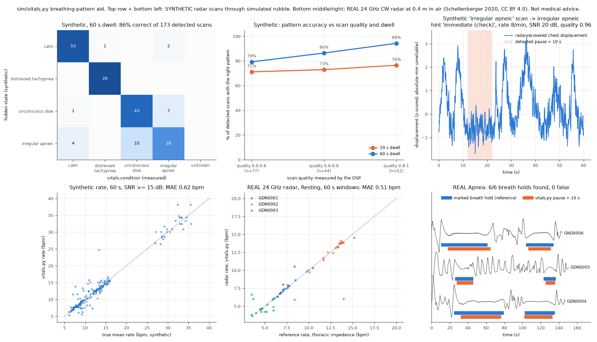

# Breathing-pattern triage aid from radar (BL-20)

**What it claims:** from the radar slow-time signal at a ping, `sim/vitals.py` measures breathing rate, breath-to-breath variability, pauses > 10 s and movement. It turns them into a **condition** read from the breathing (`calm | distressed_tachypnea | unconscious_slow | irregular_apneic | unknown`) and a START/SALT-style *respiratory* hint that helps rescuers order the dig. **It is an aid for rescuers, not a diagnosis.** It never says a person is confirmed, injured or unconscious as fact. It describes the chest motion, what it *may* mean, and how sure it is. There is no age or child inference (user decision, 2026-11-07).

**What it does not claim:** anything validated through real rubble. Real-data numbers below come from a 24 GHz radar 0.4 m from a still subject in air. Through-rubble numbers are synthetic.

Files: `sim/physio.py` (synthetic chest motion, truth side), `sim/vitals.py` (features + classifier, planner side), `scripts/validate_vitals.py`, `tests/test_vitals.py`, `docs/vitals_validation.png`.



## 1. Synthetic chest motion (`sim/physio.py`, truth side only)

`chest_displacement(t, physio, rng) -> metres` turns the hidden `physio` dict from `sim/scenario.py` into a breath-by-breath waveform. `radar_dsp._breath_displacement` uses it when `Breather.physio` is set.

- Per breath: raised-cosine inhale over Ti, passive (exponential-like) exhale over Te, and an end-expiratory pause for slow breathing. The inhale takes 0.33-0.45 of the cycle depending on state.
- Interval and amplitude jitter per breath from `cv` (log-normal). Occasional sighs (2x breath).
- Apnea: Poisson onsets at `apnea_per_min`, 10.5-20 s of flat chest, with shallower breaths just before and after.
- Optional small body movements (0.5-2 s, 1-6 mm) for conscious states.
- Optional cardiac motion, ~0.1 mm at 55-110 bpm. At the rubble radar's ~25 cm wavelength that is ~0.005 rad of phase: **not reliably resolvable through rubble**. It is not reported.
- `depth_rel` 1.0 = 5 mm peak-to-peak chest excursion.

| hidden state = expected `vitals.condition` | breathing (scenario.PHYSIO_STATES) | internal `pattern` (legacy alias) |
|---|---|---|
| calm | 12-16/min, CV 0.03-0.08 | regular_calm |
| distressed_tachypnea | 26-36/min, shallow, CV 0.12-0.25 | rapid_shallow |
| unconscious_slow | 6-10/min, deep, CV 0.05-0.12, 0-0.3 pauses/min | slow_regular |
| irregular_apneic | 8-14/min, CV 0.25-0.45, 0.5-1.5 pauses/min | irregular_with_pauses |

## 2. Features (`sim/vitals.py`)

Input: the complex slow-time samples of the candidate's range bin, motion-compensated as in `process_if` (`Xc[:, k]`). Phase, displacement in metres, or any displacement-proportional series also work.

1. **Demodulation.** The arctangent is used when the I/Q points trace a real arc: arc >= 0.6 rad, sqrt(minor/major variance) >= 0.25, ring residual < 0.6, median phase step < 0.15 rad. Otherwise principal-axis linear demodulation, scaled to metres by the amplitude the **propagation model** predicts for that range and rubble path. Real 24 GHz data: arctangent. Synthetic rubble radar (a breath is a ~0.1-0.4 rad arc): path-loss scaling.
2. **Movement / artefacts.** 1 s frames whose 0.9-3.5 Hz energy is above 5x the scan median. Breath intervals that touch one are dropped.
3. **Rate.** Spectral peak in 0.1-0.75 Hz plus time-domain breath peaks (both polarities, since chest direction is unknown through rubble). The breath count wins when there are >= 3 clean intervals. The CI is a delta method on the interval median, at least +-0.5/min.
4. **Timing variability.** Robust CV of breath intervals: 1.4826 x MAD / median.
5. **Depth variability (`amp_cv`).** Robust CV of the per-breath peak-to-trough size. This is the *shape* of the breathing (waxing and waning around pauses), not its absolute amplitude.
6. **Relative depth.** Median breath size / 5 mm. **LOW confidence**: `depth_rel_conf` <= 0.3 x SQI. It feeds nothing in the condition rules.
7. **Pauses (apnea).** Two routes, both outside movement frames:
   - Envelope route: moving-rms envelope (window 0.6 breath periods, 3-6 s) of the 0.08-0.5 Hz band (upper edge raised to 1.6x the rate for fast breathing) stays below 45% of its 80th percentile for >= 10 s.
   - Gap route: a gap between detected breaths of >= 10 s and >= 2.2 median intervals whose envelope stays below 80%.
8. **Signal quality index (SQI).** Combines band SNR, the DSP candidate SNR, movement, breath count and scan quality.

## 3. Condition rules and triage hint (in this order)

There is no learned model. Every threshold is a named constant at the top of `sim/vitals.py`.

| step | rule | condition | triage_hint |
|---|---|---|---|
| 0 | SQI < 0.35, no rate, or < 2 breaths and no pause | unknown | assess |
| 1 | any pause >= 10 s | irregular_apneic | immediate (check) |
| 2 | rate > 30 | distressed_tachypnea | immediate |
| 3 | rate 20-30 | distressed_tachypnea | immediate (check) at 25-30, urgent at 20-25 |
| 4 | timing CV >= 0.30 + 0.25 x (1 - quality), or depth variability >= 0.35 with timing CV >= half that threshold | irregular_apneic | immediate (check) |
| 5 | rate < 11, regular, no pauses | unconscious_slow | **urgent** |
| 6 | rate 11-20, regular | calm | delayed |

`condition_text` is the rescuer-facing sentence, for example:
- "rapid shallow breathing, 32/min -> possible injury, pain or distress, check"
- "irregular breathing with 1 pause(s) over 10 s, 9/min -> possible airway problem or reduced consciousness, check"
- "slow, regular breathing, 7/min -> could be deep rest or reduced consciousness; the radar cannot tell which, so call out and check responsiveness"
- "calm, regular breathing, 14/min -> stable for now (breathing only), re-check later"

**Slow but regular is not "immediate".** Breathing alone cannot tell a deeply relaxed person breathing 6/min from someone with reduced consciousness. So slow, regular, pause-free breathing gets "urgent" plus an explicit "call out and check responsiveness". Slow breathing that is *also* irregular or has pauses goes to irregular_apneic and "immediate (check)". The `unconscious_slow` name comes from the contract's enum; the text never asserts unconsciousness.

We never output "expectant": a radar cannot tell absent breathing from a chest out of view. `priority_weight(v)` maps the hint to a rank (immediate 1.0, immediate (check) 0.85, urgent 0.7, assess 0.55, delayed 0.35), shrunk toward "assess" as `pattern_conf` falls. `dig_score(v, p_mass, depth_m)` = weight x localisation certainty x clip(1 - depth/4 m, 0.2, 1).

## 4. Validation

Reproduce: `scripts/heavy.sh .venv/bin/python scripts/validate_vitals.py --n 250 --plot docs/vitals_validation.png` (~4 min). Add `--cache <file>.pkl` to re-tune thresholds without re-simulating. Tests: `.venv/bin/python -m pytest -q tests/test_vitals.py` (12 pass, ~3 s).

### 4a. Synthetic radar scans (truth only in the evaluator)

250 scans per dwell, the four states in rotation. Setup:
- Range 1.5-4 m, rubble path 0-3 m, landing quality 0.45-0.97.
- Chest RCS jittered +-3 dB (sd); the planner's rubble-path estimate is off by up to +-30%.
- Chest rendered by `physio.chest_displacement` inside `radar_dsp.simulate_if`. The evaluator records the true pauses that fall in each window.
- Real `process_if` chain, respiration band 0.1-0.75 Hz, then `vitals.extract` on the candidate bin within 0.5 m of the truth. Propagation: `radar_dsp` `legacy` mode (0.7 dB/m).

| dwell | detected | condition correct | triage hint agrees* | rate MAE (SNR >= 15 dB, q >= 0.6) | within 1.5/min |
|---|---|---|---|---|---|
| 20 s | 172/250 | **73%** | 67% | 1.04/min | 81% |
| 60 s | 173/250 | **86%** | 84% | 0.62/min | 89% |

*Measured hint vs the hint the true state and true mean rate would get.

At 60 s, accuracy by landing quality: 79% (< 0.6), 86% (0.6-0.8), **94% (>= 0.8)**. By rubble path it is 83-87%.

Confusion matrix, 60 s dwell (rows: hidden state; columns: `vitals.condition`):

| | calm | distressed_tachypnea | unconscious_slow | irregular_apneic | unknown |
|---|---|---|---|---|---|
| calm | **53** | 1 | | 2 | |
| distressed_tachypnea | | **26** | | | |
| unconscious_slow | 1 | | **43** | 7 | |
| irregular_apneic | 4 | | 10 | **26** | |

Recall: calm 95%, **distressed 100%** (was 83% while the child class competed with it), unconscious_slow 84%, irregular_apneic **65%** (was 63%).

Pause detection through the simulated radar: **78% of the 27 scans whose window holds a true >= 10 s pause** (was 44% before the rate-scaled envelope window and the narrower band). 3% false pauses in scans without one.

Where it still goes wrong:
- irregular_apneic -> unconscious_slow (10) or calm (4): windows with no pause and moderate variability. This is under-triage ("urgent" instead of "immediate (check)").
- unconscious_slow -> irregular_apneic (7): some have real pauses (the state allows up to 0.3/min); others have timing jitter from poor landings. This is over-triage.
- 20 s dwell: irregular_apneic is almost never recognised (1/38). Condition claims need a 45-60 s "vitals look".
- Depth (path-loss scaled): measured/true median 1.5x (p10-p90 0.9-2.5x), log correlation 0.50. Not used for the condition.

### 4b. Real radar: Schellenberger et al. 2020 (24 GHz CW, 0.4 m, supine, CC BY 4.0)

Data are in `data/radar_real/` (gitignored; see `SOURCE.md`). The same `vitals.extract` runs on the radar I/Q (decimated to 20 Hz) and on the thoracic-impedance reference.

**Resting** (GDN0001-0003, healthy volunteers, ~10 min each):

| window | windows | rate MAE | median abs error | within 1.5/min | same condition as reference | false pauses |
|---|---|---|---|---|---|---|
| 60 s (hop 30 s) | 57 | **0.51/min** | 0.10 | 89% | 86% | 1 (1.8%) |
| 30 s (hop 15 s) | 118 | **0.25/min** | 0.10 | 95% | 93% | 1 (0.8%) |

Condition per 60 s window, before and after this rework:

| | calm | unconscious_slow (slow, regular) | irregular_apneic | hint "immediate (check)" |
|---|---|---|---|---|
| before (CV >= 0.20 irregular, slow -> "immediate (check)") | 8 | 30 | 19 | 49/57 (86%) |
| now | 14 | 38 | 5 | **5/57 (9%)** |

These relaxed volunteers breathe 5-8/min (GDN0001, GDN0003), so most windows still read "slow, regular -> could be deep rest or reduced consciousness, check responsiveness" (hint "urgent"). Breathing alone cannot do better here, and the doc and output say so. Their real breath-timing CV is 0.10-0.28, well above our synthetic "calm" state (0.03-0.08). That is why the irregularity threshold moved from 0.20 to 0.30.

**Apnea** (GDN0004-0006, ~150 s each, two voluntary breath holds per file marked by `tfm_intervention`):
- **6/6 breath holds detected (13-55 s), 0 false pause events.** Coverage is 85-87% of the marked hold time; median onset lag 2.3 s.
- 22/23 of the 60 s windows that hold >= 12 s of a breath hold read irregular_apneic.
- These are voluntary holds by healthy volunteers, not pathological apnea.

## 5. Honest limits

- **Not through rubble.** Real data is 24 GHz at 0.4 m in air. The rubble radar is 0.4-2 GHz with tens of dB of loss, clutter in the same bin, and a landed drone that moves. All rubble numbers are synthetic, from our own propagation model.
- **Slow and regular is ambiguous.** Deep rest and reduced consciousness look the same to a radar. Only a voice or responsiveness check separates them (the drone loudspeaker, BL-27).
- **Dwell.** 20 s supports rate only. Variability and pauses need >= 45-60 s, and a condition seen once needs a re-scan.
- **Synthetic calm is too regular.** Real resting adults vary more (CV 0.1-0.28), so the synthetic confusion matrix is optimistic for calm vs irregular.
- **Amplitude is unreliable.** depth_rel depends on aspect, posture, range, rubble loss and our model. It is low-confidence and not used for the condition. No age is inferred.
- **Heart rate is not reported** (~0.1 mm is not resolvable through rubble).
- **Platform motion** jitters breath timing and fills pauses. Poor landings degrade the condition before they degrade the rate.
- **Respiratory criteria only.** START/SALT also need perfusion, mental status and command-following. **Not medical advice.**
- Thresholds were tuned on the same synthetic set and real files they are reported on (sweeps in the commit history). There is no held-out set.

## 6. Contract (`vitals` object, contracts/INTERFACES.md v1.3.1)

Attached per radar candidate (`vitals: [...]` aligned with `range_candidates`) and per ping. JSON-safe; `null` when not measurable.

```jsonc
"vitals": {
  "version": "vitals-v1",
  "condition": "distressed_tachypnea",           // calm | distressed_tachypnea | unconscious_slow | irregular_apneic | unknown
  "condition_text": "rapid shallow breathing, 32/min -> possible injury, pain or distress, check",
  "pattern": "rapid_shallow",                    // legacy alias: regular_calm | rapid_shallow | slow_regular | irregular_with_pauses | unclear
  "pattern_conf": 0.72, "pattern_reason": "rate 32/min > 30",
  "triage_hint": "immediate",                    // immediate | immediate (check) | urgent | delayed | assess
  "triage_reason": "breathing over 30/min (START respiratory criterion for IMMEDIATE)",
  "priority_weight": 0.88,                       // hint rank shrunk toward 'assess' (0.55) as pattern_conf falls
  "rate_bpm": 31.6, "rate_ci": [29.8, 33.6], "rate_spectral_bpm": 31.2, "rate_count_bpm": 31.6,
  "cv": 0.21, "amp_cv": 0.3, "ie_ratio": 0.72,   // timing / depth variability (robust); shorter/longer half-cycle
  "depth_rel": 0.6, "depth_rel_conf": 0.12,      // 1.0 = 5 mm p-p; conf <= 0.3 ALWAYS; not used for the condition
  "apnea_events": 0, "apnea_events_per_min": 0.0, "apnea_longest_s": 0.0,
  "movement": 0.03, "snr_db": 18.4, "sqi": 0.81, "n_breaths": 31, "duration_s": 60.0, "demod": "linear+pathloss",
  "caveats": ["aid for rescuers, not a diagnosis: ...", "..."]
}
```

There is no age field. `fast_small` and `slow_deep` are no longer emitted.
